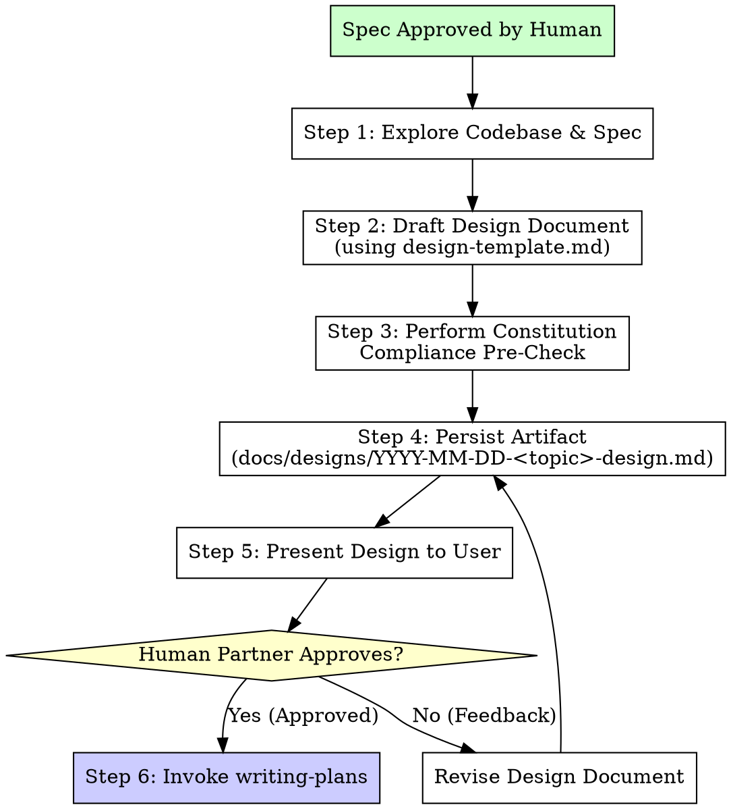

# Design Gate

## Overview

Bridge the gap between feature specifications and step-by-step implementation plans by establishing concrete low-level architecture, inward dependency graphs, and module boundaries before touching code or drafting tasks.

**Core principle:** Architecture and boundaries must be locked down, verified against the Iny Constitution, and explicitly approved by the human partner before writing an implementation plan.

**Announce at start:** "I am using the design-gate skill to design module maps, interfaces, and dependency boundaries."

## When to Use

**Mandatory:**

- After a feature specification has been explicitly approved in Step 3 of the workflow.
- Before invoking `writing-plans` or authoring any implementation plan in `docs/plans/`.
- For all architectural features, subsystem additions, refactors, and multi-file changes.

**Do Not Use:**

- During initial exploratory brainstorming (use `brainstorming` instead).
- For throwaway spike investigations where no persistent code will be authored.
- For emergency hotfixes or bounded single-line patches explicitly exempted by the human partner.

## The Iron Law

```
NO IMPLEMENTATION PLAN MAY BE DRAFTED WITHOUT AN EXPLICITLY APPROVED DESIGN ARTIFACT
```

Drafting an implementation plan before the design artifact is reviewed and approved by the human partner is a critical workflow breach. If you begin writing plan tasks before design approval, stop immediately, delete the unapproved plan, and return to the design gate.

## Gate Mechanics & Workflow Positioning

The Design Gate is inserted as a mandatory checkpoint between Spec Approval and Implementation Plan Creation:

```text
[1. Brainstorming] ──▶ [2. Spec Creation] ──▶ [3. Spec Human Review Gate] (Hard Stop)
                                                               │
                                                               ▼ (Approved)
                                                      [4. DESIGN GATE] (Current Skill)
                                                               │
                                                               ▼
                                                  [5. Design Human Review Gate] (Hard Stop)
                                                               │
                                                               ▼ (Approved)
                                                      [6. Writing Plans]
                                                               │
                                                               ▼
                                                      [7. Worktree TDD Execution]
```

### Compaction & Session Safety

1. The low-level design is never kept solely in chat context. It must be persisted to disk as a dedicated Markdown document at:
   `docs/designs/YYYY-MM-DD-<topic>-design.md`
2. Storing the design artifact in the filesystem ensures that downstream sessions, subagents, and compacted contexts retain the full architectural blueprint.
3. The subsequent implementation plan must explicitly reference this artifact in its header:
   `Design: docs/designs/YYYY-MM-DD-<topic>-design.md`

### Hard Gate Enforcement

- Presenting the design document and immediately drafting the implementation plan in the same turn is strictly prohibited.
- The agent must present the design document to the human partner and pause for explicit review and approval.
- Only upon receiving explicit approval (e.g., "Design approved", "Proceed to plan") may the agent proceed to invoke `writing-plans`.

### Downstream Traceability Constraint

- The approved design artifact constrains all downstream planning in `writing-plans`.
- Every task in the implementation plan must trace directly to a file, interface, or responsibility documented in the approved Module Map.
- Any implementation plan task attempting to introduce an undeclared file, unexpected dependency edge, or foreign export constitutes a plan validation failure.

## The Design Artifact Requirements

The design document must be created by populating the standard template located at `.agents/skills/design-gate/design-template.md`. It consists of six mandatory sections:

### 1. Module Map

A comprehensive table cataloging every source file to be created, modified, or removed:

- **File Path**: Relative path from repository root (e.g., `src/core/ports/MessStagingRepositoryPort.ts`).
- **Zone**: Architectural classification (`Core Entity`, `Core Port`, `Core Use Case`, `Inbound Adapter`, `Outbound Adapter`, `Tool`).
- **Single Responsibility**: Exactly one clear sentence defining what the module does.
- **Does NOT Do**: Explicit boundary constraint specifying responsibilities intentionally excluded to prevent scope creep or god-class formation.

### 2. Inward Dependency Graph

A clear visual diagram (Mermaid or ASCII graph) depicting all planned import relationships:

- Illustrates components across inbound, core, outbound, and tool layers.
- Must verify that all dependency arrows point inward toward `src/core/`.
- Proves zero outward imports from `src/core/` and zero direct horizontal links between inbound and outbound adapters.

### 3. Constitution Compliance Pre-Check

A 10-point checklist evaluating the planned design against the Iny Low-Level Design Constitution (`.agents/constitution.md`):

1. **Port-First Contract**: Outbound capabilities declare explicit ports in `src/core/ports/` with `implements` clauses; zero phantom ports.
2. **Inward Boundary Isolation**: Inbound adapters never import outbound adapters or database schemas.
3. **Tool Boundary Isolation**: Tools extend `BaseTool` and depend solely on core ports; no presentation adapters imported.
4. **150-Line Source File Limit**: Projected line count for each new or modified file remains under 150 lines (excluding relational schemas).
5. **40-Line Function Limit**: Projected method and function bodies remain under 40 lines.
6. **3-Level Nesting Limit**: Control flow nesting stays within 3 levels; early guard returns planned.
7. **No Test-Only Exports**: Every exported symbol has an active production call site; public API testing only.
8. **Single Responsibility & Cohesion**: Entities are pure data structures; time and timezone math centralized in `Temporal.ts`.
9. **Zero Speculative Boilerplate**: No uncalled factories, dummy wrappers, or polymorphic ghosts (Slopnought anti-slop rules).
10. **Strict Convention Conformance**: Extensionless TypeScript imports, strict constructor DI without optional chaining (`?.`), exhaustive JSDoc without em dashes.

### 4. Canonical Codebase References

Citations to at least 2 existing production files in the Iny repository that serve as structural and behavioral role models for the proposed design. Document what specific patterns are borrowed from each file.

### 5. "Declined to Build" List

An explicit inventory of abstractions, factory classes, generic helpers, and premature optimizations that were considered during design formulation but deliberately rejected to maintain simplicity and prevent slop.

### 6. Open Questions for Reviewer

A targeted list of architectural trade-offs, interface naming decisions, or boundary questions where human partner feedback or guidance is specifically requested.

## Step-by-Step Process



### Step 1: Review Approved Spec & Codebase Context

Read the approved specification in `docs/specs/` thoroughly. Examine relevant domain entities, existing ports, and established adapters to identify reusable contracts and design conventions.

### Step 2: Establish Module Map & Zone Boundaries

Enumerate every file required to fulfill the specification. Assign each file to its exact architectural zone. Write a concise single-responsibility statement and a strict "Does NOT Do" constraint for each entry.

### Step 3: Construct Inward Dependency Graph

Map all import edges between the planned files. Verify that core entities and use cases import nothing from outside `src/core/`. Confirm that adapters depend inward on core ports and use cases.

### Step 4: Execute Constitution Compliance Pre-Check

Inspect the planned modules against the 10 binding rules of `.agents/constitution.md`. Check for projected file length, method sizing, port completeness, and absence of speculative scaffolding.

### Step 5: Document Canonical References and Declined Abstractions

Identify 2 existing Iny files that serve as canonical architectural exemplars. Formulate the "Declined to Build" catalog by explicitly ruling out premature abstractions.

### Step 6: Persist the Design Document

Save the completed design artifact to `docs/designs/YYYY-MM-DD-<topic>-design.md`. Ensure all template placeholders are replaced with concrete design specifications.

### Step 7: Submit for Human Review (Hard Gate)

Present a concise summary of the design artifact in chat, provide the file path, and highlight key design decisions or open questions. Explicitly request the human partner's review and approval. STOP and await their response.

### Step 8: Handoff to Implementation Planning

Upon receiving explicit approval from the human partner, update the document status to `APPROVED`. Proceed to invoke the `writing-plans` skill, ensuring the plan references the approved design artifact and adheres strictly to its module map.

## Anti-Rationalization & Red Flags

| Rationalization Thought                                                                           | Reality & Correct Action                                                                                                                                                                              |
| :------------------------------------------------------------------------------------------------ | :---------------------------------------------------------------------------------------------------------------------------------------------------------------------------------------------------- |
| "The spec is already approved, so I can start drafting the implementation plan directly."         | The spec defines requirements and domain behaviors. The design gate defines concrete file boundaries, inward ports, and invariants. Plan creation cannot proceed without an approved design artifact. |
| "This feature is small enough to design inside the implementation plan tasks."                    | Designing inside a plan bypasses architectural validation and leads to bloated, multi-responsibility tasks. All multi-file changes require a persisted design artifact.                               |
| "I will generate the design document and implementation plan in a single turn to save time."      | This violates the Hard Gate. The human partner must review and approve the design before any implementation plan is authored.                                                                         |
| "I will create this factory and generic base class now because future requirements will need it." | Violates Constitution Rule 9. If an abstraction is not actively consumed by the current feature, place it on the 'Declined to Build' list.                                                            |
| "I can omit the 'Does NOT Do' column because the module responsibility is obvious."               | 'Does NOT Do' constraints prevent scope creep, leaky abstractions, and god classes. Every row in the module map requires a clear negative boundary.                                                   |
| "I can reference an unapproved design draft if I update it while writing the plan."               | The design must be approved before planning begins. Mid-flight design drift without human approval invalidates downstream plans.                                                                      |

## Pre-Review Verification Checklist

Before presenting the design artifact to the human partner, verify:

- [ ] Design document exists at `docs/designs/YYYY-MM-DD-<topic>-design.md`.
- [ ] Status is set to `DRAFT`.
- [ ] Every planned file is categorized in the Module Map with Single Responsibility and "Does NOT Do".
- [ ] Inward Dependency Graph confirms zero outward imports from `src/core/`.
- [ ] All 10 Constitution Compliance checklist items are verified and marked.
- [ ] At least 2 canonical Iny codebase files are cited with specific patterns modeled.
- [ ] "Declined to Build" list contains at least one deliberately excluded abstraction.
- [ ] Open questions for the reviewer are clearly articulated.
- [ ] Zero em dashes exist in the prose of the design document.

## Handoff & Downstream Constraints

When handoff occurs from `design-gate` to `writing-plans`:

1. The implementation plan header must include:
   ```markdown
   **Design:** docs/designs/YYYY-MM-DD-<topic>-design.md
   ```
2. The implementation plan task breakdown must map 1:1 with the files in the Module Map.
3. If new files, unexpected dependencies, or new port requirements emerge during plan drafting or execution, the implementer must pause, update the design document, and request renewed design approval before continuing.
