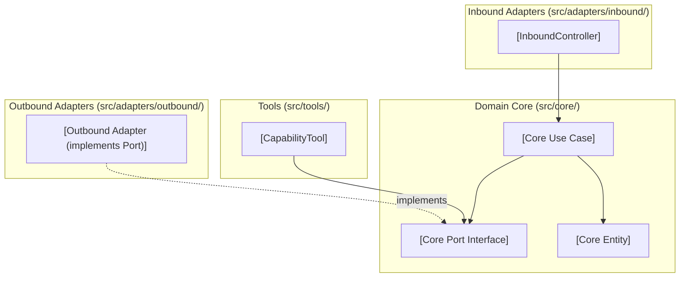

# [Feature Name] Low-Level Design

**Spec Reference:** docs/specs/YYYY-MM-DD-<topic>-spec.md  
**Date:** YYYY-MM-DD  
**Status:** DRAFT  
<!-- Status must remain DRAFT until explicitly approved by the human partner -->

---

## 1. Module Map

List every source file to be created, modified, or deleted. Every file must belong to a single architectural zone, define a single clear responsibility, and state an explicit boundary constraint in the "Does NOT Do" column.

| File Path | Zone | Single Responsibility | Does NOT Do |
|:---|:---|:---|:---|
| `src/core/entities/<Entity>.ts` | Core Entity | Defines the pure domain data structure and domain validation rules. | Does NOT perform database operations, I/O, or timezone formatting. |
| `src/core/ports/<Capability>Port.ts` | Core Port | Declares the abstract TypeScript interface for external capability operations. | Does NOT provide concrete runtime logic or import external libraries. |
| `src/core/use-cases/<UseCase>.ts` | Core Use Case | Coordinates business flow execution using injected core ports. | Does NOT access raw database drivers, network transports, or presentation formats. |
| `src/adapters/inbound/<Controller>.ts` | Inbound Adapter | Translates incoming external requests into core use case calls. | Does NOT import outbound adapters or execute raw database queries. |
| `src/adapters/outbound/<Adapter>.ts` | Outbound Adapter | Implements the core port using specific external libraries or databases. | Does NOT contain domain business logic or bypass port interface contracts. |
| `src/tools/<Tool>.ts` | Tool | Exposes an executable capability extending BaseTool for agentic workflows. | Does NOT import presentation formatters or concrete outbound adapters. |

*Allowed Zones:* `Core Entity`, `Core Port`, `Core Use Case`, `Inbound Adapter`, `Outbound Adapter`, `Tool`.

---

## 2. Inward Dependency Graph

Illustrate all module dependencies using Mermaid or ASCII syntax. Verify that all arrows point inward toward `src/core/`.

**Directional Verification Checklist:**
- [ ] No module inside `src/core/` imports any file from outside `src/core/`.
- [ ] Inbound adapters import only use cases or ports, never outbound adapters.
- [ ] Outbound adapters depend inward by implementing interfaces defined in `src/core/ports/`.
- [ ] Tools depend only on `BaseTool` and `src/core/ports/`.
- [ ] Zero cyclic imports exist across the dependency graph.

---

## 3. Constitution Compliance Pre-Check

Verify compliance against the 10 binding invariants of the Iny Low-Level Design Constitution (`.agents/constitution.md`):

- [ ] **Rule 1 (Port-First Contract):** Every outbound capability declares an explicit interface in `src/core/ports/` with an `implements` clause on the adapter; zero phantom ports.
- [ ] **Rule 2 (Inward Boundary Isolation):** Inbound adapters never import outbound adapters or raw database infrastructure (`PgDatabase`, table schemas).
- [ ] **Rule 3 (Tool Boundary Isolation):** Tools extend `BaseTool`, depend only on `src/core/ports/`, and import no presentation adapters or formatters.
- [ ] **Rule 4 (150-Line Source File Limit):** Projected line count for every new or modified file is strictly under 150 lines (excluding relational table schemas in `schema.ts`).
- [ ] **Rule 5 (40-Line Function Limit):** Projected length of every function, method, or constructor is strictly under 40 lines.
- [ ] **Rule 6 (3-Level Nesting Limit):** Control flow nesting depth will not exceed 3 levels; guard clauses and early returns planned for complex branching.
- [ ] **Rule 7 (No Test-Only Exports):** Every exported function, class, or type has at least one production call site; black-box testing through public APIs only.
- [ ] **Rule 8 (Single Responsibility & Cohesion):** Entities contain pure data structures; date and time operations are delegated to `src/core/utils/Temporal.ts`.
- [ ] **Rule 9 (Zero Speculative Boilerplate):** No uncalled factories, dummy pass-through wrappers, or generic base classes for hypothetical requirements (Slopnought catalog).
- [ ] **Rule 10 (Strict Convention Conformance):** TypeScript imports omit extensions (`.js`, `.ts`), constructor dependency injection is uniform without optional chaining (`?.`), and JSDoc is present without em dashes.

---

## 4. Canonical Codebase References

List at least 2 existing canonical files in the Iny codebase that this design models:

1. **`src/core/ports/<CanonicalPort>.ts` (or existing use-case/adapter)**:
   - *Pattern Modeled:* [Explain what design pattern, interface structure, or error handling strategy is borrowed from this file.]
2. **`src/adapters/outbound/<CanonicalAdapter>.ts` (or existing controller)**:
   - *Pattern Modeled:* [Explain how constructor injection, query patterns, or port implementation conventions are mirrored.]

---

## 5. "Declined to Build" List

Explicitly catalog speculative abstractions, unused factories, generic wrappers, or premature helpers considered during design formulation but deliberately excluded to prevent codebase bloat:

| Considered Abstraction | Reason Declined (YAGNI / Anti-Slop Rationale) |
|:---|:---|
| *e.g., GenericRepositoryFactory* | Not required; only a single concrete repository implementation is needed for this feature. |
| *e.g., MultiTenantAdapterWrapper* | Premature abstraction; multi-tenancy is not part of the active specification scope. |
| *e.g., Standalone Domain Utility Class* | Functionality already handled by existing `Temporal.ts` service. |

---

## 6. Open Questions for Reviewer

Document architectural trade-offs, naming decisions, or boundary edge cases where explicit feedback or input is requested from the human reviewer:

1. [Question 1: Trade-off or interface consideration]
2. [Question 2: Edge-case boundary or convention decision]
