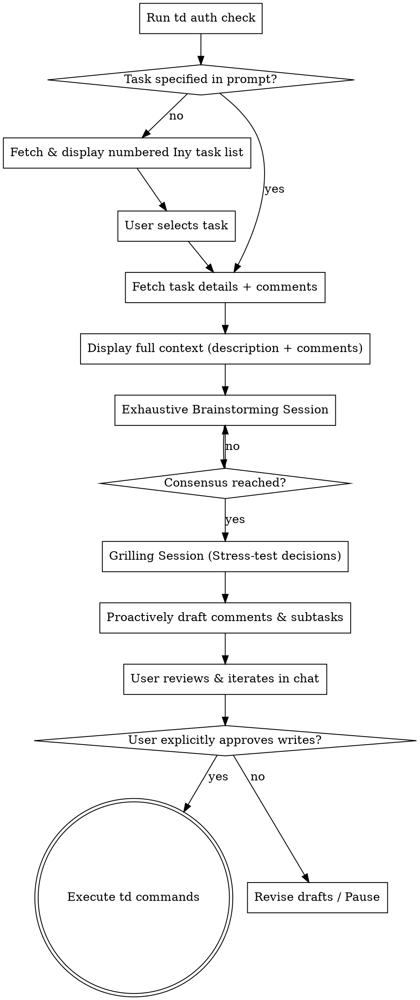

# Iny Todoist Workflow

## Overview

This skill connects tasks captured in your **Iny** Todoist project directly into the agent development workspace. It handles triage, full context ingestion (descriptions, motivation, caveats, and comment threads), guides an exhaustive brainstorming and grilling session, and proactively suggests updates (decision comments, subtasks) while strictly enforcing an explicit approval gate before any Todoist mutations.

**Complementary Roles:**
- **`todoist-cli`**: Reference skill for raw `td` command flags, subcommands, and syntax.
- **`iny-todoist-workflow`**: Process playbook governing task selection, context loading, deep brainstorming, decision grilling, and the proactive suggestion/approval lifecycle.



---

## Core Invariants

1. **Decoupled Brainstorming Mandate**:
   - Every fetched task enters a detailed brainstorming session.
   - **Do NOT assume or force code implementation or the 7-step engineering pipeline.** Brainstorming may result solely in refined thoughts, Todoist subtasks, or deferred priorities. Only transition to spec/LLD/code if the user explicitly instructs you to build it.
2. **Exhaustive Exploration & Technology Guidance**:
   - Brainstorming must be thorough: explore domain requirements, Hexagonal architecture boundaries (`src/core/` domain purity vs. inbound/outbound adapters), data models, and offer proactive recommendations on technologies and libraries with clear trade-offs.
3. **Adversarial Grilling Session**:
   - After initial consensus, conduct an interactive grilling session (aligning with `/grill-me`). Adopt a devil's-advocate posture to rigorously challenge edge cases, concurrency, race conditions, network failures, and performance bottlenecks before concluding.
4. **Proactive Suggestions**:
   - The agent must proactively compile and suggest Todoist updates (decision summary comments, actionable subtasks, description refinements) so the user never forgets to record progress.
5. **Strict Approval Gate (Zero Unconfirmed Writes)**:
   - **NEVER** run any mutating `td` command (`td comment add`, `td task add --parent`, `td task update`, `td task complete`) autonomously.
   - Present exact drafts in chat, allow the user to iterate on the draft, and wait for explicit approval before executing writes.

---

## Operational Workflow

### Phase 1: Authentication & Task Discovery

1. **Verify Auth**:
   ```bash
   td auth status --json
   ```
   If unauthenticated, alert the user to run `td auth login` and stop.

2. **Discover / Select Task**:
   - **If a task title or ID was provided**: Jump straight to step 3.
   - **If no task was specified**: Query open tasks in the Iny project:
     ```bash
     td task list --project "Iny" --json
     ```
     Render a clean, numbered Markdown table:
     | # | Task | Priority | Labels | Due / Deadline | ID |
     |---|---|---|---|---|---|
     | 1 | Automate the ingestion pipeline | p1 | `feat`, `deep` | 2026-11-07 | `id:...` |
     | 2 | ... | ... | ... | ... | `id:...` |

     Prompt the user to select a task by number, name, or ID.

3. **Context Ingestion**:
   Fetch the full task details and all existing comments:
   ```bash
   td task view id:<task-id> --json
   td comment list id:<task-id> --json
   ```
   Print a formatted summary in chat:
   - **Task Title & Labels**
   - **Description / Motivation / Caveats** (render complete markdown)
   - **Comment Thread** (chronological order with timestamps and authors)

---

### Phase 2: Exhaustive Brainstorming

Once context is displayed, open the brainstorming dialogue:
1. **Analyze Seed Details**: Ground the discussion in the captured motivation, high-level ideas, and caveats.
2. **One Question at a Time**: Ask focused, high-leverage questions (prefer multiple choice with a recommended option when clear alternatives exist).
3. **Architecture & Technology Options**:
   - Map against Iny's Hexagonal boundaries (Pure Core in `src/core/`, adapters in `src/adapters/`).
   - Suggest concrete libraries, tools, and technical patterns.
   - Evaluate edge cases: empty states, network drops, malformed data, WhatsApp socket disconnects.
4. **Decoupled Consensus**: Synthesize decisions reached. Do not force code writing.

---

### Phase 3: The Grilling Session (Decision Stress-Testing)

Following brainstorming consensus, transition to grilling:
1. **Adopt Devil's Advocate Posture**:
   - Actively challenge decisions: *"What happens if an announcement is edited 30 seconds after posting while a job is running?"*, *"How does this handle Baileys 515 restart loops?"*, *"What prevents memory leaks in this queue?"*
2. **Probe Hidden Assumptions**: Uncover unstated constraints, single points of failure, or unhandled database rollbacks.
3. **Conclude Alignment**: Close the grilling session once all critical edge cases and architectural trade-offs are satisfactorily resolved.

---

### Phase 4: Proactive Suggestion & Explicit Write Gate

1. **Assemble Proposed Updates**:
   Proactively draft the updates in chat:
   - **Decision Summary Comment**:
     ```markdown
     ### Brainstorming & Architecture Decisions
     - **Domain Core**: ...
     - **Adapters**: ...
     - **Key Decisions**: ...
     - **Mitigated Risks**: ...
     ```
   - **Actionable Subtasks**:
     - `1. Define domain port interfaces for ...`
     - `2. Implement outbound postgres adapter for ...`
     - `3. Add unit test suite with 100% coverage for ...`
   - **Metadata Changes**: (e.g. update labels, adjust priority, or update description).

2. **Iterative Refinement**:
   Ask the user:
   > *"Here are the suggested updates for Todoist. Would you like to refine the comment or subtask list before I push them, or are they good to go?"*
   Iterate until the user is satisfied.

3. **Execute Writes (Only on Explicit Approval)**:
   Once the user explicitly confirms (e.g., *"Looks good, push them"*):
   ```bash
   # Add summary comment
   td comment add id:<task-id> --content "<final_comment_markdown>"

   # Add subtasks
   td task add "<subtask_1_title>" --parent id:<task-id>
   td task add "<subtask_2_title>" --parent id:<task-id>

   # Update description (if requested)
   td task update id:<task-id> --description "<updated_description>"
   ```

---

## Quick Command Reference

| Action | Command |
|---|---|
| Check Auth | `td auth status --json` |
| List Iny Tasks | `td task list --project "Iny" --json` |
| View Task | `td task view <ref> --json` |
| List Comments | `td comment list <ref> --json` |
| Add Comment (Approved only) | `td comment add id:<id> --content "<markdown>"` |
| Add Subtask (Approved only) | `td task add "<title>" --parent id:<id>` |
| Update Task (Approved only) | `td task update id:<id> --description "<markdown>"` |
| Complete Task (Approved only) | `td task complete id:<id>` |

---

## Common Mistakes & Red Flags

| Mistake | Correction |
|---|---|
| **Autonomous Todoist Writes** | STOP. Never run `td task add`, `td comment add`, or `td task update` without explicit user confirmation. |
| **Forcing 7-Step Pipeline** | STOP. Brainstorming is decoupled from code implementation. Do not write specs or plans unless explicitly told to build. |
| **Ignoring Existing Comments** | Always run `td comment list` when fetching a task. Captured comments often contain vital context or earlier decisions. |
| **Skipping Grilling** | Do not accept the first idea uncritically. Always challenge edge cases, concurrency, and failure modes. |
| **Forgetting to Suggest Updates** | Always proactively draft comments and subtasks at the end of the session so the user doesn't forget to sync. |
