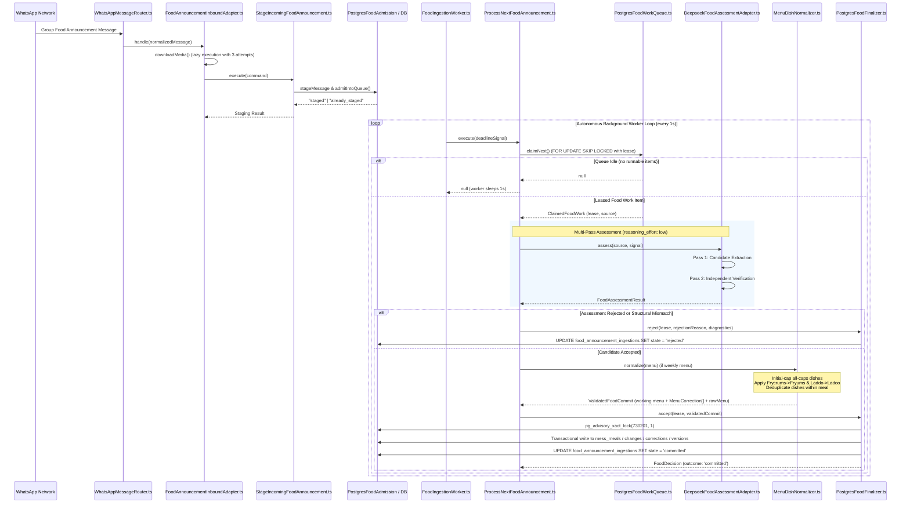

# System Architecture

## 1. System Vision & The Hexagonal Boundary

Iny serves as a highly modular, zero-trust WhatsApp bot engine powered by LLMs. Our core philosophy relies heavily on Hexagonal Architecture (Ports and Adapters). The **Domain Core** (`src/core`) contains zero external runtime dependencies and remains pure. It dictates the business logic and how messages should be processed. Adapters handle all interaction with the outside world (like WhatsApp Web via Baileys, LLMs, and tool registries) by implementing interfaces (ports) defined by the core.

## 2. Mental Model & Core Concepts

- **Entities & Core Utilities**: Pure data structures and domain utilities:
  - `src/core/entities/Message.ts`: Discriminated union of `UserMessage`, `AssistantMessage` (`AssistantTextMessage` | `AssistantToolCallMessage`), and `ToolResultMessage`. Exposes `MessageFactory` for strongly-typed construction.
  - `src/core/entities/ToolCallRequest.ts`: Discriminated union of `ValidToolCallRequest` and `MalformedToolCallRequest` modeling parsed LLM function invocations.
  - `src/core/entities/DialogueTurn.ts`: Encapsulates a complete, turn-atomic interaction boundary (`UserMessage`, intermediate tool calls and results, final `AssistantTextMessage`, `startedAt`, and `completedAt`). Exposes `DialogueTurnFactory`.
  - `src/core/entities/MessMeal.ts`: Pure domain entities and interfaces modeling campus dining: `MessMeal`, `MessMealLocationDetail`, `MessMealTimingExtension`, `MessMealChange`, `ResolvedMessMeal`, and meal slot types.
  - `src/core/entities/FoodAnnouncement.ts`: Domain models for incoming raw announcements and ingestion events (`FoodAnnouncementSource`, `AdmittedFoodAnnouncement`, `FoodAnnouncementType`).
  - `src/core/entities/FoodIngestion.ts`: Fenced background work execution entities (`FoodLease`, `ClaimedFoodWork`, `FoodAssessmentResult`, `FoodDecision`, `ValidatedFoodCommit`, `FoodFailure`).
  - `src/core/entities/MessAnnouncement.ts`: Menu extraction structures (`StagedWeeklyMenu`, `OperationalAnnouncement`, `MenuCorrection`, `MenuAliasId`).
  - `src/core/entities/MessCommit.ts`: Operational commit parameters and persistence types.
  - `src/core/prompts/SystemPrompt.ts`: Pure domain system prompt composition module defining SST campus persona, official WhatsApp markdown formatting invariants, live food facts lookup mandate, response brevity contracts (<=25 words direct, <=45 words info), negative boundaries (no nutritional/taste/cancellation speculation, no unsolicited closers), 4-quadrant routing guidelines, and the canonical non-empty `SYSTEM_PROMPT` constant.
  - `src/core/utils/Temporal.ts`: Pure domain utilities encapsulating IST timezone offset arithmetic (`Asia/Kolkata`), date resolution (`getISTDateString`, `getCurrentMealSlot`, `resolveTargetMealDate`), historical message timestamp formatting (`formatHistoricalMessageTimeIST`), and temporal prompt formatting.
- **Use Cases & Domain Services**: Application-specific business rules:
  - `src/core/use-cases/HandleIncomingUserMessage.ts`: 4-phase orchestrator separating Conversation Context Retrieval, Reasoning, Delivery, and Persistence phases with auxiliary interactive feedback (read receipts, typing presence, emoji reactions). Captures turn entry (`startedAt`) and transport completion (`completedAt`) timestamps, isolates dead transport failures, and prevents ghost turns in conversation memory.
  - `src/core/use-cases/StageIncomingFoodAnnouncement.ts`: Staging orchestrator validating incoming food announcements against zero-trust domain invariants, delegating persistence to `MessStagingRepositoryPort` and admitting them into `food_announcement_ingestions`.
  - `src/core/use-cases/ProcessNextFoodAnnouncement.ts`: Serial background work processor claiming leased queue items, executing multi-pass assessment, validating campus evidence, applying spelling aliases/deduplication, and committing or rejecting.
  - `src/core/services/AgentLoop.ts`: Pure domain service executing the ReAct (Reasoning + Acting) loop. Manages concurrent tool execution via `Promise.all`, circuit breaker forced synthesis, malformed tool error injection, temporal IST grounding injection, and terminal tool early termination.
  - `src/core/services/WeeklyMenuValidator.ts`: Pure domain validator enforcing weekly menu structural completeness (21 distinct meals, all 4 meal slots per date, and valid vendors).
  - `src/core/services/OperationalAnnouncementValidator.ts`: Pure domain validator for operational dish changes, timing extensions, location details, and meal swaps.
  - `src/core/services/FoodCandidateValidator.ts`: Pure domain validator dispatching candidate checks to `WeeklyMenuValidator` or `OperationalAnnouncementValidator`.
  - `src/core/services/AnnouncementEvidenceValidator.ts`: Verifies model extraction evidence against raw source text substrings.
  - `src/core/services/BatchVenueEvidence.ts`: Validates venue batch evidence (`hostelBatches`, `collegeBatches`) against source text clauses.
  - `src/core/services/AnnouncementDateEvidence.ts`: Validates date evidence spans against source text.
  - `src/core/services/AnnouncementDateResolver.ts`: Resolves relative and absolute meal dates with IST timezone grounding.
  - `src/core/services/DateRangeClauseParser.ts`: Validates multi-day date range clauses (e.g., "from 6th November 2026 to 12th November 2026") with IST timezone grounding.
  - `src/core/services/WrittenMonthDateParser.ts`: Parses natural-language written dates containing English month names.
  - `src/core/services/MealSwapResolver.ts`: Resolves source and target meal prerequisites for meal swaps before committal.
  - `src/core/services/MenuDishNormalizer.ts`: Applies approved dish spelling aliases (`Frycrums` -> `Fryums`, `Laddo` -> `Ladoo`), initial-caps all-caps entries, and deduplicates identical dish items per meal while preserving original OCR strings for audit provenance.
  - `src/core/services/FoodProcessingFailure.ts`: Categorizes thrown errors and abort signals into domain failure classifications and builds structured rejection diagnostics.
- **Ports**: Interfaces that define how the core communicates with the outside world without knowing implementation details:
  - `src/core/ports/AccessControlPort.ts`: Core access control port (`AccessControlPort` with `authenticate`, `getUser`) and administrative user management port (`AccessControlAdminPort` with `seedUsers`, `countActiveUsers`).
  - `src/core/ports/DialogueTurnRepositoryPort.ts`: Turn-atomic conversation history persistence (`saveTurn`, `getRecentTurns`, `getTurnCount`).
  - `src/core/ports/ContextRetrievalPort.ts`: Outbound port for retrieving contextual conversation history for a user.
  - `src/core/ports/LoggerPort.ts`: Structured, leveled logging.
  - `src/core/ports/MessageSenderPort.ts`: Outbound messaging transport.
  - `src/core/ports/MessageFeedbackPort.ts`: Outbound port for transient chat interaction feedback (read receipts, typing presence, emoji reactions).
  - `src/core/ports/MessCardPresenterPort.ts`: Outbound presentation port defining card rendering contracts, decoupling tools from concrete text/ANSI formatters.
  - `src/core/ports/MessRepositoryPort.ts`: Read port for student meal queries (`getResolvedMeal`).
  - `src/core/ports/MessStagingRepositoryPort.ts`: Staging and transaction rollback port (`listStagedMessages`, `getMessageById`, `stageMessage`, `atomicCommit`, `atomicCommitComposite`, `markIgnored`, `atomicUndo`, `atomicReset`), decoupling inbound adapters from database drivers.
  - `src/core/ports/FoodAssessmentPort.ts`: Outbound port for multimodal and text announcement extraction/verification.
  - `src/core/ports/FoodIngestionRepositoryPort.ts`: Outbound port for atomic admission, leased work queue claims, atomic acceptance, rejections, and retry failures.
  - `src/core/ports/PdfRasterizationPort.ts`: Bounded first-page PDF inspection and rendering port.
  - `src/core/ports/MenuExtractionPort.ts` & `src/core/ports/TextAnnouncementExtractionPort.ts`: Extraction ports for menu images/PDFs and operational text announcements.
  - `src/core/ports/ToolRegistryPort.ts`: Tool registration and execution contracts (`ToolDefinition` and `Tool` with `isTerminal` flag).
- **Tools**: Declarative tool extensions available to the LLM:
  - `src/tools/BaseTool.ts`: Abstract base class using the Template Method pattern, declarative Zod schemas, automatic JSON Schema generation, and self-correcting error string returns.
  - `src/tools/CalculatorTool.ts`: Safe arithmetic evaluation tool using recursive descent parsing (zero `eval`).
  - `src/tools/DisplayMessCardTool.ts`: Terminal mess card tool (`isTerminal: true`) depending strictly on `MessCardPresenterPort` and `MessRepositoryPort`, returning deterministic terminal notices for unpopulated menus to prevent LLM cancellation hallucinations.
  - `src/tools/QueryMessDetailsTool.ts`: Granular multi-turn query tool (`isTerminal: false`) depending on `MessCardPresenterPort` and `MessRepositoryPort`.
  - `src/tools/SetDefaultMessTool.ts`: Terminal preference tool (`isTerminal: true`) allowing users to persist their default mess caterer preference (`cheftalk_regular`, `cheftalk_jain`, `tcb`) backed by `AccessControlPort`.
- **Inbound Adapters**: Entry points that trigger core use cases:
  - `src/adapters/inbound/workers/FoodIngestionWorker.ts`: Autonomous background worker driving serial execution of `ProcessNextFoodAnnouncement` with bounded invocation deadlines.
  - `src/adapters/inbound/whatsapp/router/WhatsAppMessageRouter.ts`: Multi-handler priority router dispatching normalized messages to first-matching registered handlers with early dropping of outgoing stanzas (`fromMe: true`), error isolation, and configurable upsert mode filtering (`notify`, `append`).
  - `src/adapters/inbound/whatsapp/router/WhatsAppMessageNormalizer.ts`: Pure normalizer transforming raw Baileys `WAMessage` stanzas into uniform domain `NormalizedWhatsAppMessage` instances with bidirectional JID/LID resolution, IST timestamps, and lazy media downloading closures.
  - `src/adapters/inbound/whatsapp/router/WhatsAppMessageContentExtractor.ts`: Collaborator resolving and unwrapping message content (ephemeral, view-once) into strongly-typed text, image, and document payloads with exponential download retries.
  - `src/adapters/inbound/whatsapp/router/CatchAllLoggingHandler.ts`: Terminal fallback handler logging diagnostic metadata for unhandled incoming messages.
  - `src/adapters/inbound/whatsapp/DirectMessageInboundAdapter.ts`: Inbound driving adapter matching direct text messages from authorized users, performing access control checks via `AccessControlPort`, and dispatching to `HandleIncomingUserMessage`.
  - `src/adapters/inbound/whatsapp/FoodAnnouncementInboundAdapter.ts`: Inbound driving adapter matching broadcast group announcements, downloading media attachments lazily, and dispatching commands to `StageIncomingFoodAnnouncement`.
  - `src/adapters/inbound/cli/`: Modularized operator triage CLI components (`TriageCliController`, `TriageAnnouncementController`, `TriageWeeklyMenuController`, `TriageWeeklyMenuReview`, `TriageMessageActions`, `TriageIo`, `TriageTerminalView`, `TriageCompositeRenderer`, `TriageWeeklyMenuRenderer`, `TriageMenuRenderer`, `TriagePreviewRenderer`, `TriageErrorCardRenderer`, `TriageAnsi`).
  - `src/adapters/inbound/cli/InteractiveJsonEditor.ts`: Child-process spawned Neovim/Vim JSON editor with schema re-validation.
  - `src/adapters/inbound/cli/MediaPreviewer.ts`: Headless-safe native OS image/PDF viewer (`xdg-open` / `open`).
- **Outbound Adapters**: Concrete implementations of our core ports:
  - `src/adapters/outbound/access-control/postgres/PostgresAccessControlAdapter.ts`: Driven adapter implementing `AccessControlPort` and `AccessControlAdminPort` backed by PostgreSQL (`users` table) with O(1) indexed lookups, status gating, background asynchronous LID caching, and idempotent seeding.
  - `src/adapters/outbound/access-control/postgres/schema.ts`: Drizzle ORM schema defining `users` table with canonical `phone_number` PK, unique `pn_jid` and partial unique `lid_jid` indexes, and PostgreSQL check constraints.
  - `src/adapters/outbound/whatsapp/BaileysMessageSenderAdapter.ts`: Driven adapter implementing `MessageSenderPort` to transmit text payloads over the active WhatsApp socket.
  - `src/adapters/outbound/whatsapp/BaileysMessageFeedbackAdapter.ts`: Driven adapter implementing `MessageFeedbackPort` to emit non-blocking read receipts, typing presence, and emoji reactions with socket readiness checks.
  - `src/adapters/outbound/whatsapp/BaileysConnectionManager.ts`: Coordinates Baileys WebSocket lifecycle, connection updates, reconnection policies (515 restart, 408/428 transient disconnects), device logout (401), and incoming message distribution via concurrent, fault-isolated subscriber dispatch (`Promise.allSettled`). Accepts `BaileysSessionManagerPort`.
  - `src/adapters/outbound/whatsapp/PostgresBaileysSessionManager.ts`: Implements `BaileysSessionManagerPort` managing WhatsApp credentials and Signal Protocol keys in PostgreSQL (`whatsapp_auth` table) with in-memory caching (`makeCacheableSignalKeyStore`), `BufferJSON` buffer preservation, batch operations, and atomic purge upon logout.
  - `src/adapters/outbound/whatsapp/postgres/schema.ts`: Drizzle ORM table schema defining `whatsapp_auth` with composite primary key `(session_id, key)`.
  - `src/adapters/outbound/mess/postgres/`: Modular postgres repository components:
    - `PostgresFoodAdmission.ts`: Message admission staging into `food_announcement_ingestions`.
    - `PostgresFoodWorkQueue.ts`: Concurrency-safe lease claims using `FOR UPDATE SKIP LOCKED`.
    - `PostgresFoodFinalizer.ts`: Atomic acceptance and rejection commit execution protected by transaction advisory locks.
    - `PostgresFoodIngestionRepository.ts`: Unified implementation of `FoodIngestionRepositoryPort`.
    - `PostgresMessCommitPreparation.ts`: Preparation of operational table rows and dish corrections.
    - `PostgresMessOperationAudit.ts`: Storing operation audit records and version snapshots.
    - `PostgresMessProvenance.ts`: Menu version tracking and extraction provenance.
    - `PostgresMessWriteGuard.ts`: Advisory locking and conflict detection before database writes.
    - `createMessPersistence.ts`: Composition root factory wiring all mess postgres modules.
    - `schema.ts`: Drizzle ORM table definitions for operational mess dining tables, staging, and automated ingestion tables (`food_announcement_ingestions`, `food_announcement_audit_logs`, `food_announcement_versions`, `food_announcement_dish_corrections`).
  - `src/adapters/outbound/mess/extraction/`:
    - `DeepseekFoodAssessmentAdapter.ts`: Two-pass assessment adapter (candidate extraction + independent verification) with low reasoning effort, and 300 DPI PDF rendering for background token efficiency.
    - `FoodExtractionEnvelopeNormalizer.ts`: Normalizes raw LLM extraction envelopes, reconciles character span offsets against `source.textBody`, and synthesizes supporting clause evidence for multi-day date range expansions.
    - `FoodVerificationPrompt.ts`: System prompt for Pass 2 independent verification of extracted food candidates.
    - `OperationalExtractionPrompt.ts`: Focused Pass 1 extraction prompt for text-based operational dining announcements.
    - `WeeklyMenuExtractionPrompt.ts`: Focused Pass 1 extraction prompt for weekly menu images and PDFs.
    - `PdfRasterizer.ts`: Poppler `pdftoppm` first-page rasterizer with pixel and byte bounds (600 DPI default for manual CLI inspection, 300 DPI optimized for background automated ingestion).
    - `DeepseekVisionExtractor.ts`: Multimodal vision extractor for weekly menu images and PDFs.
    - `DeepseekTextExtractor.ts`: Single-pass composite announcement extractor with IST temporal grounding, batch normalization, and nested date fallbacks.
    - `ExtractorUtils.ts`: Strips markdown fences, normalizes client resolution, and captures `rawResponse` and Zod issues.
  - `src/adapters/outbound/mess/formatting/MessCardRenderer.ts`: Driven adapter implementing `MessCardPresenterPort` for WhatsApp card presentation.
  - `src/adapters/outbound/llm/DeepseekAdapter.ts`: Lean coordinator delegating to pure collaborators (`DeepseekRequestMapper`, `DeepseekToolMapper`, `DeepseekToolCallParser`, `DeepseekResponseParser`, `DeepseekErrorTranslator`).
  - `src/adapters/outbound/dialogue-turn-repository/postgres/PostgresDialogueTurnRepository.ts`: Persistent conversation history repository implementing `DialogueTurnRepositoryPort` using Drizzle ORM and `postgres.js` under the Hybrid Envelope pattern.
  - `src/adapters/outbound/dialogue-turn-repository/postgres/schema.ts`: Drizzle ORM table schema defining `dialogue_turns` with stored generated `duration_ms`, first-class `reasoning` text array, composite index on `(user_id, completed_at DESC)`, and PostgreSQL `CHECK` constraints.
  - `src/adapters/outbound/dialogue-turn-repository/postgres/migrator.ts`: Startup database migration runner executing Drizzle migrations before service startup.
  - `src/adapters/outbound/context-retrieval/DialogueTurnContextRetrievalAdapter.ts`: Outbound adapter implementing `ContextRetrievalPort` backed by `DialogueTurnRepositoryPort`, pruning raw historical tool calls and outputs while preserving conversational messages, with 24-hour default TTL filtering and graceful error fallback.
  - `src/adapters/outbound/logger/PinoLoggerAdapter.ts`: Structured logging wrapper around Pino with unambiguous signature routing, internal multistreaming (pretty console in development, raw NDJSON in production), and session file streaming.
  - `src/adapters/outbound/logger/LogFileManager.ts`: Outbound helper managing session log file lifecycle (`logs/app-YYYY-MM-DDTHH-mm-ss.log`), `logs/latest.log` pointer management, resilient fallback discovery, and automatic 7-day retention pruning.
  - `src/adapters/outbound/tool-registry/InMemoryToolRegistry.ts`: In-memory tool storage exposing clean tool definitions.

## 3. Codebase Directory Map

```text
src/
├── core/                                   # The Pure Domain Core (Zero External Dependencies)
│   ├── entities/
│   │   ├── Message.ts                      # Message discriminated union
│   │   ├── ToolCallRequest.ts              # ValidToolCallRequest and MalformedToolCallRequest union
│   │   ├── DialogueTurn.ts                 # Turn-atomic conversation unit
│   │   ├── MessMeal.ts                     # Mess meal, location, timing, and change entities
│   │   ├── FoodAnnouncement.ts             # Source message and admission entities
│   │   ├── FoodIngestion.ts                # Queue lease, candidate, validation, and decision entities
│   │   ├── MessAnnouncement.ts             # Staged menu, operational announcement, and correction entities
│   │   └── MessCommit.ts                   # Operational commit parameters
│   ├── prompts/
│   │   └── SystemPrompt.ts                 # Domain persona, WhatsApp markdown, and tool guardrails
│   ├── utils/
│   │   └── Temporal.ts                     # Pure IST timezone arithmetic, date resolution & prompt injection
│   ├── services/
│   │   ├── AgentLoop.ts                    # Pure ReAct reasoning loop & tool concurrency
│   │   ├── WeeklyMenuValidator.ts          # Pure 21-meal weekly menu validator
│   │   ├── OperationalAnnouncementValidator.ts # Pure operational announcement validator
│   │   ├── AnnouncementEvidenceValidator.ts # Exact text span evidence cross-checker
│   │   ├── AnnouncementDateResolver.ts     # Pure IST meal date resolver
│   │   ├── MealSwapResolver.ts             # Prerequisite meal swap validator
│   │   ├── MenuDishNormalizer.ts           # Casing, spelling aliases, and within-meal deduplication
│   │   └── FoodProcessingFailure.ts        # Failure classifier and rejection diagnostic builder
│   ├── use-cases/
│   │   ├── HandleIncomingUserMessage.ts    # 4-phase orchestrator (Retrieval, Reasoning, Delivery, Persistence)
│   │   ├── StageIncomingFoodAnnouncement.ts # Admission staging use case
│   │   └── ProcessNextFoodAnnouncement.ts  # Serial queue processor use case
│   ├── ports/                              # Interfaces for external dependencies
│   │   ├── AccessControlPort.ts            # Access control & admin user management ports
│   │   ├── DialogueTurnRepositoryPort.ts   # Conversation history persistence port
│   │   ├── LLMPort.ts                      # Language model reasoning & tool call port
│   │   ├── LoggerPort.ts                   # Structured logging port
│   │   ├── MessageSenderPort.ts            # Outbound messaging transport port
│   │   ├── MessageFeedbackPort.ts          # Outbound transient chat feedback port
│   │   ├── MessCardPresenterPort.ts        # Mess card rendering port
│   │   ├── MessRepositoryPort.ts           # Meal querying and resolved view port
│   │   ├── MessStagingRepositoryPort.ts    # Staged messages & surgical undo repository port
│   │   ├── FoodAssessmentPort.ts           # Outbound extraction & verification port
│   │   ├── FoodIngestionRepositoryPort.ts  # Outbound admission & work queue persistence port
│   │   ├── PdfRasterizationPort.ts         # First-page PDF inspection & rendering port
│   │   └── ToolRegistryPort.ts             # Tool registry and execution port
│   └── errors/
│       └── LLMErrors.ts                    # Custom domain error hierarchy (pure TypeScript)
├── tools/                                  # Concrete Domain Tools
│   ├── BaseTool.ts                         # Declarative base tool with Zod schema reflection
│   ├── CalculatorTool.ts                   # Safe recursive descent arithmetic evaluator
│   ├── DisplayMessCardTool.ts              # Terminal mess card tool (isTerminal: true)
│   └── QueryMessDetailsTool.ts             # Granular mess querying tool (isTerminal: false)
├── adapters/                               # Interaction with the outside world
│   ├── common/                             # Shared adapter utilities
│   │   ├── mess/
│   │   │   └── ExtractionSchemas.ts        # Shared Zod extraction schemas
│   │   └── whatsapp/
│   │       └── WhatsAppJid.ts              # Native Baileys JID/LID classification and normalization
│   ├── inbound/
│   │   ├── cli/                            # Modularized Operator Triage CLI
│   │   │   ├── TriageCliController.ts      # Top-level CLI triage coordinator
│   │   │   ├── TriageAnnouncementController.ts # Operational announcement review controller
│   │   │   ├── TriageWeeklyMenuController.ts # Weekly menu review controller
│   │   │   ├── TriageWeeklyMenuReview.ts   # Interactive menu editor and action handler
│   │   │   ├── TriageMessageActions.ts     # Mark ignored, undo, and reset action flows
│   │   │   ├── TriageIo.ts                 # Terminal readline input helper
│   │   │   ├── TriageTerminalView.ts       # ANSI terminal UI card renderer coordinator
│   │   │   ├── TriageMenuRenderer.ts       # Main triage menu ANSI renderer
│   │   │   ├── TriagePreviewRenderer.ts    # Raw message preview ANSI renderer
│   │   │   ├── TriageCompositeRenderer.ts  # Composite extraction preview ANSI renderer
│   │   │   ├── TriageWeeklyMenuRenderer.ts # Weekly menu grid preview ANSI renderer
│   │   │   ├── TriageErrorCardRenderer.ts  # Parsing error card ANSI renderer
│   │   │   └── TriageAnsi.ts               # Shared ANSI color formatting and IST time helpers
│   │   ├── whatsapp/
│   │   │   ├── router/
│   │   │   │   ├── CatchAllLoggingHandler.ts # Fallback unhandled message logging handler
│   │   │   │   ├── NormalizedWhatsAppMessage.ts # Domain contract for normalized incoming messages
│   │   │   │   ├── WhatsAppMessageContentExtractor.ts # Baileys message content unwrapper with retries
│   │   │   │   ├── WhatsAppMessageNormalizer.ts # Raw stanza to normalized message normalizer
│   │   │   │   └── WhatsAppMessageRouter.ts # Priority-based message routing orchestrator
│   │   │   ├── DirectMessageInboundAdapter.ts # DM driver verifying access and invoking HandleIncomingUserMessage
│   │   │   └── FoodAnnouncementInboundAdapter.ts # Group announcement driver staging to admission queue
│   │   └── workers/
│   │       └── FoodIngestionWorker.ts      # Serial background queue polling worker
│   └── outbound/
│       ├── access-control/
│       │   └── postgres/                   # PostgreSQL access control adapter
│       │       ├── schema.ts               # Drizzle ORM schema for users table
│       │       └── PostgresAccessControlAdapter.ts # Driven adapter implementing AccessControlPort & AccessControlAdminPort
│       ├── context-retrieval/
│       │   └── DialogueTurnContextRetrievalAdapter.ts # Outbound context retrieval adapter
│       ├── dialogue-turn-repository/
│       │   └── postgres/                   # PostgreSQL conversation memory adapter
│       │       ├── schema.ts               # Drizzle ORM schema & table constraints
│       │       ├── validation.ts           # Turn structural & temporal invariants
│       │       ├── metadata.ts             # Relational envelope metadata extractor
│       │       ├── PostgresDialogueTurnRepository.ts # Outbound adapter implementing DialogueTurnRepositoryPort
│       │       └── migrator.ts             # Startup Drizzle migration runner
│       ├── llm/
│       │   ├── DeepseekAdapter.ts          # Lean coordinator for DeepSeek completions
│       │   ├── DeepseekRequestMapper.ts    # Pure domain to OpenAI message mapper
│       │   ├── DeepseekToolMapper.ts       # Pure domain to OpenAI tool mapper
│       │   ├── DeepseekToolCallParser.ts   # Pure OpenAI tool call to domain request parser
│       │   ├── DeepseekResponseParser.ts   # Pure OpenAI response parser
│       │   └── DeepseekErrorTranslator.ts  # Pure HTTP and SDK error translator
│       ├── logger/
│       │   └── PinoLoggerAdapter.ts        # Structured logging using Pino
│       ├── mess/
│       │   ├── extraction/                 # DeepSeek multimodal & text announcement extractors
│       │   │   ├── DeepseekFoodAssessmentAdapter.ts # Two-pass assessment with low reasoning effort
│       │   │   ├── FoodAssessmentRequest.ts # Request builder, abort mapping, and error classifier
│       │   │   ├── FoodAssessmentSchemas.ts # Candidate and verification Zod schemas
│       │   │   ├── FoodExtractionPrompt.ts  # Extraction prompt with table format & non-empty cell rules
│       │   │   ├── FoodVerificationPrompt.ts # Verification prompt validating candidate fidelity
│       │   │   ├── ManualAnnouncementNormalizer.ts # Manual CLI input normalizer
│       │   │   ├── DeepseekTextExtractor.ts # Composite single-pass announcement event extractor
│       │   │   ├── DeepseekVisionExtractor.ts # Multimodal 21-meal weekly menu extractor
│       │   │   ├── ExtractorUtils.ts       # JSON cleaning, client resolution, and error classifier
│       │   │   └── PdfRasterizer.ts        # Native Poppler pdftoppm first-page rasterizer
│       │   ├── formatting/
│       │   │   └── MessCardRenderer.ts     # Presenter adapter implementing MessCardPresenterPort
│       │   └── postgres/
│       │       ├── schema.ts               # Drizzle ORM schema for operational, staging, and audit tables
│       │       ├── PostgresFoodAdmission.ts # Admission persistence into food_announcement_ingestions
│       │       ├── PostgresFoodWorkQueue.ts # Concurrency-safe lease claim queries (FOR UPDATE SKIP LOCKED)
│       │       ├── PostgresFoodFinalizer.ts # Atomic accept/reject transaction coordinator with advisory locks
│       │       ├── PostgresFoodIngestionRepository.ts # Outbound coordinator implementing FoodIngestionRepositoryPort
│       │       ├── PostgresMessCommitPreparation.ts # Operational row preparation and dish corrections
│       │       ├── PostgresMessOperationAudit.ts # Staged audit log recording
│       │       ├── PostgresMessProvenance.ts # Menu version tracking and extraction provenance
│       │       ├── PostgresMessWriteGuard.ts # Advisory lock protection against concurrent dining writes
│       │       ├── PostgresMessAuditRestorer.ts # Restoration of previous operational state on rollback
│       │       ├── createMessPersistence.ts # Composition root factory wiring all mess postgres modules
│       │       ├── PostgresMessRepository.ts # Outbound adapter implementing MessRepositoryPort
│       │       ├── PostgresMessStagingRepository.ts # Outbound coordinator implementing MessStagingRepositoryPort
│       │       ├── PostgresStagingQueue.ts # Staging queue queries and message management
│       │       ├── PostgresMealCommitter.ts # Transactional commit coordinator
│       │       ├── PostgresMealRollback.ts  # Transactional undo and dev reset execution
│       │       └── PostgresSwapWriter.ts   # Meal swap execution & backup preservation
│       ├── tool-registry/
│       │   └── InMemoryToolRegistry.ts     # In-memory tool registry implementation
│       └── whatsapp/
│           ├── postgres/
│           │   └── schema.ts               # Drizzle ORM schema for whatsapp_auth table
│           ├── BaileysConnectionManager.ts # WebSocket lifecycle & reconnection coordinator
│           ├── BaileysMessageSenderAdapter.ts # Outbound transport implementing MessageSenderPort
│           ├── BaileysMessageFeedbackAdapter.ts # Outbound feedback implementing MessageFeedbackPort
│           ├── BaileysPairingManager.ts    # First-time device pairing code coordinator
│           └── PostgresBaileysSessionManager.ts # PostgreSQL auth credentials & Signal key manager
├── runtime/
│   ├── ApplicationLifecycle.ts             # Deterministic service startup & graceful shutdown coordinator
│   └── RuntimeOperations.ts                # Process signal listening & resource disposal
├── scripts/                                # Administrative & CLI Tools
│   ├── ingest-announcements.ts             # Composition root for npm run ingest
│   ├── reset-mess.ts                       # Dev reset script with 3 production safety guards
│   ├── reset-tables.ts                     # Database reset utility (npm run db:reset-tables)
│   └── evaluate-menu-extraction.ts         # Automated menu extraction benchmark against ground truth
├── config.ts                               # Fail-fast configuration with pure parseConfig
├── index.ts                                # The Composition Root
├── Dockerfile                              # Multi-stage hardened build (node:22-bookworm-slim, USER node)
├── docker-compose.yml                      # Orchestration for PostgreSQL 16 & Iny application
└── .dockerignore                           # Security boundary excluding secrets and test files
```

## 4. Canonical Control & Data Flow

### 4.1 Inbound User Query Flow

```mermaid
sequenceDiagram
    participant WA as WhatsApp Network
    participant Conn as BaileysConnectionManager.ts
    participant Router as WhatsAppMessageRouter.ts
    participant Normalizer as WhatsAppMessageNormalizer.ts
    participant DMAdapter as DirectMessageInboundAdapter.ts
    participant AccessControl as AccessControlPort / PostgresAccessControlAdapter.ts
    participant UCUser as HandleIncomingUserMessage.ts
    participant Feedback as MessageFeedbackPort / BaileysMessageFeedbackAdapter.ts
    participant Loop as AgentLoop.ts
    participant Repo as DialogueTurnRepositoryPort.ts
    participant Reg as ToolRegistryPort.ts
    participant LLM as LLMPort.ts
    participant Sender as BaileysMessageSenderAdapter.ts
    participant Log as LoggerPort.ts

    WA->>Conn: messages.upsert
    Conn->>Router: handleUpsert(upsertPayload)

    loop For each message in batch
        alt Outgoing Message (fromMe = true)
            Note over Router: Drop outgoing loopback & log debug
        else Inbound Stanza
            Router->>Normalizer: normalize(rawMessage)
            alt Malformed Message (Missing ID or remoteJid)
                Normalizer-->>Router: null
                Note over Router: Discard & log debug (zero cost)
            else Normalized Message
                Normalizer-->>Router: normalizedMessage

                alt Direct User Message Match
                    Router->>DMAdapter: matches(normalizedMessage)
                    DMAdapter-->>Router: true
                    Router->>DMAdapter: handle(normalizedMessage)
                    DMAdapter->>AccessControl: authenticate(senderJid, companionLidJid)
                    alt Unauthorized or Inactive Sender
                        AccessControl-->>DMAdapter: null
                        Note over DMAdapter: Discard & log debug
                    else Authorized & Active User
                        AccessControl-->>DMAdapter: UserRecord
                        Note over DMAdapter: user.pnJid is verified canonical identity
                        DMAdapter->>UCUser: execute(userMessage)
                        UCUser->>Log: logger.child({ userId, messageId })
                        UCUser->>Log: log.info("Processing incoming message")

                        rect rgb(255, 250, 230)
                            Note over UCUser,Feedback: Initial Transient Interactive Feedback
                            UCUser->>Feedback: markRead(userId, messageId)
                            UCUser->>Feedback: sendPresence(userId, 'composing')
                            UCUser->>Feedback: sendReaction(userId, messageId, '👀')
                        end

                        rect rgb(245, 245, 255)
                            Note over UCUser,Repo: Phase 1: Conversation Context Retrieval
                            UCUser->>Repo: dialogueTurnRepository.getRecentTurns(userId, maxHistoryTurns)
                            Repo-->>UCUser: DialogueTurn[] (history)
                        end

                        rect rgb(240, 248, 255)
                            Note over UCUser,Loop: Phase 2: Reasoning Phase
                            UCUser->>Reg: toolRegistry.getToolDefinitions()
                            Reg-->>UCUser: ToolDefinition[]
                            UCUser->>Loop: loop.run(userMessage, history, tools, log)

                            loop ReAct Tool Loop (up to maxToolIterations)
                                Loop->>LLM: llm.generateResponse(systemPrompt, workingHistory, tools)
                                alt Response: Text
                                    LLM-->>Loop: { type: 'text', content, reasoning }
                                    Note over Loop: Break loop
                                else Response: Tool Calls
                                    Loop->>Reg: Promise.all(toolCalls.map(executeTool))
                                    Reg-->>Loop: Tool results / reflected error strings
                                    Note over Loop: Append tool messages to workingHistory & iterate
                                end
                            end

                            opt Circuit Breaker (if max iterations reached without text)
                                Loop->>LLM: llm.generateResponse(systemPrompt, workingHistory, tools, { forcedSynthesis: true })
                                LLM-->>Loop: { type: 'text', content, reasoning }
                            end
                            Loop-->>UCUser: loopResult (finalText, reasoning, sessionMessages)
                        end

                        rect rgb(240, 255, 240)
                            Note over UCUser,Sender: Phase 3: Delivery Phase
                            UCUser->>Sender: sender.sendMessage(userId, finalText)
                            Sender->>Conn: getSocket()
                            Conn-->>Sender: activeSocket
                            Sender->>WA: sock.sendMessage(userId, { text: finalText })
                            alt Delivery Succeeds
                                Note over UCUser: Capture completedAt timestamp immediately
                            else Delivery Fails
                                Sender-->>UCUser: Transport Error
                                UCUser->>Log: log.error("Failed to deliver message...")
                                Note over UCUser: Abort (do not retry over dead transport; do not save turn)
                            end
                        end

                        rect rgb(255, 240, 245)
                            Note over UCUser,Feedback: Auxiliary Feedback Cleanup (finally block)
                            UCUser->>Feedback: sendPresence(userId, 'paused')
                            UCUser->>Feedback: sendReaction(userId, messageId, '')
                        end

                        rect rgb(255, 250, 240)
                            Note over UCUser,Repo: Phase 4: Persistence Phase
                            UCUser->>Repo: dialogueTurnRepository.saveTurn(turn)
                            UCUser->>Log: log.info("Message processed successfully")
                        end
                    end
                else Catch-All Fallback Match
                    Router->>Log: CatchAllLoggingHandler: log unhandled message
                end
            end
        end
    end
```

### 4.2 Automated Food Announcement Admission & Ingestion Queue Flow



## 5. Architectural Invariants

- **Pure Core**: `src/core/` must never import from outside of itself. It contains solely pure TypeScript interfaces, entities, use cases, and errors with zero runtime external dependencies.
- **Turn-Atomic Conversation Memory**: History persistence is partitioned into complete `DialogueTurn` boundaries. Sliding windows and retention limits prune complete turns, never bisecting an assistant tool call from its corresponding tool response.
- **Single Composition Root**: In production runtime code, `src/index.ts` is the only place where adapters and the core are stitched together. Dependency injection is wired up here (unit tests and internal adapter factory methods like `PinoLoggerAdapter.child()` may instantiate adapters directly).
- **Fail-Fast Startup**: `src/config.ts` uses Zod to validate all environment variables at startup. Pure `parseConfig()` is exported for direct testing without dynamic module reloading. Application fails fast if no active authorized users exist.
- **Automated Food Work Queue Lease & Concurrency Fencing**: Serial background queue processing in `PostgresFoodWorkQueue` uses `FOR UPDATE SKIP LOCKED` combined with authoritative database-side lease tokens (`leaseExpiresAt > clock_timestamp()`). Operational dining commits in `PostgresFoodFinalizer` acquire transaction-level PostgreSQL advisory locks (`pg_advisory_xact_lock(730201, 1)`), preventing concurrent worker and CLI write conflicts.
- **Two-Pass Assessment with Low Reasoning Effort & 300 DPI Optimization**: Background food menu extraction enforces two isolated LLM passes (Pass 1: Candidate Extraction; Pass 2: Independent Verification) using DeepSeek vision and text models. To bound token expenditure and latency while preserving OCR precision, automated inference explicitly configures `reasoning_effort: "low"` and rasterizes PDF documents at 300 DPI (while the interactive manual CLI supports up to 600 DPI).
- **Auditable Spelling Normalization & Deduplication**: `MenuDishNormalizer` applies approved spelling aliases (`Frycrums` -> `Fryums`, `Laddo` -> `Ladoo`), initial-caps all-caps menu entries, and deduplicates identical dish items per meal slot while keeping `rawMenu` and `rawExtraction` completely untouched in `food_announcement_versions` for forensic auditability. All spelling substitutions generate auditable `MenuCorrection` records in `food_announcement_dish_corrections`.
- **Persistent Access Control & Canonical Identity Duality**: WhatsApp access authorization is persisted in PostgreSQL (`users` table with canonical `phone_number` primary key, unique `pn_jid`/`lid_jid` indexes, and `status` lifecycle states: active, pending, revoked, suspended). Modern WhatsApp linked identities (`@lid`) are mapped back to canonical phone numbers (`@s.whatsapp.net`), ensuring that conversation memory (`dialogue_turns`) is never fragmented across identity changes or devices.
- **Inbound Access Control Boundary**: Inbound messages are authenticated against `AccessControlPort` at the adapter boundary before any use case execution or LLM token expenditure. Outbound transport focuses strictly on reliable delivery over the active Baileys socket.
- **Hybrid Envelope Persistence**: Conversation turns are persisted with first-class relational columns for operational queries (`user_query`, `assistant_response`, `tool_names`, `started_at`, `completed_at`, and generated `duration_ms`) while preserving the full fidelity ordered `Message[]` sequence in a `JSONB` payload validated by database-level PostgreSQL `CHECK` constraints.
- **Stateless Container & Database-Backed Auth**: WhatsApp authentication state and Signal Protocol cryptographic keys are persisted in PostgreSQL (`whatsapp_auth` table with composite primary key `(session_id, key)`), eliminating host filesystem bindings and directory mutex races. High-frequency Signal keys are cached in memory via `makeCacheableSignalKeyStore`, and binary buffer prototypes are preserved across `jsonb` serialization using `BufferJSON`.
- **Hardened Multi-Stage Containerization**: The runtime environment executes in an isolated Docker container based on `node:22-bookworm-slim` across both builder and runner stages, guaranteeing `glibc` runtime binary compatibility with Baileys' native modules on ARM64 (Oracle Cloud Ampere A1) and x86_64. Production images drop root privileges and run strictly as unprivileged `USER node`.
- **Loopback-Only Database Port Exposure**: PostgreSQL port 5432 is bound strictly to `127.0.0.1:5432:5432` on the host, preventing public internet exposure while enabling secure local tool access (Drizzle Studio, GUI clients) via SSH tunnels. All application communication occurs across an isolated Docker bridge network (`iny-network`).
- **Early Termination All-or-Nothing Rule**: When a terminal tool (`isTerminal: true`, e.g. `DisplayMessCardTool`) executes successfully in `AgentLoop` and all concurrent tools in the turn succeed, the reasoning loop terminates immediately on Turn 1 without invoking a redundant second LLM synthesis turn.
- **Temporal Grounding Injection**: On all reasoning turns, `AgentLoop` dynamically formats the incoming message's timestamp in Indian Standard Time (`Asia/Kolkata`) and appends it to the effective system prompt (`[Current Time (IST): ...]`), ensuring accurate calendar resolution ("today", "tomorrow", day-of-week) without model hallucinations.
- **Version-Controlled Domain System Prompt**: The system prompt is an immutable, strictly required domain entity (`src/core/prompts/SystemPrompt.ts`) rather than an unversioned environment variable. It encodes SST campus identity, strict WhatsApp markdown capabilities, mess-scoped tool discipline (forbidding speculative parallel probes to `display_mess_card`), and 4-quadrant deterministic routing instructions. `AgentLoop` constructor fails fast if `systemPrompt` is empty or whitespace.
- **Transactional Audit Trail & Surgical Rollback**: Operational mess tables (`mess_meals`, `mess_meal_location_details`, `mess_meal_timing_extensions`, `mess_meal_changes`) track operational provenance via an indexed `source_message_id`. `atomicCommitComposite` executes across all operational tables inside a single PostgreSQL transaction. Meal swaps back up original dishes as JSON in `mess_meal_changes.original_item`. `atomicUndo` surgically restores swapped dishes and removes operational rows, resetting the staged message to `pending`.
- **Option B Pre-Commit Verification Gate**: Before committing an announcement containing a meal swap, the system verifies that both the referenced source meal and the target meal exist in `mess_meals`. If either meal is missing, confirmation `[y]` is blocked until the corresponding weekly menu is ingested.
- **Three-Layer Dev Reset Safety Guards**: `scripts/reset-mess.ts` (`npm run mess:reset`) enforces three independent safety checks (`NODE_ENV !== 'production'`, target host display, and exact database name confirmation challenge) before executing `atomicReset`.
- **Development Layer & Mechanical Quality Gates**: All production code adheres to the 10 rules of `.agents/constitution.md` (maximum 150 lines per file, maximum 40 lines per function, maximum nesting depth 3, zero speculative abstraction, uniform constructor dependency injection). Static checks are mechanically enforced across `src/`, `tests/`, and `scripts/` via ESLint 9 Flat Config (`eslint.config.mjs`), Prettier (`.prettierrc`, tabs, double quotes, semicolons), Knip (`knip.json`), and git pre-commit hooks (`scripts/pre-commit.sh`). Extensionless imports are strictly enforced with zero `.js` or `.ts` specifiers.
- **Low-Level Design Gate**: Mandatory protocol step between specification approval and implementation plan drafting, enforced via `.agents/skills/design-gate/`. Produces a persisted design artifact in `docs/designs/` defining module boundaries, exported types, inward dependencies, and constitution compliance before code changes are planned.
- **Transient Chat Feedback & Early Outgoing Drop**: Outbound WhatsApp stanzas (`fromMe: true`) are dropped early at `WhatsAppMessageRouter` with debug logging, preventing redundant processing across all handlers. Transient feedback (read receipts, typing presence, and emoji reactions) is isolated behind `MessageFeedbackPort` and `BaileysMessageFeedbackAdapter`. Socket feedback failures are non-fatal, logged at warn level, and never impede domain reasoning, response delivery, or turn persistence.

## 6. "How Do I..." Recipe Guide

### Recipe 1: Add Inbound Adapter

1. Create a new directory in `src/adapters/inbound/` (e.g., `telegram/`).
2. Write an adapter class that takes use cases (e.g., `HandleIncomingUserMessage`) as dependencies.
3. Listen to external events (like a webhook or socket message) and invoke the use case.
4. Wire it up in `src/index.ts`.

### Recipe 2: Add Outbound Port & Adapter

1. Define the port interface in `src/core/ports/` (e.g., `DatabasePort.ts`).
2. Create the adapter in `src/adapters/outbound/` (e.g., `postgres/PostgresAdapter.ts`) implementing the port.
3. Inject it into the necessary use cases via `src/index.ts`.

### Recipe 3: Create a Tool

1. Create a new tool file in `src/tools/` (e.g., `WeatherTool.ts`).
2. Define a declarative Zod schema for its input parameters.
3. Extend `BaseTool<typeof schema>` and implement `protected async run(args: z.infer<typeof schema>): Promise<string>`.
4. Register the tool with `InMemoryToolRegistry` in `src/index.ts`.

### Recipe 4: Deploy or Inspect with Docker Compose

1. Ensure `.env` is configured with required secrets (`DEEPSEEK_API_KEY`, `BOT_PHONE_NUMBER`, `ALLOWED_USERS`, `POSTGRES_PASSWORD`).
2. Start services in the background: `docker compose up -d`.
3. Follow application logs: `docker compose logs -f app`.
4. Inspect database locally via SSH tunnel without public port exposure:
   - On local workstation: `ssh -N -L 5432:127.0.0.1:5432 user@vps-ip`
   - Run Drizzle Studio locally: `npx drizzle-kit studio` (connecting to `localhost:5432`).

### Recipe 5: Pre-Merge Review & Archival Ritual

1. Perform an in-depth review of all PR changes (architecture, correctness, test coverage, and code hygiene).
2. Review and update `docs/ARCHITECTURE.md` to ensure architectural documentation accurately reflects all boundaries and flows.
3. Move the completed feature specification from `docs/specs/` to `docs/specs/archive/` within the same feature branch.
4. Verify all tests pass (`npm test`) and compilation succeeds (`npm run build`).
5. Commit and merge the pull request.

### Recipe 6: Inspect Application Runtime Logs

1. Triage recent errors: `npx tsx scripts/inspect-logs.ts --errors-only -n 15`
2. Inspect recent operational events: `npx tsx scripts/inspect-logs.ts -n 30 --since 15m`
3. Filter by component or WhatsApp JID: `npx tsx scripts/inspect-logs.ts --grep <pattern> -n 25`
4. Follow logs in real time: `npx tsx scripts/inspect-logs.ts --follow --level warn`
