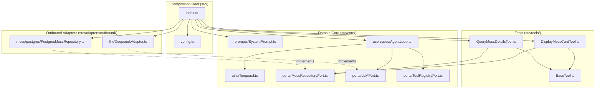

# System Prompt Composition Subsystem Low-Level Design

**Spec Reference:** docs/specs/2026-10-26-system-prompt-composition-subsystem-spec.md  
**Date:** 2026-10-26  
**Status:** APPROVED
<!-- Status must remain DRAFT until explicitly approved by the human partner -->

---

## 1. Module Map

| File Path                           | Zone          | Single Responsibility                                                                                                                            | Does NOT Do                                                                                                           |
| :---------------------------------- | :------------ | :----------------------------------------------------------------------------------------------------------------------------------------------- | :-------------------------------------------------------------------------------------------------------------------- |
| `src/core/prompts/SystemPrompt.ts`  | Core Entity   | Composes domain persona, WhatsApp formatting rules, tool discipline, and compiles the immutable `SYSTEM_PROMPT` constant.                        | Does NOT perform I/O, does NOT call external LLM APIs, and does NOT read environment variables.                       |
| `src/core/utils/Temporal.ts`        | Core Entity   | Centralizes IST date/time parsing, calculations, and temporal grounding formatting (`buildTemporallyGroundedSystemPrompt`).                      | Does NOT depend on external date libraries, does NOT perform I/O, and does NOT hold state.                            |
| `src/core/use-cases/AgentLoop.ts`   | Core Use Case | Coordinates the multi-turn ReAct reasoning loop, requiring a non-empty `systemPrompt` and injecting IST temporal grounding on each turn.         | Does NOT provide fallback prompts, does NOT access environment variables, and does NOT execute raw SQL.               |
| `src/tools/DisplayMessCardTool.ts`  | Tool          | Renders formatted WhatsApp mess meal cards across 4 presentation quadrants based on Zod-validated inputs.                                        | Does NOT execute raw database queries directly and does NOT make speculative parallel LLM calls.                      |
| `src/tools/QueryMessDetailsTool.ts` | Tool          | Queries structured mess meal data strictly for conversational dietary, ingredient, and comparative student inquiries.                            | Does NOT render formatted WhatsApp cards and does NOT handle generic menu inquiries.                                  |
| `src/config.ts`                     | Core Entity   | Validates environment variables at process startup using pure Zod parsing with `SYSTEM_PROMPT` completely removed.                               | Does NOT supply runtime default prompts, does NOT connect to network services, and does NOT hold application state.   |
| `src/index.ts`                      | Core Entity   | Acts as the sole application composition root, importing `SYSTEM_PROMPT` from `src/core/prompts/SystemPrompt` and injecting it into `AgentLoop`. | Does NOT execute domain business logic, does NOT parse incoming WhatsApp messages, and does NOT invoke LLMs directly. |

_Allowed Zones:_ `Core Entity`, `Core Port`, `Core Use Case`, `Inbound Adapter`, `Outbound Adapter`, `Tool`.

---

## 2. Inward Dependency Graph

**Directional Verification Checklist:**

- [x] No module inside `src/core/` imports any file from outside `src/core/`.
- [x] Inbound adapters import only use cases or ports, never outbound adapters.
- [x] Outbound adapters depend inward by implementing interfaces defined in `src/core/ports/`.
- [x] Tools depend only on `BaseTool` and `src/core/ports/`.
- [x] Zero cyclic imports exist across the dependency graph.

---

## 3. Constitution Compliance Pre-Check

- [x] **Rule 1 (Port-First Contract):** All outbound interactions (LLM, tool registry, mess repository) adhere strictly to established port interfaces in `src/core/ports/`; zero phantom ports are introduced.
- [x] **Rule 2 (Inward Boundary Isolation):** Inbound driving adapters never import outbound adapters or database infrastructure.
- [x] **Rule 3 (Tool Boundary Isolation):** Both `DisplayMessCardTool` and `QueryMessDetailsTool` extend `BaseTool` and depend solely on core ports and entities.
- [x] **Rule 4 (150-Line Source File Limit):** All files remain strictly under 150 lines:
  - `src/core/prompts/SystemPrompt.ts`: projected ~95 lines.
  - `src/core/utils/Temporal.ts`: currently 74 lines.
  - `src/core/use-cases/AgentLoop.ts`: currently 149 lines (concise validation guard keeps it under 150 lines).
  - `src/tools/DisplayMessCardTool.ts`: currently 141 lines (in-place description refinement preserves line count).
  - `src/tools/QueryMessDetailsTool.ts`: currently 60 lines.
  - `src/config.ts`: currently 73 lines.
- [x] **Rule 5 (40-Line Function Limit):** Every function and method (including `AgentLoop` constructor and `buildSystemPrompt`) is under 40 lines.
- [x] **Rule 6 (3-Level Nesting Limit):** Control flow nesting stays within 3 levels; early validation returns are enforced.
- [x] **Rule 7 (No Test-Only Exports):** Every exported constant and method (`SYSTEM_PROMPT`, `BASE_PERSONA`, `WHATSAPP_FORMATTING_RULES`, `TOOL_DISCIPLINE_RULES`, `MESS_ROUTING_RULES`) has an active production call site or serves as a formal contract.
- [x] **Rule 8 (Single Responsibility & Cohesion):** Entities contain pure domain structures; temporal grounding logic is centralized in `src/core/utils/Temporal.ts`.
- [x] **Rule 9 (Zero Speculative Boilerplate):** Zero uncalled factories, dummy wrappers, or polymorphic ghosts are introduced (Slopnought anti-slop catalog).
- [x] **Rule 10 (Strict Convention Conformance):** Extensionless imports (`./Temporal`), uniform constructor dependency injection, strictly non-empty required `systemPrompt`, and complete JSDoc without em dashes.

---

## 4. Canonical Codebase References

1. **`src/core/utils/Temporal.ts`**:
   - _Pattern Modeled:_ Demonstrates pure domain utility structure with zero external dependencies, handling IST calendar arithmetic and deterministic date formatting strictly through native JavaScript Date and Intl formatting.
2. **`src/core/use-cases/AgentLoop.ts`**:
   - _Pattern Modeled:_ Exemplifies clean Hexagonal use case orchestration, constructor dependency injection without optional chaining, and fail-fast invariant checks on required collaborators.

---

## 5. "Declined to Build" List

| Considered Abstraction                                          | Reason Declined (YAGNI / Anti-Slop Rationale)                                                                                                                  |
| :-------------------------------------------------------------- | :------------------------------------------------------------------------------------------------------------------------------------------------------------- |
| Dynamic Template Engine (e.g. Handlebars, Mustache)             | Unnecessary complexity; template interpolation is fully satisfied by pure TypeScript template literals without external runtime dependencies.                  |
| External Markdown File Loader (`fs.readFile`)                   | Breaks Hexagonal purity in `src/core/` and introduces unnecessary filesystem I/O and bundling edge cases. Prompts are first-class, typed TypeScript constants. |
| Environment Variable Prompt Override (`SYSTEM_PROMPT_OVERRIDE`) | Deliberately rejected per human partner instruction; system prompts must be version-controlled in VCS, not modified ad-hoc via environment variables.          |
| Optional System Prompt Fallback Stub                            | Deliberately rejected; system prompt is a strictly required invariant. Missing system prompt must fail fast at startup.                                        |

---

## 6. Open Questions for Reviewer

1. **Section Export Granularity:** In addition to compiling `SYSTEM_PROMPT`, `src/core/prompts/SystemPrompt.ts` exports the individual section constants (`BASE_PERSONA`, `WHATSAPP_FORMATTING_RULES`, `TOOL_DISCIPLINE_RULES`, `MESS_ROUTING_RULES`) to enable fine-grained unit testing. Does this level of modular export match your expectations?
2. **Fail-Fast Error Message:** In `AgentLoop`, if `systemPrompt` is empty or whitespace-only, it throws `new Error('AgentLoop requires a non-empty systemPrompt')`. Does this fail-fast behavior align with your operational requirements?
