# WhatsApp Message Router and Inbound Pipeline Low-Level Design

**Spec Reference:** docs/specs/2026-10-27-whatsapp-message-router-and-inbound-pipeline-spec.md  
**Date:** 2026-10-27  
**Status:** APPROVED

---

## 1. Module Map

The following catalog lists every source file to be created, modified, relocated, or removed:

| File Path                                                                                   | Zone             | Single Responsibility                                                                                               | Does NOT Do                                                                          |
| :------------------------------------------------------------------------------------------ | :--------------- | :------------------------------------------------------------------------------------------------------------------ | :----------------------------------------------------------------------------------- |
| `src/core/ports/DialogueTurnRepositoryPort.ts`                                              | Core Port        | Declares the persistence contract for storing and querying turn-atomic dialogue history.                            | Does NOT access databases, execute SQL, or import external ORMs.                     |
| `src/core/use-cases/HandleIncomingUserMessage.ts`                                           | Core Use Case    | Coordinates the 4-phase dialogue turn workflow (retrieval, reasoning, delivery, persistence).                       | Does NOT access WhatsApp sockets, parse raw protocols, or format presentation cards. |
| `src/core/use-cases/StageIncomingFoodAnnouncement.ts`                                       | Core Use Case    | Validates announcement payloads, enforces ingestion idempotency, and stages records via repository.                 | Does NOT parse raw WhatsApp protobufs or directly download media buffers.            |
| `src/core/services/AgentLoop.ts`                                                            | Core Service     | Executes the ReAct reasoning loop across registered tools until a terminal text response is reached.                | Does NOT handle transport delivery, conversation persistence, or socket lifecycles.  |
| `src/adapters/inbound/whatsapp/router/NormalizedWhatsAppMessage.ts`                         | Inbound Adapter  | Defines normalized message contracts, payload types, and the `WhatsAppMessageHandler` interface.                    | Does NOT perform runtime message parsing or dispatching logic.                       |
| `src/adapters/inbound/whatsapp/router/WhatsAppMessageNormalizer.ts`                         | Inbound Adapter  | Translates raw Baileys WAMessage objects into clean `NormalizedWhatsAppMessage` envelopes with lazy media closures. | Does NOT route messages or invoke core use cases.                                    |
| `src/adapters/inbound/whatsapp/router/WhatsAppMessageRouter.ts`                             | Inbound Adapter  | Coordinates Baileys upsert subscriptions and dispatches normalized messages to the first matching handler.          | Does NOT parse protobufs, download media, or execute domain workflows.               |
| `src/adapters/inbound/whatsapp/router/CatchAllLoggingHandler.ts`                            | Inbound Adapter  | Implements terminal fallback handler logging unhandled messages at debug level.                                     | Does NOT modify messages or dispatch to downstream adapters.                         |
| `src/adapters/inbound/whatsapp/DirectMessageInboundAdapter.ts`                              | Inbound Adapter  | Matches direct user text messages, authenticates senders, and triggers `HandleIncomingUserMessage`.                 | Does NOT unpack Baileys protobufs, inspect groups, or handle admin commands.         |
| `src/adapters/inbound/whatsapp/FoodAnnouncementInboundAdapter.ts`                           | Inbound Adapter  | Matches target food group messages, invokes lazy media download, and triggers `StageIncomingFoodAnnouncement`.      | Does NOT inspect direct chats, authenticate users, or send WhatsApp replies.         |
| `src/adapters/outbound/dialogue-turn-repository/postgres/PostgresDialogueTurnRepository.ts` | Outbound Adapter | Implements `DialogueTurnRepositoryPort` backed by PostgreSQL and Drizzle ORM.                                       | Does NOT manage socket connections or execute LLM calls.                             |
| `src/adapters/outbound/dialogue-turn-repository/postgres/schema.ts`                         | Outbound Adapter | Defines Drizzle relational schema for `dialogue_turns` with constraints and generated columns.                      | Does NOT contain business logic or query execution routines.                         |
| `src/adapters/outbound/dialogue-turn-repository/postgres/validation.ts`                     | Outbound Adapter | Enforces relational and structural turn validation rules before database insertion.                                 | Does NOT execute queries or import core use cases.                                   |
| `src/adapters/outbound/dialogue-turn-repository/postgres/metadata.ts`                       | Outbound Adapter | Extracts relational envelope metadata columns from a domain `DialogueTurn`.                                         | Does NOT execute SQL statements or modify domain entities.                           |
| `src/adapters/outbound/dialogue-turn-repository/postgres/migrator.ts`                       | Outbound Adapter | Runs database migrations for dialogue turn tables at service startup.                                               | Does NOT perform operational repository queries.                                     |
| `src/adapters/outbound/context-retrieval/DialogueTurnContextRetrievalAdapter.ts`            | Outbound Adapter | Implements `ContextRetrievalPort` by retrieving turns from `DialogueTurnRepositoryPort`.                            | Does NOT directly query PostgreSQL or manage turn persistence.                       |
| `src/index.ts`                                                                              | Composition Root | Instantiates adapters, registers router priority chain, and wires dependencies into use cases.                      | Does NOT contain domain business rules or adapter parsing routines.                  |
| `src/core/ports/ChatRepositoryPort.ts`                                                      | Core Port        | [DELETED] Replaced by `DialogueTurnRepositoryPort.ts`.                                                              | N/A                                                                                  |
| `src/core/use-cases/ProcessIncomingMessage.ts`                                              | Core Use Case    | [DELETED] Replaced by `HandleIncomingUserMessage.ts`.                                                               | N/A                                                                                  |
| `src/adapters/inbound/whatsapp/WhatsAppInboundAdapter.ts`                                   | Inbound Adapter  | [DELETED] Replaced by `DirectMessageInboundAdapter.ts`.                                                             | N/A                                                                                  |
| `src/adapters/inbound/whatsapp/FoodAnnouncementsInboundAdapter.ts`                          | Inbound Adapter  | [DELETED] Replaced by `FoodAnnouncementInboundAdapter.ts`.                                                          | N/A                                                                                  |
| `src/adapters/inbound/whatsapp/BaileysMessageFilter.ts`                                     | Inbound Adapter  | [DELETED] Replaced by `WhatsAppMessageNormalizer.ts`.                                                               | N/A                                                                                  |
| `src/adapters/inbound/whatsapp/BaileysMessageParser.ts`                                     | Inbound Adapter  | [DELETED] Replaced by `WhatsAppMessageNormalizer.ts`.                                                               | N/A                                                                                  |
| `src/adapters/inbound/whatsapp/FoodAnnouncementPayloadParser.ts`                            | Inbound Adapter  | [DELETED] Replaced by `WhatsAppMessageNormalizer.ts`.                                                               | N/A                                                                                  |
| `src/adapters/outbound/chat-repository/`                                                    | Outbound Adapter | [DELETED] Relocated to `src/adapters/outbound/dialogue-turn-repository/`.                                           | N/A                                                                                  |
| `src/adapters/outbound/context-retrieval/ChatRepositoryContextRetrievalAdapter.ts`          | Outbound Adapter | [DELETED] Replaced by `DialogueTurnContextRetrievalAdapter.ts`.                                                     | N/A                                                                                  |

---

## 2. Inward Dependency Graph

```mermaid
graph TD
    subgraph Inbound["Inbound Adapters (src/adapters/inbound/whatsapp/)"]
        subgraph Router["router/"]
            Normalizer["WhatsAppMessageNormalizer"]
            RouterComp["WhatsAppMessageRouter"]
            CatchAll["CatchAllLoggingHandler"]
            NormMsg["NormalizedWhatsAppMessage (types)"]
        end
        DMAdapter["DirectMessageInboundAdapter"]
        FoodAdapter["FoodAnnouncementInboundAdapter"]
    end

    subgraph Core["Domain Core (src/core/)"]
        subgraph CoreUseCases["use-cases/"]
            HandleTurn["HandleIncomingUserMessage"]
            StageAnnouncement["StageIncomingFoodAnnouncement"]
        end
        subgraph CoreServices["services/"]
            AgentLoopService["AgentLoop"]
        end
        subgraph CorePorts["ports/"]
            TurnRepoPort["DialogueTurnRepositoryPort"]
            StagingRepoPort["MessStagingRepositoryPort"]
            AccessPort["AccessControlPort"]
            ContextPort["ContextRetrievalPort"]
            SenderPort["MessageSenderPort"]
            LoggerPort["LoggerPort"]
        end
        subgraph CoreEntities["entities/"]
            TurnEntity["DialogueTurn"]
            MsgEntity["Message (UserMessage)"]
        end
    end

    subgraph Outbound["Outbound Adapters (src/adapters/outbound/)"]
        TurnRepo["PostgresDialogueTurnRepository"]
        ContextAdapter["DialogueTurnContextRetrievalAdapter"]
        ConnManager["BaileysConnectionManager"]
    end

    ConnManager --> RouterComp
    RouterComp --> Normalizer
    RouterComp --> CatchAll
    RouterComp --> DMAdapter
    RouterComp --> FoodAdapter
    Normalizer --> NormMsg

    DMAdapter --> HandleTurn
    DMAdapter --> AccessPort
    DMAdapter --> MsgEntity
    DMAdapter --> LoggerPort

    FoodAdapter --> StageAnnouncement
    FoodAdapter --> LoggerPort

    HandleTurn --> AgentLoopService
    HandleTurn --> TurnRepoPort
    HandleTurn --> ContextPort
    HandleTurn --> SenderPort
    HandleTurn --> TurnEntity
    HandleTurn --> LoggerPort

    StageAnnouncement --> StagingRepoPort
    StageAnnouncement --> LoggerPort

    TurnRepo -.->|implements| TurnRepoPort
    ContextAdapter -.->|implements| ContextPort
    ContextAdapter --> TurnRepoPort
```

### Directional Verification Checklist:

- [x] No module inside `src/core/` imports any file from outside `src/core/`.
- [x] Inbound adapters import only use cases, entities, and ports, never outbound adapters.
- [x] Outbound adapters depend inward by implementing interfaces defined in `src/core/ports/`.
- [x] Zero cyclic imports exist across the dependency graph.
- [x] All dependency arrows cross cleanly inward toward domain contracts.

---

## 3. Constitution Compliance Pre-Check

Verification against the 10 binding invariants of `.agents/constitution.md`:

- [x] **Rule 1 (Port-First Contract):** All driven capabilities declare ports in `src/core/ports/` (`DialogueTurnRepositoryPort`, `MessStagingRepositoryPort`, `AccessControlPort`, `ContextRetrievalPort`, `MessageSenderPort`, `LoggerPort`). Zero phantom ports.
- [x] **Rule 2 (Inward Boundary Isolation):** Inbound driving adapters (`DirectMessageInboundAdapter`, `FoodAnnouncementInboundAdapter`, `WhatsAppMessageRouter`) never import outbound adapters or database table schemas.
- [x] **Rule 3 (Tool Boundary Isolation):** Tools remain untouched and depend solely on core ports; no presentation adapters or inbound controllers are imported.
- [x] **Rule 4 (150-Line Source File Limit):** Projected file sizes:
  - `WhatsAppMessageNormalizer.ts`: ~90 lines.
  - `WhatsAppMessageRouter.ts`: ~85 lines.
  - `CatchAllLoggingHandler.ts`: ~30 lines.
  - `DirectMessageInboundAdapter.ts`: ~110 lines.
  - `FoodAnnouncementInboundAdapter.ts`: ~95 lines.
  - `HandleIncomingUserMessage.ts`: ~120 lines.
  - `StageIncomingFoodAnnouncement.ts`: ~65 lines.
    All files remain comfortably under 150 lines.
- [x] **Rule 5 (40-Line Function Limit):** Complex normalization logic is decomposed into single-purpose private helper functions (`resolveSender`, `resolveContent`, `buildLazyMediaClosure`), each under 30 lines.
- [x] **Rule 6 (3-Level Nesting Limit):** Early guard returns are planned across normalizer, router, and handlers to guarantee nesting depth never exceeds 3 levels.
- [x] **Rule 7 (No Test-Only Exports):** All exported functions, classes, and interfaces have active production call sites. Testing will be performed through public module interfaces.
- [x] **Rule 8 (Single Responsibility & Cohesion):** Entities contain pure domain structures. Time resolution delegates to standard Unix epoch arithmetic or `Temporal.ts`.
- [x] **Rule 9 (Zero Speculative Boilerplate):** No uncalled factories, multi-tenant abstractions, or dummy pass-through wrappers are introduced.
- [x] **Rule 10 (Strict Convention Conformance):** Extensionless imports used exclusively, uniform constructor dependency injection enforced, standard JSDoc without em dashes provided.

---

## 4. Canonical Codebase References

1. **`src/adapters/outbound/mess/postgres/PostgresMessStagingRepository.ts`**:
   - _Pattern Modeled:_ Lean coordinator delegating specialized operations to cohesive submodules (`PostgresStagingQueue`, `PostgresMealCommitter`). The new `WhatsAppMessageRouter` mirrors this coordinator pattern by delegating envelope transformation to `WhatsAppMessageNormalizer` and fallback processing to `CatchAllLoggingHandler`.
2. **`src/core/use-cases/ProcessIncomingMessage.ts`**:
   - _Pattern Modeled:_ Strict multi-phase orchestration isolating external transport failures from memory corruption. `HandleIncomingUserMessage` preserves this canonical 4-phase lifecycle while standardizing all persistence contracts on `DialogueTurnRepositoryPort`.

---

## 5. "Declined to Build" List

The following abstractions were evaluated during design formulation and deliberately rejected to maintain simplicity:

| Considered Abstraction                         | Reason Declined (YAGNI / Anti-Slop Rationale)                                                                                                                                                 |
| :--------------------------------------------- | :-------------------------------------------------------------------------------------------------------------------------------------------------------------------------------------------- |
| `GenericEventBus<T>`                           | Unnecessary generic abstraction; BaileysConnectionManager already manages raw socket events, and message handling requires an ordered first-match chain rather than arbitrary pub/sub.        |
| `MessageFilterPipeline` / `AbstractFilterRule` | Overengineered polymorphism for basic boolean predicates; simple predicate functions (`matches(msg): boolean`) satisfy requirements without object overhead.                                  |
| `EagerMediaDownloader`                         | Downloading media buffers before routing wastes bandwidth and compute for messages that do not require binary payloads (e.g. direct text chats). Lazy download closure resolves this cleanly. |
| `AdminCommandUseCase` (per individual command) | Violates Constitution Rule 9 (dummy wrappers); commands map directly to port calls. A single admin handler or use case will be created when the command feature is scheduled.                 |

---

## 6. Resolved Decisions and Reviewer Alignment

1. **Declarative Upsert Filtering**: Instead of requiring handlers to manually check `msg.upsertType` inside their `matches()` methods, `WhatsAppMessageHandler` exposes an optional declarative property `acceptedUpsertTypes?: readonly ("notify" | "append")[]` defaulting safely to `["notify"]`. The router filters handlers against the active upsert mode upfront before invoking `matches()`. `FoodAnnouncementInboundAdapter` explicitly declares `["notify", "append"]` to capture backlog announcements, while `DirectMessageInboundAdapter` uses the default `["notify"]` to prevent historical auto-replies.
2. **Subdirectory Organization**: The router mechanics are confirmed to reside under `src/adapters/inbound/whatsapp/router/`, keeping infrastructure normalization and dispatching cleanly separated from domain driving adapters (`DirectMessageInboundAdapter`, `FoodAnnouncementInboundAdapter`).
