# Conservative Automatic Food Ingestion Low-Level Design

**Spec Reference:** `docs/specs/2026-11-01-automated-food-ingestion-spec.md`

**Date:** 2026-11-01

**Status:** APPROVED by the user on 2026-11-01

This document implements the approved requirements without authorizing an
implementation plan, product changes, commits, deployment, or archival. The
module map below constrains the subsequent implementation plan.

## 1. Module Map

### 1.1 Design decisions

Keep raw announcement capture and the manual CLI. Add durable automatic
admission and a small worker that consumes only records explicitly admitted by
the new live-message path. Never infer eligibility by searching staging for
`pending` messages. PostgreSQL is already deployed and supplies the queue,
activation boundary, leases, audit, and transaction protection; no new package,
service, or broker is needed.

Recognition and extraction use a strict new assessment contract. A first model
request may abstain or return a complete candidate with evidence. A fresh second
request verifies that candidate against the same original text or rendered
image, including omitted instructions and conflicting metadata. Only explicit
agreement proceeds to pure deterministic domain validation. Verification does
not repair or rewrite a candidate. Legacy permissive extraction is available
only to the manually reviewed CLI and cannot authorize automatic commits.

PDFs are inspected with the existing Poppler installation. Initially accept
only single-page PDFs for automation. Reject other page counts instead of
assuming the first page represents the entire message. Render a single-page PDF
once at 600 DPI and reuse those exact bytes in both model requests. Image
attachments use their original bytes. No crop, upscale, or image conversion
dependency is introduced.

Spelling normalization is a pure core operation with a reviewed alias list. It
runs after raw extraction, independently of the model. Preserve raw dishes,
normalized dishes, and individual correction records in the commit audit. Run
the same normalizer for the manual preview and again at the commit boundary so
an operator edit cannot accidentally bypass it.

### 1.2 Core files

Sizes are design budgets for the complete file, including exported interfaces
and documentation, rather than promises based on current ESLint exemptions.
All helpers are imported by a production caller listed in this design.

| File Path                                               | Zone          | Action / target lines | Single Responsibility                                                                                 | Does NOT Do                                                          |
| ------------------------------------------------------- | ------------- | --------------------- | ----------------------------------------------------------------------------------------------------- | -------------------------------------------------------------------- |
| `src/core/entities/MessAnnouncement.ts`                 | Core Entity   | Create / 140          | Holds menu, operational-announcement, swap, and menu-correction data structures.                      | Performs no validation, I/O, or calendar arithmetic.                 |
| `src/core/entities/MessCommit.ts`                       | Core Entity   | Create / 120          | Holds existing operational commit inputs and resolved swap snapshots.                                 | Knows nothing about SQL transactions or extraction SDKs.             |
| `src/core/entities/FoodAnnouncement.ts`                 | Core Entity   | Create / 130          | Defines source metadata, candidate payloads, and source evidence structures.                          | Contains no model requests or domain algorithms.                     |
| `src/core/entities/FoodIngestion.ts`                    | Core Entity   | Create / 130          | Defines admission results, leased work, decisions, and verification results.                          | Implements no queue or state transitions.                            |
| `src/core/ports/MessStagingRepositoryPort.ts`           | Core Port     | Modify / 100          | Retains the existing staging and manual operation contract using imported domain types.               | Adds no automatic queue discovery or raw database types.             |
| `src/core/ports/FoodIngestionRepositoryPort.ts`         | Core Port     | Create / 130          | Declares atomic admission, fenced work claiming, and automatic finalization.                          | Exposes no transaction handles or PostgreSQL types.                  |
| `src/core/ports/FoodAssessmentPort.ts`                  | Core Port     | Create / 60           | Declares strict, evidence-bearing assessment of a complete source message.                            | Treats neither schema validity nor a confidence score as acceptance. |
| `src/core/ports/MenuExtractionPort.ts`                  | Core Port     | Create / 70           | Declares manually reviewed image-menu extraction returning raw and normalized menus with corrections. | Grants no automatic ingestion permission.                            |
| `src/core/ports/TextAnnouncementExtractionPort.ts`      | Core Port     | Create / 50           | Declares the existing manually reviewed composite text extraction capability.                         | Performs no staging or commit.                                       |
| `src/core/ports/PdfRasterizationPort.ts`                | Core Port     | Create / 70           | Declares PDF page inspection and first-page rendering with an optional explicit DPI.                  | Chooses no business acceptance policy.                               |
| `src/core/use-cases/StageIncomingFoodAnnouncement.ts`   | Core Use Case | Modify / 100          | Validates the incoming command and requests atomic capture and admission.                             | Extracts no menu and sends no WhatsApp reply.                        |
| `src/core/use-cases/ProcessNextFoodAnnouncement.ts`     | Core Use Case | Create / 140          | Coordinates one leased assessment, validation, and final decision.                                    | Polls no timers and opens no database transaction itself.            |
| `src/core/services/WeeklyMenuValidator.ts`              | Core Service  | Create / 120          | Checks source-supported vendor/date bounds and complete unique seven-day coverage.                    | Invents no dishes, dates, or vendors.                                |
| `src/core/services/OperationalAnnouncementValidator.ts` | Core Service  | Create / 140          | Checks complete supported event scope, batch allocation, times, and dish-change semantics.            | Queries no repository and parses no SDK output.                      |
| `src/core/services/AnnouncementEvidenceValidator.ts`    | Core Service  | Create / 130          | Checks field coverage, exact text spans, and agreement between evidence and candidate values.         | Claims no deterministic proof of OCR accuracy.                       |
| `src/core/services/AnnouncementDateResolver.ts`         | Core Service  | Create / 120          | Resolves stated date evidence and detects conflicting references using temporal utilities.            | Supplies no date for an undated event.                               |
| `src/core/services/MealSwapResolver.ts`                 | Core Service  | Create / 110          | Resolves all applicable source and target meals through the existing repository port.                 | Writes no meals and silently omits no missing vendor.                |
| `src/core/services/MenuDishNormalizer.ts`               | Core Service  | Create / 80           | Applies the approved whole-word spelling aliases and returns correction records.                      | Performs no fuzzy correction or model call.                          |
| `src/core/utils/Temporal.ts`                            | Core Utility  | Modify / 145          | Adds strict calendar validation and ISO-date shifting to the existing IST utilities.                  | Contains no food classification or adapter imports.                  |

Core Service and Core Utility are explicit core subzones of the architecture;
they must not be mislabeled as entity files to bypass the entity-purity rule.
The old staging port may retain type re-exports consumed by existing production
callers while its declarations move to the two domain files. Do not create
additional compatibility exports used only by tests.

### 1.3 Input, worker, and manual CLI files

The existing CLI controller is 592 physical lines and imports concrete outbound
extractors. Its extraction, review, and swap responsibilities are split only
because this feature must share extraction behavior and audit with that path.
Keep its operator interactions, including manual editing, vendor/date changes,
media preview, ignore, and rollback.

| File Path                                                           | Zone                 | Action / target lines | Single Responsibility                                                                           | Does NOT Do                                                            |
| ------------------------------------------------------------------- | -------------------- | --------------------- | ----------------------------------------------------------------------------------------------- | ---------------------------------------------------------------------- |
| `src/adapters/inbound/whatsapp/router/NormalizedWhatsAppMessage.ts` | Inbound Adapter      | Modify / 120          | Adds the delivered upsert mode and nullable original timestamp to the normalized envelope.      | Substitutes no processing timestamp for original-source metadata.      |
| `src/adapters/inbound/whatsapp/router/WhatsAppMessageNormalizer.ts` | Inbound Adapter      | Modify / 145          | Preserves original timestamp validity alongside the existing DM-compatible timestamp.           | Decides no ingestion eligibility.                                      |
| `src/adapters/inbound/whatsapp/router/WhatsAppMessageRouter.ts`     | Inbound Adapter      | Modify / 120          | Supplies the actual upsert mode when normalizing and retains priority routing.                  | Queries no queue or staging table.                                     |
| `src/adapters/inbound/whatsapp/FoodAnnouncementInboundAdapter.ts`   | Inbound Adapter      | Modify / 120          | Captures supported raw transport payloads and passes provenance to the staging use case.        | Makes no model request or operational write.                           |
| `src/adapters/inbound/workers/FoodIngestionWorker.ts`               | Inbound Adapter      | Create / 110          | Drives one-at-a-time work polling with startup and shutdown control.                            | Constructs no repository, extractor, or use case.                      |
| `src/adapters/inbound/cli/TriageCliController.ts`                   | Inbound Adapter      | Modify / 130          | Owns message selection, inspection, and delegation to focused manual flows.                     | Imports no outbound adapter and contains no extraction or review loop. |
| `src/adapters/inbound/cli/TriageIo.ts`                              | Inbound Adapter      | Create / 75           | Owns readline input and the CLI I/O contract moved from the controller.                         | Performs no business operation.                                        |
| `src/adapters/inbound/cli/TriageMessageActions.ts`                  | Inbound Adapter      | Create / 130          | Drives per-message action selection, media preview, ignore, and rollback confirmation.          | Constructs no collaborator and parses no PDF itself.                   |
| `src/adapters/inbound/cli/TriageWeeklyMenuController.ts`            | Inbound Adapter      | Create / 140          | Drives manual menu extraction and preview using injected core ports.                            | Makes no automatic acceptance decision.                                |
| `src/adapters/inbound/cli/TriageWeeklyMenuReview.ts`                | Inbound Adapter      | Create / 135          | Drives menu editing, vendor/date adjustments, correction preview, and confirmed commit.         | Drops no original extraction or correction audit.                      |
| `src/adapters/inbound/cli/TriageAnnouncementController.ts`          | Inbound Adapter      | Create / 130          | Drives manually reviewed composite extraction, edit, and confirmed commit.                      | Imports no outbound extractor or SQL schema.                           |
| `src/adapters/inbound/cli/TriageTerminalView.ts`                    | Inbound Adapter      | Modify / 120          | Presents existing previews plus source-to-canonical menu corrections using core types.          | Imports no outbound schema or extraction type.                         |
| `src/adapters/inbound/cli/TriagePreviewRenderer.ts`                 | Inbound Adapter      | Modify / 145          | Retains preview coordination using core announcement types.                                     | Performs no extraction or correction algorithm.                        |
| `src/adapters/inbound/cli/TriageCompositeRenderer.ts`               | Inbound Adapter      | Modify / 140          | Retains composite display using core announcement types.                                        | Resolves no database prerequisite.                                     |
| `src/adapters/inbound/cli/TriageWeeklyMenuRenderer.ts`              | Inbound Adapter      | Modify / 135          | Retains the weekly grid using core menu types.                                                  | Validates no ingestion decision.                                       |
| `src/runtime/ApplicationLifecycle.ts`                               | Runtime Driver       | Create / 130          | Runs injected startup/shutdown operations, access-control initialization, and worker lifecycle. | Instantiates no adapter or use case and wires no dependencies.         |
| `src/index.ts`                                                      | Composition Root     | Modify / 145          | Instantiates and injects every production dependency including the worker.                      | Contains no extraction, admission, transaction, or polling rules.      |
| `scripts/ingest-announcements.ts`                                   | Administrative Entry | Modify / 140          | Wires the administrative CLI using the shared port-based extraction and audit path.             | Starts no automatic worker or activation boundary.                     |

The manual editor's existing Zod dependency is allowed in the adapter zone.
Move shared schemas to the common adapter area rather than importing outward
from the CLI. The unchanged `InteractiveJsonEditor` still receives a schema as
an argument. All newly factored controllers receive their collaborators through
constructors; no fallback instances are created inside them. The administrative
script retains its existing separate CLI entrypoint role; production runtime
composition remains exclusively in `src/index.ts`.

`scripts/reset-mess.ts` is also modified as an Administrative Entry, with a
target of 100 lines, solely to inject the same guarded rollback collaborators
after their constructor changes. Its existing three safety guards remain; it
does not initialize activation, start a worker, or reset automatic eligibility.

### 1.4 Extraction and schema files

| File Path                                                                | Zone                          | Action / target lines | Single Responsibility                                                                                   | Does NOT Do                                                      |
| ------------------------------------------------------------------------ | ----------------------------- | --------------------- | ------------------------------------------------------------------------------------------------------- | ---------------------------------------------------------------- |
| `src/adapters/common/mess/ExtractionSchemas.ts`                          | Shared Adapter Collaborator   | Move / 120            | Holds the existing manually reviewed payload schemas and inferred adapter types.                        | Supplies no automatic authorization or core dependency.          |
| `src/adapters/outbound/mess/extraction/ExtractionSchemas.ts`             | Outbound Adapter Collaborator | Remove                | Its declarations move to the common adapter path.                                                       | Leaves no forwarding file or duplicate schema implementation.    |
| `src/adapters/outbound/mess/extraction/FoodAssessmentSchemas.ts`         | Outbound Adapter Collaborator | Create / 145          | Validates strict abstention, candidate, evidence, and verifier response envelopes without defaults.     | Resolves no date or missing field.                               |
| `src/adapters/outbound/mess/extraction/DeepseekFoodAssessmentAdapter.ts` | Outbound Adapter              | Create / 140          | Implements `FoodAssessmentPort` with source preparation and two isolated model requests.                | Writes no operational facts or overrides a rejection.            |
| `src/adapters/outbound/mess/extraction/FoodAssessmentRequest.ts`         | Outbound Adapter Collaborator | Create / 110          | Maps text/image sources and candidates to the existing SDK request format with fixed deadlines.         | Calls no database and chooses no business policy.                |
| `src/adapters/outbound/mess/extraction/FoodExtractionPrompt.ts`          | Outbound Adapter Collaborator | Create / 140          | Defines strict classification/extraction instructions and evidence requirements.                        | Applies no correction alias itself.                              |
| `src/adapters/outbound/mess/extraction/FoodVerificationPrompt.ts`        | Outbound Adapter Collaborator | Create / 120          | Defines source comparison, completeness, disagreement, and abstention instructions.                     | Repairs no first-pass output.                                    |
| `src/adapters/outbound/mess/extraction/DeepseekVisionExtractor.ts`       | Outbound Adapter              | Modify / 130          | Implements `MenuExtractionPort` for the manual flow and returns raw and normalized extraction.          | Authorizes no automatic commit.                                  |
| `src/adapters/outbound/mess/extraction/WeeklyMenuPrompt.ts`              | Outbound Adapter Collaborator | Create / 100          | Holds the manual vision extraction prompt moved from the extractor.                                     | Performs no SDK request.                                         |
| `src/adapters/outbound/mess/extraction/DeepseekTextExtractor.ts`         | Outbound Adapter              | Modify / 130          | Implements `TextAnnouncementExtractionPort` for the single production-used composite extraction method. | Serves no strict automatic assessment request.                   |
| `src/adapters/outbound/mess/extraction/ManualAnnouncementPrompt.ts`      | Outbound Adapter Collaborator | Create / 145          | Holds the existing composite extraction instructions for operator review.                               | Defines no automatic acceptance contract.                        |
| `src/adapters/outbound/mess/extraction/ManualAnnouncementNormalizer.ts`  | Outbound Adapter Collaborator | Create / 100          | Retains legacy manual payload normalization outside the strict assessment path.                         | Supplies no field to automatic ingestion.                        |
| `src/adapters/outbound/mess/extraction/ExtractorUtils.ts`                | Outbound Adapter Collaborator | Modify / 80           | Retains JSON fence removal and typed extraction-error translation.                                      | Constructs no SDK client or dependency implicitly.               |
| `src/adapters/outbound/mess/extraction/PdfRasterizer.ts`                 | Outbound Adapter              | Modify / 140          | Implements `PdfRasterizationPort` with Poppler page inspection, bounded rendering, and cleanup.         | Treats a first-page render as evidence of document completeness. |

The three legacy standalone text methods have no production callers and are
removed when the 366-line extractor is decomposed. Tests migrate to its actual
composite production API. Existing manual normalization remains visibly
separate from strict schemas; extracting a legacy default is never reusable as
automatic evidence. SDK clients are constructor-injected from the entrypoints,
replacing the legacy polymorphic client-or-key resolver.

### 1.5 Persistence files

| File Path                                                                | Zone                          | Action / target lines     | Single Responsibility                                                                                                | Does NOT Do                                                       |
| ------------------------------------------------------------------------ | ----------------------------- | ------------------------- | -------------------------------------------------------------------------------------------------------------------- | ----------------------------------------------------------------- |
| `src/adapters/outbound/mess/postgres/schema.ts`                          | Outbound Adapter Schema       | Modify / schema exception | Declares ingestion settings, work records, and operation audit tables alongside existing mess tables.                | Backfills automatic eligibility for existing messages.            |
| `src/adapters/outbound/mess/postgres/PostgresFoodIngestionRepository.ts` | Outbound Adapter              | Create / 120              | Implements `FoodIngestionRepositoryPort` through injected admission, work, and finalization collaborators.           | Creates no collaborators internally or evaluates model meaning.   |
| `src/adapters/outbound/mess/postgres/PostgresFoodAdmission.ts`           | Outbound Adapter Collaborator | Create / 140              | Atomically initializes activation and captures newly observed staging/admission records.                             | Enrolls no pre-existing staging row.                              |
| `src/adapters/outbound/mess/postgres/PostgresFoodWorkQueue.ts`           | Outbound Adapter Collaborator | Create / 140              | Claims, fences, and schedules only admitted automatic work.                                                          | Reads no arbitrary pending staging backlog.                       |
| `src/adapters/outbound/mess/postgres/PostgresFoodFinalizer.ts`           | Outbound Adapter Collaborator | Create / 140              | Finalizes a fenced automatic decision and accepted writes in one transaction.                                        | Trusts no pre-transaction swap snapshot without rechecking it.    |
| `src/adapters/outbound/mess/postgres/PostgresMessWriteGuard.ts`          | Outbound Adapter Collaborator | Create / 140              | Serializes mess writes and checks provenance ordering and current prerequisite snapshots.                            | Performs no model extraction or silently orders equal timestamps. |
| `src/adapters/outbound/mess/postgres/PostgresMessOperationAudit.ts`      | Outbound Adapter Collaborator | Create / 140              | Persists facts, source/correction evidence, and before/after snapshots for accepted manual and automatic operations. | Uses no audit record to enqueue work.                             |
| `src/adapters/outbound/mess/postgres/PostgresMessStagingRepository.ts`   | Outbound Adapter              | Modify / 125              | Retains the manual repository port through injected collaborators and adds audit lookup.                             | Instantiates no database collaborator internally.                 |
| `src/adapters/outbound/mess/postgres/PostgresStagingQueue.ts`            | Outbound Adapter Collaborator | Modify / 140              | Retains staging queries while exposing persisted automatic decisions for CLI inspection.                             | Changes no terminal automatic decision when manually ignored.     |
| `src/adapters/outbound/mess/postgres/PostgresMealCommitter.ts`           | Outbound Adapter Collaborator | Modify / 140              | Coordinates shared validated operational writes, guards, and audit in the caller's transaction.                      | Opens no nested transaction in automatic finalization.            |
| `src/adapters/outbound/mess/postgres/PostgresOperationalWriter.ts`       | Outbound Adapter Collaborator | Modify / 145              | Inserts and updates existing operational rows using normalized commit data.                                          | Marks no automatic job complete independently of its writes.      |
| `src/adapters/outbound/mess/postgres/PostgresSwapWriter.ts`              | Outbound Adapter Collaborator | Modify / 110              | Applies verified swaps with original-dish and provenance backups.                                                    | Resolves no missing source or target by guessing.                 |
| `src/adapters/outbound/mess/postgres/PostgresMealRollback.ts`            | Outbound Adapter Collaborator | Modify / 140              | Coordinates explicit undo/reset with shared write locking and automation tombstones.                                 | Reopens no automatic decision or restores over a newer owner.     |
| `src/adapters/outbound/mess/postgres/PostgresMessAuditRestorer.ts`       | Outbound Adapter Collaborator | Create / 130              | Restores recorded before-images when the current after-image still belongs to the explicitly undone operation.       | Deletes no unrelated or subsequently changed row.                 |

### Task 12 module-boundary amendment (approved)

The approved persistence map budgets at most 150 physical lines per production
file. Implementation of the transaction-local committer and operation audit
requires more space than the mapped files have available. Add two focused
outbound collaborators and retain the existing ports and transaction ownership:

| File Path                                                              | Zone                          | Single Responsibility                                                                                                      | Does NOT Do                                                         |
| ---------------------------------------------------------------------- | ----------------------------- | -------------------------------------------------------------------------------------------------------------------------- | ------------------------------------------------------------------- |
| `src/adapters/outbound/mess/postgres/PostgresMessProvenance.ts`        | Outbound Adapter Collaborator | Derives affected fact keys and reads current fact owners and swap endpoint rows for the existing audit and write guard.    | Performs no writes, transaction creation, or model processing.      |
| `src/adapters/outbound/mess/postgres/PostgresMessCommitPreparation.ts` | Outbound Adapter Collaborator | Prepares normalized commit values, duplicate-key checks, and the adapter-private operation input for the shared committer. | Opens no transaction, queries no database, and records no decision. |

`PostgresMessOperationAudit` delegates existing provenance reads to the first
collaborator and owns audit evidence and before/after persistence. The shared
committer uses the second for deterministic preparation and continues to own
transaction-local orchestration and guard ordering. Collaborators are injected
through the existing production composition root and administrative entrypoints;
no new core port, repository capability, dependency direction, database table,
or user-visible behavior is introduced. The user approved this amendment on 2026-11-02; the implementation plan
may include these two collaborators.

All database collaborators are implementation details of the two real
repository capabilities. They accept the existing typed database dependency or
an internal transaction parameter; no transaction object crosses a core port.
Both entrypoints construct and inject the same guarded commit collaborators.
The existing staging repository remains the public manual capability rather
than introducing one new repository per table.

### 1.6 Migration, tooling, and verification artifacts

| File Path                                                                       | Zone                        | Action | Single Responsibility                                                                             | Does NOT Do                                                                          |
| ------------------------------------------------------------------------------- | --------------------------- | ------ | ------------------------------------------------------------------------------------------------- | ------------------------------------------------------------------------------------ |
| `drizzle/migrations/0006_automated_food_ingestion.sql`                          | Database Migration          | Create | Adds the three ingestion tables, constraints, indexes, and source metadata.                       | Creates no eligible job for existing data or activation timestamp at migration time. |
| `drizzle/migrations/meta/0006_snapshot.json`                                    | Migration Metadata          | Create | Describes the resulting schema using the existing Drizzle metadata format.                        | Rewrites no historical migration.                                                    |
| `drizzle/migrations/meta/_journal.json`                                         | Migration Metadata          | Modify | Registers migration 0006.                                                                         | Changes no prior migration ordering.                                                 |
| `eslint.config.mjs`                                                             | Development Tooling         | Modify | Removes legacy size exemptions for the extraction and CLI files refactored here.                  | Weakens no quality rule or removes unrelated exemptions.                             |
| `scripts/evaluate-menu-extraction.ts`                                           | Administrative Verification | Create | Compares supplied, manually labeled PDF fixtures at 300 and 600 DPI without database writes.      | Downloads no private media or enrolls historical messages.                           |
| `scripts/MenuExtractionEvaluationSupport.ts`                                    | Administrative Verification | Create | Validates evaluation manifests and compares pure raw/canonical menu fields.                       | Creates no clients, database connections, or runtime ingestion effects.              |
| `tests/fixtures/food-ingestion/README.md`                                       | Verification Data Contract  | Create | Describes sanitized source fixtures, expected labels, and local-only real-menu evaluation inputs. | Invents a representative live corpus.                                                |
| `tests/core/services/WeeklyMenuValidator.test.ts`                               | Verification                | Create | Exercises unique coverage, source mismatch, and calendar rejection through the public validator.  | Tests no private helper.                                                             |
| `tests/core/services/OperationalAnnouncementValidator.test.ts`                  | Verification                | Create | Exercises whole-message rejection and supported operational semantics.                            | Duplicates no schema-only checks as correctness evidence.                            |
| `tests/core/services/AnnouncementEvidenceValidator.test.ts`                     | Verification                | Create | Exercises false spans, absent facts, and contradictory evidence.                                  | Assumes no OCR string proves image accuracy.                                         |
| `tests/core/services/AnnouncementDateResolver.test.ts`                          | Verification                | Create | Covers original-time IST resolution, typos, boundaries, and conflicting dates.                    | Uses no wall-clock-dependent expectations.                                           |
| `tests/core/services/MealSwapResolver.test.ts`                                  | Verification                | Create | Covers all-vendor completeness and missing prerequisite rejection.                                | Performs no operational writes.                                                      |
| `tests/core/services/MenuDishNormalizer.test.ts`                                | Verification                | Create | Covers approved whole-word correction, audit, and preservation of unfamiliar names.               | Introduces no speculative alias.                                                     |
| `tests/core/use-cases/ProcessNextFoodAnnouncement.test.ts`                      | Verification                | Create | Covers one-work-item orchestration, rejection, failure, and fenced finalization.                  | Mocks no private algorithm.                                                          |
| `tests/adapters/outbound/mess/postgres/PostgresFoodIngestionRepository.test.ts` | Verification                | Create | Covers atomic admission, rollback, terminal decisions, and retries.                               | Substitutes mocks for concurrency verification.                                      |
| `tests/adapters/outbound/mess/extraction/DeepseekFoodAssessmentAdapter.test.ts` | Verification                | Create | Covers abstention, independent verification, strict response parsing, and source reuse.           | Makes no paid live model call by default.                                            |
| `tests/adapters/inbound/workers/FoodIngestionWorker.test.ts`                    | Verification                | Create | Covers polling, isolated failures, and bounded shutdown.                                          | Waits on real timers.                                                                |
| `tests/integration/FoodIngestionTransactions.test.ts`                           | Verification                | Create | Uses disposable real PostgreSQL to verify leases, races, atomic effects, and ordering.            | Runs against the configured production database.                                     |
| `tests/e2e/FoodIngestion.test.ts`                                               | Verification                | Create | Exercises live admission through final persistence with deterministic extractor fakes.            | Claims live model accuracy from fake responses.                                      |

Existing affected test files are modified in place:

- `tests/core/use-cases/StageIncomingFoodAnnouncement.test.ts`
- `tests/core/ports/MessStagingRepositoryPort.test.ts`
- `tests/core/utils/Temporal.test.ts`
- `tests/adapters/inbound/whatsapp/FoodAnnouncementInboundAdapter.test.ts`
- `tests/adapters/inbound/whatsapp/DirectMessageInboundAdapter.test.ts`
- `tests/adapters/inbound/whatsapp/router/WhatsAppMessageNormalizer.test.ts`
- `tests/adapters/inbound/whatsapp/router/WhatsAppMessageRouter.test.ts`
- `tests/adapters/inbound/cli/TriageCliController.test.ts`
- `tests/adapters/inbound/cli/TriageTerminalView.test.ts`
- `tests/adapters/inbound/cli/TriagePreviewRenderer.test.ts`
- `tests/adapters/outbound/mess/extraction/DeepseekExtractors.test.ts`
- `tests/adapters/outbound/mess/extraction/ExtractionSchemas.test.ts`
- `tests/adapters/outbound/mess/extraction/PdfRasterizer.test.ts`
- `tests/adapters/outbound/mess/postgres/PostgresMealCommitter.test.ts`
- `tests/adapters/outbound/mess/postgres/PostgresMealRollback.test.ts`
- `tests/adapters/outbound/mess/postgres/PostgresMessStagingRepository.test.ts`
- `tests/adapters/outbound/mess/postgres/PostgresStagingQueue.test.ts`
- `tests/e2e/MessSystemIntegration.test.ts`

Each existing test change preserves its public behavioral coverage while
updating injection or moved imports. No changes to unrelated runtime systems,
Docker dependencies, package dependencies, or `docs/ARCHITECTURE.md` are included
at this gate. Architecture synchronization remains part of the user-triggered
pre-merge ritual. If source decomposition needs a different module, amend this
design and obtain approval before adding it to a plan.

### 1.7 Exported contracts

All new core data uses plain TypeScript, strings, numbers, `Date`, and
`Uint8Array`. Buffer conversion remains inside adapters. No core schema is
inferred from Zod, OpenAI, Drizzle, or Baileys types.

Keep entity dependencies acyclic: `MessAnnouncement` depends only on the base
meal types; `MessCommit` depends on `MessAnnouncement`; `FoodAnnouncement`
depends on announcement value types; `FoodIngestion` depends on these data
contracts. Menu corrections and raw/normalized menu extraction data belong to
`MessAnnouncement`, so adding manual audit metadata to `MessCommit` never
imports automatic work state back into the operational contracts.

`FoodAnnouncementSource` contains `messageId`, `groupJid`, sender identity,
`deliveryMode: "notify" | "append"`, `originalCreatedAt: Date | null`,
`capturedAt`, transport content type, text/caption, MIME type, and optional media
bytes. `NormalizedWhatsAppMessage.timestamp` remains compatible with existing
DM handling; `originalTimestamp: number | null` expressly cannot contain the
fallback timestamp. The router provides a required actual `upsertType` when
calling `normalize(raw, upsertType)`.

`FoodCandidate` is a discriminated union:

- `weekly_menu`: vendor, seven-day menu, source header/date evidence, and one
  item evidence record per dish in each of the 21 slots.
- `operational_announcement`: arrays of locations, timings, dish changes, and
  swaps, with shared or per-event date/slot/vendor/batch/time/dish evidence.
  Arrays allow multiple location clauses without forcing the legacy CLI's
  singular `location` shape onto automatic extraction.

`SourceEvidence` identifies the candidate field by a stable path, raw source
value, and either an exact `[start, end)` text span or page/row/column evidence
for an image. Source raw values are distinct from resolved ISO dates and
normalized names. Each operational event also identifies the complete source
clause supporting it. Empty, overlapping contradictory, fabricated, or
uncovered required-field evidence is invalid.

`FoodAssessmentPort.assess(source, signal)` returns either:

- `{ kind: "candidate", candidate, evidence, verification, rawExtraction,
rawVerification, model, promptVersion }`, or
- `{ kind: "rejected", reason, detail, rawExtraction, rawVerification?, model, promptVersion, recognizedType? }`.

Verification includes a literal accept/reject/uncertain verdict, missing or
conflicting field paths, unsupported clauses, and a complete-message coverage
verdict. No numeric confidence authorizes progress. External errors throw a
typed failure preserving a failure code, retriable flag, and diagnostic data.
`FoodFailure.diagnostics` contains only plain optional raw extraction and verification
strings, model, prompt version, and recognized candidate type. The repository
persists available diagnostics for failures and rejections; no SDK errors or
provider headers cross into core data contracts.
Model JSON that violates the strict contract is a terminal failed assessment,
not a candidate to repair by repeatedly prompting.

The signal is standard invocation cancellation context, not a dependency on a
framework. `ProcessNextFoodAnnouncement.execute(signal)` receives it from the
worker and forwards it to assessment. PDF inspect/render operations also
accept this cancellation context. The worker owns the four-minute abort
deadline; adapters propagate cancellation to SDK requests and child processes.
The lease fence remains authoritative if cancellation is delayed.

`MenuExtractionPort.extractWeeklyMenu(image, options)` returns
`{ rawMenu, menu, corrections }`. The existing manual flow uses `rawMenu` as
immutable extraction evidence and `menu` as the working normalized preview.
Edits create separate operator-review data rather than rewriting raw evidence.
`TextAnnouncementExtractionPort.extractAnnouncementEvents(text, originalTime)`
returns the legacy manually reviewed composite shape. The standalone legacy
location/timing/change methods are removed because only tests called them.

`PdfRasterizationPort.inspect(pdf)` returns a validated page count and page
dimensions. `renderFirstPage(pdf, dpi = 600)` returns PNG bytes plus render
dimensions, DPI, and elapsed time. An explicit valid DPI overrides the default.
The rasterizer rejects invalid input, nonpositive/nonfinite DPI, failed Poppler
execution, timeout, or oversized output; it cleans temporary files on all exits.
Initial resource bounds are 32 MiB per input or rendered PNG and 50 million
rendered pixels. Check PDF point dimensions against the pixel bound before
rendering and verify output bounds afterward. These are local worker limits,
not claims about the remote provider's accepted image size; provider rejection
is recorded as failure and must be measured in the evaluation.

`FoodIngestionRepositoryPort` exposes exactly these production capabilities:

| Method                           | Contract                                                                                                                                             |
| -------------------------------- | ---------------------------------------------------------------------------------------------------------------------------------------------------- |
| `initialize(groupJid)`           | Creates the group's activation boundary with database time on first startup and returns the existing boundary thereafter.                            |
| `capture(source)`                | Atomically preserves a new staging row and its eligible work or final ineligible decision; returns staged/admitted, staged/ineligible, or duplicate. |
| `claimNext()`                    | Returns one source plus opaque lease token/expiry or null; considers only previously admitted work.                                                  |
| `accept(lease, validatedCommit)` | Returns accepted, rejected-with-reason, or lease-lost after fenced atomic finalization.                                                              |
| `reject(lease, decision)`        | Records a semantic rejection only while the lease is current, without operational writes.                                                            |
| `fail(lease, failure)`           | Schedules a permitted bounded transient retry or records terminal failure while fenced.                                                              |

`ValidatedFoodCommit` contains the discriminated candidate, evidence,
verification metadata, raw/normalized menu and corrections when applicable, and
expected source/target meal snapshots for swaps. Only
`ProcessNextFoodAnnouncement` constructs it after the pure validators and swap
resolver have succeeded. Persistence rechecks state-dependent invariants.

The existing manual commit input receives optional extraction/review audit
metadata. Existing manual callers without it remain supported, but normalization
and source ordering apply at the shared commit boundary. The existing staging
port gains `getIngestionAudit(messageId)` for CLI inspection without acquiring
the automatic repository's mutation capabilities.

### Internal range-witness reuse clarification

`WeeklyMenuValidator.rangeWitnesses(candidate, evidence): ReadonlySet<SourceEvidence>` is consumed by `AnnouncementEvidenceValidator` for dates derived from a complete, source-backed seven-day range. It returns actual evidence records matching independently validated header witnesses, preserving raw value/location/clause identity and rejecting outside-range or conflicting literal dates. Existing public validate signatures and port boundaries remain unchanged. This keeps calendar/range ownership in the already mapped weekly validator instead of adding a module or copying its logic. Source identity remains the evidence validator's responsibility.

### 1.8 Admission, state, and restart behavior

Use three additional PostgreSQL tables in the existing schema file:

1. `food_ingestion_settings`: primary key `group_jid`, immutable
   `activated_at`, and rules version. Initialize after startup migrations and
   before subscribing to WhatsApp. A migration must not set activation early.
2. `food_announcement_ingestions`: primary/foreign key `message_id` pointing to
   staging; group, delivery mode, nullable original timestamp, captured time,
   eligibility reason, state, attempt count, next-attempt time, lease token and
   expiry, decision reason/detail, candidate/evidence/verifier JSON, corrections,
   model/prompt versions, and completion timestamps.
3. `mess_ingestion_operation_audits`: operation UUID, source message ID,
   original source timestamp, manual/automatic mode, affected fact keys,
   extraction/review/correction evidence, before-images, after-images, and
   optional explicit manual-reversal metadata. Audits never enroll work.

Database constraints enforce nonnegative attempt counts, lease fields present
only in `processing`, terminal completion timestamps, and the source/group
identity. Index admitted runnable work by state and next-attempt time; index
audit source ID and affected fact keys. Original timestamps use full source
precision. WhatsApp's second-level timestamps are not replaced by capture time.

States are `queued`, `processing`, `accepted`, `rejected`, `failed`, and
`ineligible`. The staging `pending/processed/ignored` enum remains unchanged:
accepted commits mark processed, rejected inputs mark ignored, terminal failed
inputs remain pending for explicit manual handling, and ordinary historical
capture retains current staging behavior. Automation state, rather than the
staging enum, determines whether work can ever run.

`capture` attempts staging insertion with conflict detection and creates the
automatic work/decision in the same transaction only when insertion is new.
Any pre-existing staging ID without an admitted job stays ineligible; do not
retrofit it. Live eligibility additionally requires a valid original timestamp
at/after activation. `append`, invalid timestamps, and pre-activation sources
are captured as ineligible. Already admitted duplicates retain their state.

The worker polls once per second with concurrency one in each process. Claims
use `FOR UPDATE SKIP LOCKED`, a new random lease token, and a five-minute lease.
Increment attempts at claim, including recovery from an expired processing
lease. Use database time for leases and scheduling. Processing has a four-minute
deadline, model calls a 90-second deadline each with SDK automatic retries
disabled, and Poppler commands a 30-second deadline each. Do not start a new
item until the previous one finishes or its bounded processing path returns.

Only transport timeout, connection failure, HTTP 429, and HTTP 5xx permit a
transient retry, with at most three total attempts and delays of 5 then 30
seconds. Respect a longer provider retry-after value if supplied. Schema
failure, verifier uncertainty, unsupported content, and invalid source content
never trigger attempts to get a different model answer. A process crash can
resume its already admitted work after lease expiry. Terminal decisions never
become runnable after restart or a rules change.

On shutdown stop claiming, wait for the bounded active operation, and close the
database afterward. If forced termination interrupts work, its lease permits
recovery; an old worker cannot commit after replacement or expiry. This worker
never blocks DM handling on its model requests.

### 1.9 Validation and source interpretation

The strict assessment adapter chooses text or media transport mechanically, but
the model still must identify a supported business type explicitly. A PDF is
not presumed to be a menu. An image caption is part of menu evidence; it does
not enable text operational ingestion for a media message. Unsupported media
types and multi-page PDFs reject before expensive model calls.

Validate candidate and verifier envelopes without Zod defaults or date repair.
Then require verifier acceptance, no missing/conflicting/unsupported relevant
clauses, and complete coverage. Core evidence checks require the quoted source
span to exist exactly and map to the corresponding field. Calendar evidence is
resolved independently by `AnnouncementDateResolver`; individual events may
share a clear source date/slot clause but cannot inherit the day sent by default.

Recognize explicit ISO dates and day/month/year with two-digit years in
2000..2099, and today/tomorrow/yesterday including documented common spellings.
Use `Temporal.ts` for strict calendar conversion, offset arithmetic, and IST
date operations. Explicit and relative date evidence must agree. Reject bare
weekdays or yearless dates in this first conservative implementation rather
than choosing an occurrence or year. A source-defined full menu range may
expand deterministically to seven individual ISO dates.

For menus, verify one supported vendor, source date range, all 21 unique slots,
seven consecutive real dates, and nonblank readable items. Source headers,
caption dates, and per-cell evidence must agree. Preserve clearly separate
snacks without importing them. For text, validate batch vocabulary, allocation
conflicts, clear time roles/AM-PM, complete replacements, explicit vendor scope,
and nonempty supported events. A message with any unsupported meal instruction
is rejected atomically; greetings and sign-offs are harmless.

Keep the user-confirmed vendor aliases: unqualified Cheftalk and Cheftalk
regular/general map to
`cheftalk_regular`, explicit Cheftalk Jain to `cheftalk_jain`, and TCB/Uniworld to
`tcb`. An unqualified vendor-specific reference that could denote multiple
menus rejects rather than inheriting a vendor from an unrelated message.
Shared location/general timing updates need no fabricated vendor. Explicit
all-vendor swaps require source and target meals for all three supported
vendors, not merely whichever rows happen to exist.

`MenuDishNormalizer.normalize(menu)` returns a new menu and correction records
containing date, slot, item index, original item, corrected item, and alias ID.
The initial alias is case-insensitive whole-word `Frycrums` to `Fryums`.
Surrounding words and punctuation stay intact. Running normalization again is
idempotent. The model extracts raw source spelling rather than being asked to
invent canonical names. An unfamiliar but readable dish is preserved.

Two requests to the same model can share errors. The second pass and evidence
checks reduce recognizable failures but cannot prove every visual transcription
correct. Store both responses and evaluate real fixtures; do not describe the
result as a guarantee of zero false acceptance.

### 1.10 Atomic commits, ordering, and manual coordination

Every automatic finalization verifies the processing state, matching lease
token, and unexpired lease while holding a row lock. Accepted finalization also
takes one fixed transaction-level PostgreSQL advisory lock shared with manual
commit, ignore, undo, and dev reset. Low message volume justifies one mess-write
lock; no distributed lock service or per-meal lock framework is needed. Never
hold a SQL transaction or lock during model inference or rasterization.

Under that lock, preflight the entire payload before writing any operational
row. Check staging still permits the operation, source ordering, swap source
and target existence/vendor coverage, and equality of the snapshots used by the
resolver. Any conflict rejects the whole message. Recheck the complete source
vendor set, not just rows listed in a potentially incomplete earlier snapshot.

Use existing tables for operational facts. Stable affected keys are
`menu/date/slot/vendor`, `location/date/slot`, `timing/date/slot`, and
`change/date/slot/vendor`. Timing keys deliberately serialize shared and
vendor-specific timing updates conservatively; swaps touch both their target
menu key and change key. Inspect active audit records for these keys and current
rows' source provenance. A strictly older source cannot supersede a newer
accepted fact. Distinct messages with equal timestamps reject on conflicting
keys rather than ordering by an arbitrary message ID. Missing provenance that
prevents a safe ordering decision rejects automatic overwrite. Seed no
fabricated historical timestamps during migration.

`PostgresMealCommitter` exposes an internal transaction-scoped write operation
used by both repository entrypoints. The manual methods open their transaction;
the automatic finalizer supplies its own existing transaction. The operation
normalizes menu items, records before-images, applies all operational writes,
records after-images and correction/source audit, and marks staging processed.
Automatic finalization marks its ingestion accepted in that same transaction.
Any exception rolls back rows, snapshots, and successful state together.

If manual ignore or commit finalizes a message while extraction is running,
clear/invalidate its automation lease under the shared lock and preserve a final
`manual_override` decision. Its old worker cannot commit afterward. Explicit
manual handling may inspect rejected inputs, but does not erase or mutate the
recorded original automatic rejection. Manual operation audits are distinct
from the immutable automatic decision.

Undo uses recorded before/after images for new audited operations. Restore only
when current rows still match that operation's after-image; otherwise block the
whole undo rather than overwrite a later owner. Restore original provenance as
well as items. Existing unaudited legacy messages retain the existing surgical
rollback path, with ownership checks before any swap restoration. Undo/reset
must not make previously admitted automatic jobs runnable. Dev reset preserves
the activation boundary and final decisions and disables outstanding queued or
processing automatic work with a terminal `manual_reset` disposition.

### 1.11 Quality evidence

Tests must distinguish deterministic invariants from model accuracy. Use fakes
for orchestration and SDK-envelope coverage; use real disposable PostgreSQL for
leases, concurrent finalization, manual races, ordering, and transactional
rollback. Existing pg-mem tests alone cannot establish row-lock or advisory-lock
correctness. The integration suite takes an explicit disposable test database
URL and creates an isolated test schema; it never reads `.env` as a fallback.

The evaluation script takes an explicit fixture manifest and output path and
performs no staging/commit. The manifest associates local sanitized PDF paths
with manually checked vendor, dates, slots, and raw dish lists. Run identical
model settings on 300- and 600-DPI renders, compare exact raw extraction before
spelling correction and canonical extraction afterward, and record render
dimensions/bytes/time, peak rendering process memory when measurable, model
latency/failures, and field-level mismatches. Protect raw originals and do not
commit private menus without authorization. Keep live calls separate from the
default test suite and report the corpus size and any unavailable evidence.

No representative real menu is currently attached to this chat or present in
the inspected test fixtures. Synthetic fixtures can validate DPI plumbing but
cannot support an accuracy-improvement claim. This limits the claim, not the
ability to implement the approved 600-DPI default. No live evaluation is run at
the design gate.

## 2. Inward Dependency Graph

```mermaid
graph TD
    subgraph Drivers[Inbound and runtime drivers]
        Router[WhatsApp router and normalizer]
        Food[FoodAnnouncementInboundAdapter]
        Worker[FoodIngestionWorker]
        CLI[Triage controllers and views]
        Lifecycle[ApplicationLifecycle]
    end
    subgraph Core[Pure TypeScript core]
        Stage[StageIncomingFoodAnnouncement]
        Process[ProcessNextFoodAnnouncement]
        Validators[Menu, operational, evidence and date validators]
        Swap[MealSwapResolver]
        Normalize[MenuDishNormalizer]
        Temporal[Temporal]
        Data[Food and mess entity contracts]
        IngestPort[FoodIngestionRepositoryPort]
        AssessmentPort[FoodAssessmentPort]
        ManualPorts[MenuExtractionPort and TextAnnouncementExtractionPort]
        PdfPort[PdfRasterizationPort]
        StagingPort[MessStagingRepositoryPort]
        Log[LoggerPort]
    end
    subgraph Outbound[Driven implementations]
        Repo[PostgresFoodIngestionRepository]
        ManualRepo[PostgresMessStagingRepository]
        SqlParts[Admission, queue, finalizer, guard, audit and writers]
        Assessment[DeepseekFoodAssessmentAdapter]
        Legacy[Manual Deepseek extractors]
        Raster[PdfRasterizer]
    end
    Root[src/index.ts composition root]
    Router --> Food
    Food --> Stage
    Worker --> Process
    Stage --> IngestPort
    Stage --> Data
    Process --> IngestPort
    Process --> AssessmentPort
    Process --> Validators
    Process --> Swap
    Process --> Normalize
    Validators --> Data
    Validators --> Temporal
    Swap --> StagingPort
    Normalize --> Data
    CLI --> ManualPorts
    CLI --> PdfPort
    CLI --> StagingPort
    CLI --> Swap
    CLI --> Normalize
    CLI --> Data
    Lifecycle --> Log
    Repo -. implements .-> IngestPort
    ManualRepo -. implements .-> StagingPort
    Repo --> SqlParts
    ManualRepo --> SqlParts
    SqlParts --> Data
    SqlParts --> Normalize
    Assessment -. implements .-> AssessmentPort
    Assessment --> PdfPort
    Legacy -. implements .-> ManualPorts
    Legacy --> Normalize
    Raster -. implements .-> PdfPort
    Root --> Drivers
    Root --> Core
    Root --> Outbound
```

The shared Zod schemas belong to the adapter layer and are imported by manual
CLI editing and manual extractors. They import core data types only. Strict
assessment schemas remain local to the outbound assessment capability.
Outbound collaborators may use SDKs, Poppler, and SQL internally; these edges
never escape their ports. Runtime lifecycle operations are injected callbacks
for connecting/subscribing/stopping existing infrastructure, not a second
composition root. Unchanged tools retain their current core-port dependencies.

**Directional Verification Checklist:**

- [x] No planned core module imports outside `src/core/`.
- [x] Planned inbound code consumes use cases, ports, core types, or shared
      adapter schemas, never outbound adapters or database schemas.
- [x] Every new external capability has a named core port and an explicit
      `implements` clause on its driven implementation.
- [x] Tools remain unchanged and depend on existing core ports.
- [x] Internal SQL helper imports are one-way; core data files do not re-import
      their ports, validators, or consumers, preventing dependency cycles.

## 3. Constitution Compliance Pre-Check

These checks describe the proposed design, not measured implementation results.
Their enforcement commands remain necessary during worktree execution.

- [x] **Rule 1, Port-First Contract:** `FoodIngestionRepositoryPort`,
      `FoodAssessmentPort`, `MenuExtractionPort`,
      `TextAnnouncementExtractionPort`, and `PdfRasterizationPort` have explicit
      driven implementations; no phantom capability is referenced.
- [x] **Rule 2, Inward Boundary Isolation:** The CLI's existing outward imports
      are removed through core ports/types and shared adapter schemas. The
      worker drives a use case rather than querying SQL.
- [x] **Rule 3, Tool Boundary Isolation:** No tool imports or contracts change.
- [x] **Rule 4, 150-Line Source File Limit:** Per-file budgets are listed above.
      The existing 592-line controller and 366-line text extractor are split.
      Staging types are extracted from the 169-line port. Startup/shutdown is
      moved out of the nearly full root without moving dependency composition.
      Table schemas retain their documented exception.
- [x] **Rule 5, 40-Line Function Limit:** Orchestrators delegate preparation,
      validation, preflight, writes, and finalization to named focused methods.
      Transaction callbacks call helpers rather than inlining every query;
      long prompts live in focused modules rather than function bodies.
- [x] **Rule 6, 3-Level Nesting Limit:** Use early rejection returns, bounded
      single-item work, and separate review/action handlers. Do not nest CLI
      selection, media action, extraction retry, and review loops together.
- [x] **Rule 7, No Test-Only Exports:** Validators, ports, normalizer, prompt
      builders, and transaction helpers have identified production consumers.
      Remove legacy standalone text methods and the obsolete client resolver
      instead of preserving them only for tests.
- [x] **Rule 8, Single Responsibility and Cohesion:** Entities contain data
      only. Calendar/IST calculations stay in `Temporal.ts`; date interpretation
      is a domain service. SQL, prompts, rendering, CLI, and orchestration are
      kept in their owning zones.
- [x] **Rule 9, Zero Speculative Boilerplate:** PostgreSQL supplies only the
      durable work and audit that this approved feature requires. No generic
      workflow, broker, plugin registry, or speculative retry framework appears.
- [x] **Rule 10, Strict Convention Conformance:** Use extensionless imports,
      constructor injection for service collaborators, explicit `implements`,
      and public JSDoc for semantics and failure modes. No optional-chained
      required dependency or inline dummy service is allowed. Design prose
      contains no em dash.

Verification includes focused behavior tests, disposable PostgreSQL integration
tests, `npm run check:all`, and `npm run build`. Static import checks must cover
the changed CLI and strict assessment path. Do not add more legacy lint
exemptions to fit a module. If a budget proves insufficient, return to this
design before changing its module boundaries.

## 4. Canonical Codebase References

1. `src/core/use-cases/StageIncomingFoodAnnouncement.ts`: retain command
   validation, source-scoped logging, and idempotent outcomes. Extend the
   persistence boundary atomically rather than adding SQL to the inbound driver.
2. `src/core/use-cases/HandleIncomingUserMessage.ts`: model the explicit phases
   and error boundaries; successful persistence must follow the actual
   operation, preventing a processed marker for a failed write.
3. `src/adapters/outbound/mess/postgres/PostgresMealCommitter.ts`: retain a
   transaction around all effects of one announcement. Expose a transaction-local
   internal operation so the automatic decision can join that same transaction.
4. `src/adapters/inbound/whatsapp/router/WhatsAppMessageRouter.ts`: preserve
   ordered routing and declarative notify/append handling while carrying exact
   delivery provenance into capture.
5. `src/core/utils/Temporal.ts`: reuse IST date decomposition and extend this
   utility for strict calendar operations instead of scattering date arithmetic.

These files are behavioral and structural reference points; their existing
internal construction or legacy size violations are not copied into new code.

## 5. "Declined to Build" List

| Considered abstraction or behavior                         | Reason declined                                                                                       |
| ---------------------------------------------------------- | ----------------------------------------------------------------------------------------------------- |
| Redis/BullMQ, event bus, or external workflow service      | The existing PostgreSQL transaction boundary can durably admit and claim this low-volume work.        |
| Generic lease, retry, or distributed-lock framework        | One worker and two repositories need concrete contracts, not an extensible framework.                 |
| Confidence-score threshold as authorization                | A confident model can still invent or omit facts; source coverage and validation are required.        |
| Unlimited repair prompts or repeated voting                | They can turn a rejection into a permissive answer and have unbounded cost.                           |
| A second model/provider dependency                         | A fresh verifier request reuses the existing configured service; provider migration is outside scope. |
| Automatic historical sweep or retrospective normalization  | Only newly admitted live inputs may trigger automation.                                               |
| Automatic fuzzy dish correction or a cuisine dictionary    | Only the reviewed alias is authorized; readable unfamiliar names must survive.                        |
| Automatic multi-page PDF assembly                          | Conservatively reject non-single-page PDFs instead of adding layout-merging behavior.                 |
| Cropping, image upscaling, or a new OCR engine             | The approved change is higher PDF rasterization DPI and strict existing-model assessment.             |
| A new repository per operational table                     | The existing staged/manual capability and new automatic capability share transaction collaborators.   |
| Root factory modules that secretly instantiate adapters    | Production wiring stays visible in `src/index.ts`; lifecycle code only drives injected operations.    |
| A dashboard, WhatsApp notification flow, or review web app | Persisted audit and the existing administrative CLI satisfy inspection needs.                         |

## 6. Open Questions for Reviewer

No unresolved requirement blocks a concrete implementation plan. Approval of
this design accepts the following implementation trade-offs; request changes
here before planning if a different choice is wanted:

1. **Verification cost:** supported candidates require two model requests. The
   verifier uses a fresh context and can only accept, reject, or abstain. This
   improves checking at the cost of additional latency and tokens, and does not
   eliminate correlated model errors.
2. **Conservative PDF scope:** automatic PDF menus must be single-page. Other
   PDFs remain captured and inspectable but are rejected automatically.
3. **Failure recovery:** admit work durably, use five-minute fenced leases, and
   permit at most three attempts for transient service/transport failures.
   Semantic rejections and invalid model envelopes are terminal.
4. **Manual compatibility:** refactor only the manual ingestion files needed to
   remove outward imports, share correction/audit, and respect write ordering.
   Keep their existing review/edit/preview/undo interaction.
5. **Quality evidence:** implement the 600-DPI default, but reserve any claimed
   accuracy benefit until a real, manually labeled menu comparison is available.

The user approved this design on 2026-11-01. Implementation planning may now
proceed against its module map; execution still follows the plan handoff and
isolated worktree workflow.

The user approved a Task 19 amendment on 2026-11-03 for
`scripts/MenuExtractionEvaluationSupport.ts`. This administrative helper owns
manifest/path validation and pure field-mismatch comparison for the deliberate
evaluation script. It creates no clients, reads no database, and performs no
runtime ingestion.
