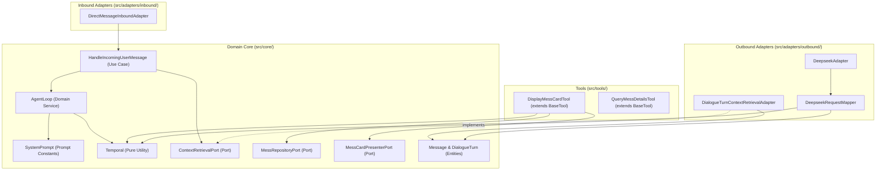

# Iny Production Dialogue Quality and Context Integrity Low-Level Design

**Spec Reference:** docs/specs/2026-11-01-production-dialogue-quality-and-context-spec.md  
**Date:** 2026-11-01  
**Status:** APPROVED

---

## 1. Module Map

| File Path                                                                        | Zone             | Single Responsibility                                                                                                                                               | Does NOT Do                                                                                                 |
| :------------------------------------------------------------------------------- | :--------------- | :------------------------------------------------------------------------------------------------------------------------------------------------------------------ | :---------------------------------------------------------------------------------------------------------- |
| `src/core/utils/Temporal.ts`                                                     | Core Utility     | Provides pure IST calendar calculations, decomposed date parts, and deterministic IST timestamp formatting functions.                                               | Does NOT perform database operations, I/O, network requests, or WhatsApp text styling.                      |
| `src/core/prompts/SystemPrompt.ts`                                               | Core Prompt      | Composes immutable prompt constants defining persona, WhatsApp styling, live tool-calling mandates, negative boundary constraints, and response contracts.          | Does NOT execute tools, resolve dates, or manage session state.                                             |
| `src/adapters/outbound/context-retrieval/DialogueTurnContextRetrievalAdapter.ts` | Outbound Adapter | Implements ContextRetrievalPort to load recent turns, apply TTL expiration, and prune historical tool calls and raw tool outputs before returning dialogue context. | Does NOT perform LLM prompt mapping, database schema definitions, or live agent loop iteration.             |
| `src/adapters/outbound/llm/DeepseekRequestMapper.ts`                             | Outbound Adapter | Maps system prompt strings and domain Message entities into OpenAI-compatible message payloads, injecting IST timestamps on historical user messages.               | Does NOT invoke the DeepSeek HTTP API, parse responses, or manage agent loops.                              |
| `src/tools/DisplayMessCardTool.ts`                                               | Tool             | Executes mess meal queries and renders terminal formatted WhatsApp cards, returning deterministic terminal notices for unpopulated menus.                           | Does NOT parse LLM reasoning, perform SQL operations directly, or format multi-slot nutritional breakdowns. |
| `src/config.ts`                                                                  | Configuration    | Validates environment variables and provides strongly-typed configuration defaults including history TTL.                                                           | Does NOT instantiate adapters or run domain use cases.                                                      |
| `src/index.ts`                                                                   | Composition Root | Wires dependencies and passes runtime configuration (including context retrieval TTL) to outbound adapters.                                                         | Does NOT contain business logic or domain decision-making.                                                  |

_Allowed Zones:_ `Core Entity`, `Core Port`, `Core Use Case`, `Inbound Adapter`, `Outbound Adapter`, `Tool`.

---

## 2. Inward Dependency Graph

**Directional Verification Checklist:**

- [x] No module inside `src/core/` imports any file from outside `src/core/`.
- [x] Inbound adapters import only use cases or ports, never outbound adapters.
- [x] Outbound adapters depend inward by implementing interfaces defined in `src/core/ports/`.
- [x] Tools depend only on `BaseTool` and `src/core/ports/`.
- [x] Zero cyclic imports exist across the dependency graph.

---

## 3. Constitution Compliance Pre-Check

- [x] **Rule 1 (Port-First Contract):** `DialogueTurnContextRetrievalAdapter` implements `ContextRetrievalPort`; `DisplayMessCardTool` depends on `MessRepositoryPort` and `MessCardPresenterPort`. Zero phantom ports.
- [x] **Rule 2 (Inward Boundary Isolation):** Inbound adapters do not touch outbound adapters or database schemas.
- [x] **Rule 3 (Tool Boundary Isolation):** `DisplayMessCardTool` extends `BaseTool` and delegates rendering to `MessCardPresenterPort`.
- [x] **Rule 4 (150-Line Source File Limit):** Projected line counts:
  - `src/core/utils/Temporal.ts`: ~85 lines (current 74 lines + 11 lines). Under 150 lines.
  - `src/core/prompts/SystemPrompt.ts`: ~80 lines (current 54 lines + 26 lines). Under 150 lines.
  - `src/adapters/outbound/context-retrieval/DialogueTurnContextRetrievalAdapter.ts`: ~55 lines (current 47 lines + 8 lines). Under 150 lines.
  - `src/adapters/outbound/llm/DeepseekRequestMapper.ts`: ~140 lines (current 132 lines + 8 lines). Under 150 lines.
  - `src/tools/DisplayMessCardTool.ts`: ~145 lines (current 143 lines + 2 lines). Under 150 lines.
- [x] **Rule 5 (40-Line Function Limit):** All new and modified helper functions (`formatHistoricalMessageTimeIST`, `pruneHistoricalTurnMessages`, `resolveSlotTarget`) are under 25 lines.
- [x] **Rule 6 (3-Level Nesting Limit):** Control flow stays within 2 levels. Guard clauses and early returns are used throughout.
- [x] **Rule 7 (No Test-Only Exports):** Only domain-required functions (`formatHistoricalMessageTimeIST`) and existing exports are exposed. Testing will be performed through the public module APIs.
- [x] **Rule 8 (Single Responsibility & Cohesion):** Entities remain pure data structures. All IST timestamp formatting is consolidated inside `src/core/utils/Temporal.ts`.
- [x] **Rule 9 (Zero Speculative Boilerplate):** Zero unused wrappers or speculative abstractions. Every change addresses a specific observed production flaw from the 62-turn audit.
- [x] **Rule 10 (Strict Convention Conformance):** Extensionless imports, uniform constructor DI without optional chaining, and JSDoc without em dashes.

---

## 4. Canonical Codebase References

1. **`src/core/utils/Temporal.ts`**:
   - _Pattern Modeled:_ Pure, deterministic calendar mathematics using UTC offsets without external date-time libraries, returning structured records (`ISTDateParts`).
2. **`src/adapters/outbound/context-retrieval/DialogueTurnContextRetrievalAdapter.ts`**:
   - _Pattern Modeled:_ Pure repository-backed adapter with graceful fallback degradation on database or parsing failures.

---

## 5. "Declined to Build" List

| Considered Abstraction                   | Reason Declined (YAGNI / Anti-Slop Rationale)                                                                                                                                                                              |
| :--------------------------------------- | :------------------------------------------------------------------------------------------------------------------------------------------------------------------------------------------------------------------------- |
| _Separate UserPreferencesRepositoryPort_ | Premature complexity. The production audit showed that retaining dialogue turns over a 24-hour window successfully preserves preferences (like Cheftalk subscription) without introducing new tables or migration schemas. |
| _Standalone Prompt Sanitizer Pipeline_   | Unnecessary class hierarchy. A single unified system prompt with explicit response contracts and live lookup rules solves the issue at the LLM reasoning level without extra runtime wrappers.                             |
| _Dynamic Few-Shot Example Injector_      | Consumes substantial input token budget and risks model overfitting. Negative constraints and strict word budgets in the base persona provide deterministic enforcement.                                                   |

---

## 6. Open Questions for Reviewer

1. **History TTL Duration**: The design proposes a 24-hour default TTL (`HISTORY_TTL_HOURS: 24`). This preserves user preferences for daily conversations while automatically dropping multi-day stale context. Is 24 hours the preferred default window, or would you prefer a shorter window (e.g. 12 hours) or longer (e.g. 48 hours)?
2. **Empty Menu Notice Wording**: For unpopulated menus, the design returns: `ℹ️ No menu data is currently loaded for <Vendor / Slot> on <Date>.` Is this wording optimal for SST students, or do you prefer an alternative phrasing?
