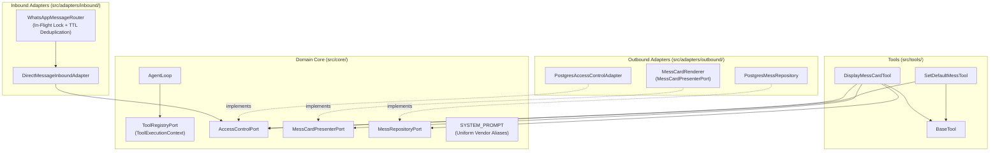

# Inbound Idempotency & User Mess Preference Low-Level Design

**Spec Reference:** docs/specs/2026-11-05-inbound-idempotency-and-user-mess-preference-spec.md  
**Date:** 2026-11-05  
**Status:** APPROVED

---

## 1. Module Map

| File Path                                                                       | Zone             | Single Responsibility                                                                                                                                            | Does NOT Do                                                                                     |
| :------------------------------------------------------------------------------ | :--------------- | :--------------------------------------------------------------------------------------------------------------------------------------------------------------- | :---------------------------------------------------------------------------------------------- |
| `src/core/ports/ToolRegistryPort.ts`                                            | Core Port        | Declares tool interfaces and passes optional `ToolExecutionContext` (with caller `userId`) to tool executions.                                                   | Does NOT implement tool execution logic or parse schemas.                                       |
| `src/core/ports/AccessControlPort.ts`                                           | Core Port        | Declares user authentication and `defaultVendor` persistence/lookup contracts.                                                                                   | Does NOT execute SQL queries or manage database connection pools.                               |
| `src/core/ports/MessCardPresenterPort.ts`                                       | Core Port        | Declares formatting contracts for multi-vendor and single-vendor mess cards, including contextual preference tips.                                               | Does NOT query database repositories or evaluate business logic.                                |
| `src/core/services/AgentLoop.ts`                                                | Core Use Case    | Coordinates ReAct tool execution loop and forwards caller `userId` into `tool.execute()`.                                                                        | Does NOT format terminal presentation cards or query database directly.                         |
| `src/core/prompts/SystemPrompt.ts`                                              | Core Entity      | Defines immutable persona, uniform vendor alias resolution rules, and strict negative behavioral contracts.                                                      | Does NOT perform dynamic runtime lookups or manage user profile state.                          |
| `src/tools/BaseTool.ts`                                                         | Tool             | Abstract base class accepting `ToolExecutionContext` and delegating to subclass `run(args, context)`.                                                            | Does NOT format WhatsApp cards or interact directly with database.                              |
| `src/tools/DisplayMessCardTool.ts`                                              | Tool             | Renders formatted meal cards for active/upcoming slots, resolving omitted vendors via caller's database `default_vendor`.                                        | Does NOT force full-day digest for slot-omitted vendor queries or track conversational history. |
| `src/tools/SetDefaultMessTool.ts`                                               | Tool             | Updates caller's persistent `default_vendor` in the database and returns a terminal confirmation card.                                                           | Does NOT format menu cards or execute unstructured conversation.                                |
| `src/adapters/inbound/whatsapp/router/WhatsAppMessageRouter.ts`                 | Inbound Adapter  | Routes WhatsApp stanzas to handlers while enforcing in-flight locking and sliding TTL deduplication.                                                             | Does NOT execute business logic, authenticate users, or query database.                         |
| `src/adapters/outbound/access-control/postgres/schema.ts`                       | Outbound Adapter | Defines PostgreSQL relational schema for `users` table including `default_vendor` enum column.                                                                   | Does NOT execute queries or apply business transformations.                                     |
| `src/adapters/outbound/access-control/postgres/PostgresAccessControlAdapter.ts` | Outbound Adapter | Implements `AccessControlPort` and `AccessControlAdminPort` to authenticate users and persist `default_vendor`.                                                  | Does NOT format WhatsApp messages or initiate inbound routing.                                  |
| `src/adapters/outbound/mess/formatting/MessCardRenderer.ts`                     | Outbound Adapter | Implements `MessCardPresenterPort`, rendering formatted single-vendor cards and appending the contextual default tip when requested vendor differs from default. | Does NOT mutate database state or parse LLM tool arguments.                                     |

---

## 2. Inward Dependency Graph



### Directional Verification Checklist

- [x] No module inside `src/core/` imports any file from outside `src/core/`.
- [x] Inbound adapters import only use cases or ports, never outbound adapters.
- [x] Outbound adapters depend inward by implementing interfaces defined in `src/core/ports/`.
- [x] Tools depend only on `BaseTool` and `src/core/ports/`.
- [x] Zero cyclic imports exist across the dependency graph.

---

## 3. Constitution Compliance Pre-Check

- [x] **Rule 1 (Port-First Contract):** `AccessControlPort` declares `setDefaultVendor(userId, vendor)`. `ToolRegistryPort` declares `ToolExecutionContext`. No phantom ports exist.
- [x] **Rule 2 (Inward Boundary Isolation):** `WhatsAppMessageRouter` and `DirectMessageInboundAdapter` do not touch raw Drizzle queries or outbound adapters.
- [x] **Rule 3 (Tool Boundary Isolation):** `DisplayMessCardTool` and `SetDefaultMessTool` depend solely on `BaseTool` and core ports (`MessRepositoryPort`, `MessCardPresenterPort`, `AccessControlPort`). They import zero presentation formatters.
- [x] **Rule 4 (150-Line Source File Limit):**
  - `WhatsAppMessageRouter.ts`: 103 lines $\rightarrow$ projected ~135 lines.
  - `DisplayMessCardTool.ts`: 145 lines $\rightarrow$ removing 20 lines of `handleFullDayDigest` leaves projected ~125 lines.
  - `SetDefaultMessTool.ts`: projected ~60 lines.
  - `PostgresAccessControlAdapter.ts`: currently 160 lines $\rightarrow$ will refactor helper methods and condense JSDoc to bring strictly $\le 150$ lines.
- [x] **Rule 5 (40-Line Function Limit):** All new methods (`dispatchMessage`, `run`, `setDefaultVendor`) projected under 35 lines.
- [x] **Rule 6 (3-Level Nesting Limit):** Guard clauses and early returns planned for all cache lookups and slot resolution branches.
- [x] **Rule 7 (No Test-Only Exports):** Only public ports, tools, and domain methods are exported.
- [x] **Rule 8 (Single Responsibility & Cohesion):** Entities contain pure domain contracts; date resolution is handled by `Temporal.ts` and `determineNextUpcomingSlot`.
- [x] **Rule 9 (Zero Speculative Boilerplate):** No unneeded factories or generic cache abstractions; deduplication uses standard TypeScript `Set` and `Map`.
- [x] **Rule 10 (Strict Convention Conformance):** Extensionless imports, uniform constructor DI, zero optional chaining on required dependencies.

---

## 4. Canonical Codebase References

1. **`src/tools/QueryMessDetailsTool.ts`**:
   - _Pattern Modeled:_ Model for declarative tool construction extending `BaseTool`, schema definition with Zod, and constructor injection of core domain ports (`MessRepositoryPort`).
2. **`src/adapters/inbound/whatsapp/router/WhatsAppMessageRouter.ts`**:
   - _Pattern Modeled:_ Gateway routing pipeline with structured logging and handler dispatching, serving as the canonical host for inbound deduplication.
3. **`src/adapters/outbound/access-control/postgres/PostgresAccessControlAdapter.ts`**:
   - _Pattern Modeled:_ PostgreSQL Drizzle ORM query patterns and in-memory caching for user identity resolution.

---

## 5. "Declined to Build" List

| Considered Abstraction                          | Reason Declined (YAGNI / Anti-Slop Rationale)                                                                                                                          |
| :---------------------------------------------- | :--------------------------------------------------------------------------------------------------------------------------------------------------------------------- |
| `DistributedRedisDeduplicator`                  | Unnecessary overhead; Iny runs as a single instance with one active Baileys socket connection. In-memory `Set` + `Map` is lightweight and zero-dependency.             |
| `DynamicFrequencyLearner`                       | Silent, implicit switching leads to false positives when checking other vendors for friends. Explicit preference via database column is deterministic and predictable. |
| `fullDay` boolean flag in `DisplayMessCardTool` | YAGNI; students on WhatsApp want the active/upcoming meal. Omitted slot cleanly defaults to cutoff/rollover.                                                           |
| `GenericPreferenceRepository`                   | Over-engineering; user defaults belong directly on the `users` relational entity alongside role and status.                                                            |

---

## 6. Open Questions for Reviewer

1. **Context Tip Formatting:**
   In `MessCardRenderer`, when a user with default `cheftalk_regular` queries `"tcb menu"`, the single-vendor slot detail formats dishes as a bulleted list separated by newlines, with the tip appended after a double newline:
   ```text
   🍽️ *Dinner — TCB (Uniworld)* (Thu, 5 Nov)

   • Black Chana
   • Gobi Matar
   • Sprout Masala
   • Onion Rice
   • Butter Roti
   • Cucumber Raita

   _Tip: Say "set default to TCB" to make this your default menu._
   ```
   Confirmed by reviewer: The newline-separated bullet list and the tip placement match product expectations. Status updated to APPROVED.
