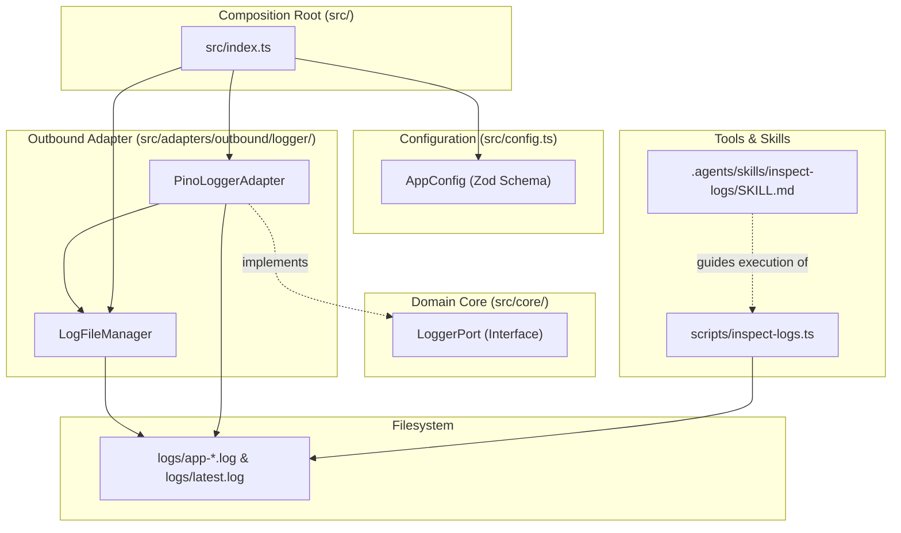

# Runtime Log Observability Low-Level Design

**Spec Reference:** docs/specs/2026-11-05-runtime-log-observability-spec.md  
**Date:** 2026-11-05  
**Status:** APPROVED by user on 2026-11-05

---

## 1. Module Map

The following table catalogs every source file to be created or modified for the runtime log observability feature. Every file belongs to an architectural zone, defines a single responsibility, and states an explicit boundary constraint in the "Does NOT Do" column.

| File Path                                           | Zone                    | Single Responsibility                                                                                                  | Does NOT Do                                                                                       |
| :-------------------------------------------------- | :---------------------- | :--------------------------------------------------------------------------------------------------------------------- | :------------------------------------------------------------------------------------------------ |
| `src/core/ports/LoggerPort.ts`                      | Core Port               | Declares the abstract TypeScript contract for structured application logging.                                          | Does NOT import Pino, Node fs, or concrete output transports. (Unchanged)                         |
| `src/config.ts`                                     | Configuration           | Validates runtime environment configuration including log file toggles, directories, and retention rules.              | Does NOT create files, manage streams, or initialize loggers.                                     |
| `src/adapters/outbound/logger/LogFileManager.ts`    | Outbound Adapter Helper | Resolves session log paths, maintains active symlink pointers, and prunes session files older than 7 days.             | Does NOT format log records or write log entries directly.                                        |
| `src/adapters/outbound/logger/PinoLoggerAdapter.ts` | Outbound Adapter        | Implements LoggerPort using Pino with internal multistreaming to console and session log file.                         | Does NOT manage file lifecycle pruning directly or expose raw Pino instances outside the adapter. |
| `src/index.ts`                                      | Composition Root        | Instantiates LogFileManager and wires runtime log configuration into PinoLoggerAdapter during boot.                    | Does NOT contain logging business logic or direct filesystem operations.                          |
| `scripts/inspect-logs.ts`                           | Tool / Script           | CLI script providing structured parsing, tailing, filtering, error extraction, and real-time following of NDJSON logs. | Does NOT write to log files or depend on application runtime state.                               |
| `.agents/skills/inspect-logs/SKILL.md`              | Skill                   | Defines the Antigravity agent runbook for autonomous log inspection, triage, and error diagnosis.                      | Does NOT execute code directly; provides procedural instructions for agent tool execution.        |

---

## 2. Inward Dependency Graph

The dependency relationships between components illustrate pure inward flow toward `src/core/`:



**Directional Verification Checklist:**

- [x] No module inside `src/core/` imports any file from outside `src/core/`. `LoggerPort.ts` remains pure.
- [x] Inbound adapters do not import `PinoLoggerAdapter` directly; they receive `LoggerPort` via constructor dependency injection.
- [x] Outbound adapters depend inward by implementing interfaces defined in `src/core/ports/`.
- [x] `scripts/inspect-logs.ts` operates independently as a consumer of stored NDJSON log files.
- [x] Zero cyclic imports exist across the dependency graph.

---

## 3. Detailed Component Contracts

### 3.1 `src/adapters/outbound/logger/LogFileManager.ts`

Manages session log file paths, active pointers, and retention cleanup.

```typescript
export interface LogFileSession {
	logFilePath: string;
	latestSymlinkPath: string;
}

export class LogFileManager {
	constructor(
		private readonly logDir: string = "logs",
		private readonly retentionDays: number = 7,
	) {}

	public initializeSession(now: Date = new Date()): LogFileSession;
	public pruneOldLogs(now: Date = new Date()): string[];
	public resolveLatestLogFile(): string | null;
}
```

- **`initializeSession(now)`**:
  1. Ensures `logDir` exists using `fs.mkdirSync(logDir, { recursive: true })`.
  2. Creates a sanitized ISO filename: `app-YYYY-MM-DDTHH-mm-ss.log`.
  3. Updates `logs/latest.log`: removes existing symlink or file if present, and creates a symlink pointing to the current session filename. If symlink creation fails due to permissions, creates an atomic text pointer file containing the active path.
  4. Returns the active file paths.
- **`pruneOldLogs(now)`**:
  1. Scans `logDir` for files matching pattern `^app-.*\.log$`.
  2. Compares file modification time (`mtimeMs`) or parsed filename timestamp against `now - retentionDays * 86400000`.
  3. Removes files older than 7 days, catching and warning on any filesystem errors without crashing.
  4. Returns the list of pruned file paths.
- **`resolveLatestLogFile()`**:
  1. Checks if `logs/latest.log` exists. If it is a symlink or valid file, resolves its target.
  2. If missing or broken, scans `logDir` for all `app-*.log` files, sorts descending by `mtimeMs`, and returns the path of the newest file. Returns `null` if no logs exist.

### 3.2 `src/adapters/outbound/logger/PinoLoggerAdapter.ts`

Extends the current `PinoLoggerAdapter` to support internal multistreaming:

```typescript
export interface PinoLoggerAdapterOptions {
	level: string;
	toFile?: boolean;
	logFilePath?: string;
	prettyConsole?: boolean;
}

export class PinoLoggerAdapter implements LoggerPort {
	private pino: pino.Logger;

	constructor(level: string = "info", baseLogger?: pino.Logger, options?: PinoLoggerAdapterOptions);

	static createWithMultistream(options: PinoLoggerAdapterOptions): PinoLoggerAdapter;

	debug(message: string, context?: LogContext): void;
	info(message: string, context?: LogContext): void;
	warn(message: string, error?: unknown, context?: LogContext): void;
	error(message: string, error?: unknown, context?: LogContext): void;
	fatal(message: string, error?: unknown, context?: LogContext): void;
	child(bindings: LogContext): LoggerPort;
}
```

- In `createWithMultistream`:
  1. Constructs an array of Pino stream destinations.
  2. **Console Stream:** If `prettyConsole` is true, dynamically imports or uses `pino-pretty` to format output to `process.stdout`. If false or in production, streams raw NDJSON to `process.stdout`.
  3. **File Stream:** If `toFile` is true and `logFilePath` is provided, creates `fs.createWriteStream(logFilePath, { flags: "a" })` for clean, ANSI-free NDJSON writes.
  4. Combines streams using `pino.multistream(streams)`.

### 3.3 `scripts/inspect-logs.ts`

Command-line tool for surgical log inspection:

```typescript
export interface InspectLogsOptions {
	file?: string;
	tail?: number;
	level?: string;
	since?: string;
	grep?: string;
	errorsOnly?: boolean;
	follow?: boolean;
	raw?: boolean;
	list?: boolean;
}
```

- **File Resolution:** Defaults to `LogFileManager.resolveLatestLogFile()`.
- **Parsing:** Reads stream line by line with `readline`. Parses valid JSON lines; skips malformed lines with a warning to stderr.
- **Filtering Pipeline:**
  1. `level`: Compares numerical Pino level (`debug: 20`, `info: 30`, `warn: 40`, `error: 50`, `fatal: 60`).
  2. `since`: Parses relative durations (`5m`, `1h`, `2d`) or ISO timestamps, comparing against line `time`.
  3. `grep`: Case-insensitive regex or substring match on `msg` and stringified context.
  4. `errorsOnly`: Matches lines where `err` or `error` is present or level >= 50.
  5. `tail`: Keeps only the last N matching items using a ring buffer or sliding slice.
- **Follow Mode (`--follow` / `-w`):**
  Uses `fs.watch` or file polling on the active log file to emit matching lines as they append, keeping process open until `SIGINT` (`Ctrl+C`).
- **Formatting:**
  Prints compact, clean strings with timestamps, levels, context highlights, and formatted error stack traces.

---

## 4. Constitution Compliance Pre-Check

Evaluating the planned design against `.agents/constitution.md`:

- [x] **Rule 1 (Port-First Contract):** `PinoLoggerAdapter` implements `src/core/ports/LoggerPort.ts`. No phantom ports introduced.
- [x] **Rule 2 (Inward Boundary Isolation):** Inbound adapters receive `LoggerPort` via constructor DI; no inbound adapter imports `PinoLoggerAdapter` or `LogFileManager`.
- [x] **Rule 3 (Tool Boundary Isolation):** `scripts/inspect-logs.ts` is an operational CLI tool in `scripts/`; it does not import domain use cases or presentation controllers.
- [x] **Rule 4 (150-Line Source File Limit):**
  - `src/adapters/outbound/logger/LogFileManager.ts`: ~90 lines projected.
  - `src/adapters/outbound/logger/PinoLoggerAdapter.ts`: ~85 lines projected.
  - `src/config.ts`: ~70 lines projected.
  - `scripts/inspect-logs.ts`: ~140 lines projected.
    All files remain strictly under 150 lines.
- [x] **Rule 5 (40-Line Function Limit):** Every helper method (`initializeSession`, `pruneOldLogs`, `resolveLatestLogFile`, `createWithMultistream`, `parseLine`) remains strictly under 40 lines.
- [x] **Rule 6 (3-Level Nesting Limit):** Guard clauses and early returns planned for all filesystem checks and JSON parsing. Nesting depth will not exceed 3 levels.
- [x] **Rule 7 (No Test-Only Exports):** Exported methods have active production or script call sites. Unit tests evaluate public API surfaces.
- [x] **Rule 8 (Single Responsibility & Cohesion):** `LogFileManager` encapsulates filesystem pathing and rotation; `PinoLoggerAdapter` encapsulates logging protocol and emission.
- [x] **Rule 9 (Zero Speculative Boilerplate):** No unneeded base classes, custom event emitters, or generic query languages.
- [x] **Rule 10 (Strict Convention Conformance):** Extensionless imports used across TypeScript files; constructor dependency injection used uniformly; zero em dashes present in prose.

---

## 5. Canonical Codebase References

1. **`src/adapters/outbound/logger/PinoLoggerAdapter.ts`**:
   - _Pattern Modeled:_ Structural baseline for mapping domain `LoggerPort` methods (`info`, `warn`, `error`, `debug`, `fatal`) to underlying Pino log invocations while supporting `child(bindings)` inheritance.
2. **`scripts/ingest-announcements.ts`**:
   - _Pattern Modeled:_ Canonical template for executable TypeScript utilities in `scripts/`, including CLI argument parsing, environment loading via `tsx`, and clean terminal reporting.

---

## 6. "Declined to Build" List

| Considered Abstraction                | Reason Declined (YAGNI / Anti-Slop Rationale)                                                                                                                              |
| :------------------------------------ | :------------------------------------------------------------------------------------------------------------------------------------------------------------------------- |
| Custom Log Streaming Worker Thread    | Premature optimization. Node standard non-blocking `fs.createWriteStream` provides sufficient throughput without worker thread serialization overhead.                     |
| Complex SQL-like Log Query Engine     | Over-engineering. Standard CLI flags (`--level`, `--since`, `--grep`, `--errors-only`, `--tail`) fulfill 100% of autonomous agent needs without query compiler complexity. |
| In-Memory Log PubSub WebSocket Server | Unnecessary daemon burden. Simple file append combined with `fs.watch` for `--follow` mode solves real-time inspection with zero background network ports.                 |

---

## 7. Open Questions for Reviewer

1. **NPM Run Script:** Would you like `"dev"` in `package.json` updated to `tsx --env-file=.env src/index.ts` (removing `| pino-pretty` since Pino will handle console formatting internally in development mode)?
2. **Follow Polling Interval:** For `--follow` mode, is `fs.watch` with a 250ms fallback polling interval suitable for your local Linux development environment?
