# Inbound Message Observability and Log Enrichment Low-Level Design

**Spec Reference:** docs/specs/2026-11-07-inbound-log-enrichment-spec.md  
**Date:** 2026-11-07  
**Status:** DRAFT

---

## 1. Module Map

| File Path                                                                 | Zone            | Single Responsibility                                                                           | Does NOT Do                                                            |
| :------------------------------------------------------------------------ | :-------------- | :---------------------------------------------------------------------------------------------- | :--------------------------------------------------------------------- |
| `src/adapters/inbound/whatsapp/router/NormalizedWhatsAppMessage.ts`       | Inbound Adapter | Defines types and payload structures for normalized WhatsApp envelopes and contents.            | Does NOT perform runtime extraction, parsing, or logging.              |
| `src/adapters/inbound/whatsapp/router/WhatsAppMessagePreviewFormatter.ts` | Inbound Adapter | Formats sanitized single-line content previews ($\le 500$ chars) and extracts raw message keys. | Does NOT perform network calls, message routing, or state persistence. |
| `src/adapters/inbound/whatsapp/router/WhatsAppMessageContentExtractor.ts` | Inbound Adapter | Extracts normalized payload content and lazy media closures from Baileys stanzas.               | Does NOT determine routing destinations or log dispatch events.        |
| `src/adapters/inbound/whatsapp/router/CatchAllLoggingHandler.ts`          | Inbound Adapter | Terminal handler that logs unhandled incoming messages at info level with full context.         | Does NOT attempt message redelivery or mutate message payloads.        |
| `src/adapters/inbound/whatsapp/router/WhatsAppMessageRouter.ts`           | Inbound Adapter | Dispatches normalized messages to matching handlers and logs enriched routing decisions.        | Does NOT format message content or implement domain business logic.    |
| `src/adapters/inbound/whatsapp/router/WhatsAppMessageNormalizer.ts`       | Inbound Adapter | Transforms raw Baileys WAMessage into NormalizedWhatsAppMessage with enriched logging.          | Does NOT execute use cases or manage handler registration.             |
| `src/adapters/inbound/whatsapp/FoodAnnouncementInboundAdapter.ts`         | Inbound Adapter | Matches food announcement messages and emits diagnostic logs on target group skips.             | Does NOT perform meal menu parsing or database persistence.            |
| `src/adapters/inbound/whatsapp/DirectMessageInboundAdapter.ts`            | Inbound Adapter | Matches direct messages, checks access control, and logs unauthorized messages with previews.   | Does NOT manage session state or execute agent loops.                  |

---

## 2. Inward Dependency Graph

```mermaid
graph TD
    subgraph Inbound["Inbound Adapters (src/adapters/inbound/whatsapp/)"]
        Normalizer["WhatsAppMessageNormalizer"]
        Extractor["WhatsAppMessageContentExtractor"]
        Formatter["WhatsAppMessagePreviewFormatter"]
        Router["WhatsAppMessageRouter"]
        CatchAll["CatchAllLoggingHandler"]
        FoodAdapter["FoodAnnouncementInboundAdapter"]
        DirectAdapter["DirectMessageInboundAdapter"]
        Types["NormalizedWhatsAppMessage"]
    end

    subgraph Core["Domain Core (src/core/)"]
        LoggerPort["LoggerPort"]
        AccessControlPort["AccessControlPort"]
        StageUseCase["StageIncomingFoodAnnouncement"]
        UserMsgUseCase["HandleIncomingUserMessage"]
    end

    Normalizer --> Extractor
    Normalizer --> Types
    Normalizer --> LoggerPort
    Extractor --> Formatter
    Extractor --> Types
    Extractor --> LoggerPort
    Router --> Types
    Router --> LoggerPort
    CatchAll --> Types
    CatchAll --> LoggerPort
    FoodAdapter --> Types
    FoodAdapter --> StageUseCase
    FoodAdapter --> LoggerPort
    DirectAdapter --> Types
    DirectAdapter --> AccessControlPort
    DirectAdapter --> UserMsgUseCase
    DirectAdapter --> LoggerPort
```

### Directional Verification Checklist

- [x] No module inside `src/core/` imports any file from outside `src/core/`.
- [x] Inbound adapters import only use cases, core entities, or ports, never outbound adapters.
- [x] All adapters depend inward by calling ports or use cases defined in `src/core/`.
- [x] Zero cyclic imports exist across the dependency graph.

---

## 3. Constitution Compliance Pre-Check

- [x] **Rule 1 (Port-First Contract):** All logging utilizes existing `LoggerPort` interface; no phantom ports or external logger imports in core.
- [x] **Rule 2 (Inward Boundary Isolation):** Inbound adapters do not import database connections, repositories, or outbound clients.
- [x] **Rule 3 (Tool Boundary Isolation):** Tools are untouched in this design.
- [x] **Rule 4 (150-Line Source File Limit):**
  - `NormalizedWhatsAppMessage.ts`: ~110 lines ($\le 150$).
  - `WhatsAppMessagePreviewFormatter.ts`: ~55 lines ($\le 150$).
  - `WhatsAppMessageContentExtractor.ts`: ~110 lines ($\le 150$).
  - `CatchAllLoggingHandler.ts`: ~40 lines ($\le 150$).
  - `WhatsAppMessageRouter.ts`: ~145 lines ($\le 150$).
  - `WhatsAppMessageNormalizer.ts`: ~142 lines ($\le 150$).
  - `FoodAnnouncementInboundAdapter.ts`: ~115 lines ($\le 150$).
  - `DirectMessageInboundAdapter.ts`: ~60 lines ($\le 150$).
- [x] **Rule 5 (40-Line Function Limit):** Every function and helper method remains $\le 40$ lines.
- [x] **Rule 6 (3-Level Nesting Limit):** Truncation and formatting helpers use early returns and guard clauses; max nesting depth $\le 3$.
- [x] **Rule 7 (No Test-Only Exports):** Only domain contracts and production methods are exported.
- [x] **Rule 8 (Single Responsibility & Cohesion):** `WhatsAppMessagePreviewFormatter` isolates string normalization and key extraction.
- [x] **Rule 9 (Zero Speculative Boilerplate):** No unused formatting classes or abstract logger wrappers.
- [x] **Rule 10 (Strict Convention Conformance):** Extensionless imports, constructor injection without `?.`, JSDoc comments without em dashes.

---

## 4. Canonical Codebase References

1. **`src/adapters/inbound/whatsapp/router/CatchAllLoggingHandler.ts`**:
   - _Pattern Modeled:_ Terminal fallback handler in the priority chain. We follow its exact structure while elevating log level to `info` and enriching contextual fields.
2. **`src/adapters/inbound/whatsapp/router/WhatsAppMessageContentExtractor.ts`**:
   - _Pattern Modeled:_ Content extraction and classification. We delegate preview string computation to `WhatsAppMessagePreviewFormatter` to maintain cohesive boundaries under 150 lines.

---

## 5. "Declined to Build" List

| Considered Abstraction                          | Reason Declined (YAGNI / Anti-Slop Rationale)                                                                                                                  |
| :---------------------------------------------- | :------------------------------------------------------------------------------------------------------------------------------------------------------------- |
| Standalone Log Enrichment Middleware Pipeline   | Premature complexity; enrichment naturally belongs inside the message normalizer and content extractor where raw stanzas are decoded.                          |
| Global Log Interceptor / Pino Serializer Plugin | Coupling formatting to Pino internals violates Hexagonal boundary neutrality and prevents test assertions against `NormalizedWhatsAppMessage.content.preview`. |
| Dynamic Configurable Truncation Length Service  | Fixed 500-character boundary meets user requirements without adding configuration boilerplate.                                                                 |

---

## 6. Open Questions for Reviewer

1. In `FoodAnnouncementInboundAdapter`, when a message in the target group fails `matches()`, we will log at `debug` level with `reason` and `contentPreview`. Does `debug` level meet your operational needs for filtered messages, while `CatchAllLoggingHandler` logs at `info`?
2. When a document message has both a file name and caption, preview formats as `"[document: <fileName>] <caption>"`. If only fileName exists, `"[document: <fileName>]"`. Does this format work for your log inspection workflow?
