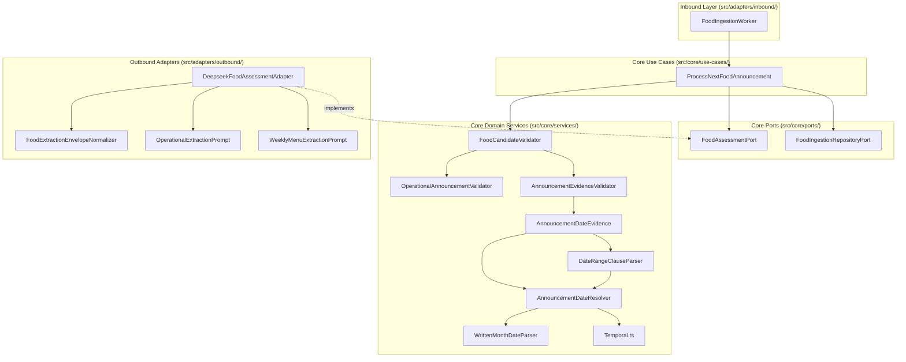

# Operational Food Announcement Ingestion Low-Level Design

**Spec Reference:** docs/specs/2026-11-07-operational-announcement-ingestion-spec.md  
**Date:** 2026-11-07  
**Status:** DRAFT
<!-- Status must remain DRAFT until explicitly approved by the human partner -->

---

## 1. Module Map

| File Path                                                                   | Zone             | Single Responsibility                                                                                                   | Does NOT Do                                                       |
| :-------------------------------------------------------------------------- | :--------------- | :---------------------------------------------------------------------------------------------------------------------- | :---------------------------------------------------------------- |
| `src/core/services/WrittenMonthDateParser.ts`                               | Core Service     | Parses written month date strings with years into ISO `YYYY-MM-DD` strings.                                             | Does NOT handle relative dates, timezones, or yearless dates.     |
| `src/core/services/DateRangeClauseParser.ts`                                | Core Service     | Validates whether a target event date falls within an extracted date range clause.                                      | Does NOT perform batch or dish validation.                        |
| `src/core/services/AnnouncementDateResolver.ts`                             | Core Service     | Resolves date tokens from source references using numeric, relative, and written month parsers.                         | Does NOT infer unstated calendar years or weekdays without dates. |
| `src/core/services/AnnouncementDateEvidence.ts`                             | Core Service     | Validates that individual event dates agree with raw evidence spans and supporting clauses.                             | Does NOT validate location venues or batch allocations.           |
| `src/core/services/AnnouncementEvidenceValidator.ts`                        | Core Service     | Validates all extracted candidate fields against source evidence spans and venue clauses.                               | Does NOT perform LLM inference or database persistence.           |
| `src/adapters/outbound/mess/extraction/FoodExtractionEnvelopeNormalizer.ts` | Outbound Adapter | Normalizes flattened LLM extraction responses into the required `{ kind: "candidate" }` envelope.                       | Does NOT mutate valid responses or bypass Zod validation.         |
| `src/adapters/outbound/mess/extraction/OperationalExtractionPrompt.ts`      | Outbound Adapter | Exports system instructions specialized for text operational mess announcements.                                        | Does NOT contain weekly menu table or dish cell instructions.     |
| `src/adapters/outbound/mess/extraction/WeeklyMenuExtractionPrompt.ts`       | Outbound Adapter | Exports system instructions specialized for media weekly vendor menus.                                                  | Does NOT contain operational announcement event instructions.     |
| `src/adapters/outbound/mess/extraction/DeepseekFoodAssessmentAdapter.ts`    | Outbound Adapter | Implements `FoodAssessmentPort` by dispatching medium-specific prompts, normalizing envelopes, and logging diagnostics. | Does NOT execute database queries or manage worker leases.        |

---

## 2. Inward Dependency Graph



### Directional Verification Checklist

- [x] No module inside `src/core/` imports any file from outside `src/core/`.
- [x] Inbound adapters import only use cases or ports, never outbound adapters.
- [x] Outbound adapters depend inward by implementing interfaces defined in `src/core/ports/`.
- [x] Zero cyclic imports exist across the dependency graph.

---

## 3. Constitution Compliance Pre-Check

- [x] **Rule 1 (Port-First Contract):** `FoodAssessmentPort` is already defined in `src/core/ports/FoodAssessmentPort.ts`. `DeepseekFoodAssessmentAdapter` implements `FoodAssessmentPort`. Zero phantom ports.
- [x] **Rule 2 (Inward Boundary Isolation):** Inbound worker drives domain strictly via `ProcessNextFoodAnnouncement`.
- [x] **Rule 3 (Tool Boundary Isolation):** Mess and dialogue tools do not touch or import food assessment extraction adapters.
- [x] **Rule 4 (150-Line Source File Limit):**
  - `src/core/services/WrittenMonthDateParser.ts`: ~45 lines ($\le 150$)
  - `src/core/services/DateRangeClauseParser.ts`: ~40 lines ($\le 150$)
  - `src/core/services/AnnouncementDateResolver.ts`: ~95 lines ($\le 150$)
  - `src/core/services/AnnouncementDateEvidence.ts`: ~52 lines ($\le 150$)
  - `src/core/services/AnnouncementEvidenceValidator.ts`: ~138 lines ($\le 150$)
  - `src/adapters/outbound/mess/extraction/FoodExtractionEnvelopeNormalizer.ts`: ~35 lines ($\le 150$)
  - `src/adapters/outbound/mess/extraction/OperationalExtractionPrompt.ts`: ~65 lines ($\le 150$)
  - `src/adapters/outbound/mess/extraction/WeeklyMenuExtractionPrompt.ts`: ~65 lines ($\le 150$)
  - `src/adapters/outbound/mess/extraction/DeepseekFoodAssessmentAdapter.ts`: ~140 lines ($\le 150$)
- [x] **Rule 5 (40-Line Function Limit):** Every function and helper method is planned $\le 30$ lines.
- [x] **Rule 6 (3-Level Nesting Limit):** Parsing and validation algorithms use guard clauses, regex matching, and early returns.
- [x] **Rule 7 (No Test-Only Exports):** Only genuine domain and adapter operations exported.
- [x] **Rule 8 (Single Responsibility & Cohesion):** Date arithmetic strictly delegated to `Temporal.ts`.
- [x] **Rule 9 (Zero Speculative Boilerplate):** No unused abstract classes or generic helper wrappers.
- [x] **Rule 10 (Strict Convention Conformance):** Extensionless relative imports, constructor dependency injection, explicit JSDoc comments without em dashes.

---

## 4. Canonical Codebase References

1. **`src/core/services/AnnouncementDateResolver.ts`**:
   - _Pattern Modeled:_ Pure, functional validation returning a union `ValidationResult<string>`, utilizing regex tokenization, strict validation error objects, and delegating date manipulation to `Temporal.ts`.
2. **`src/adapters/outbound/mess/extraction/DeepseekFoodAssessmentAdapter.ts`**:
   - _Pattern Modeled:_ Outbound driven adapter adhering strictly to two-pass LLM assessment and schema validation while keeping the adapter focused on external orchestration and error translation.

---

## 5. "Declined to Build" List

| Considered Abstraction                                | Reason Declined (YAGNI / Anti-Slop Rationale)                                                                                                                                                  |
| :---------------------------------------------------- | :--------------------------------------------------------------------------------------------------------------------------------------------------------------------------------------------- |
| External NLP Date Library (`chrono-node`, `date-fns`) | Introduces heavy external runtime dependencies into `src/core/`, violating Rule 10 and hexagonal purity. A focused ~45-line regex parser for English months meets 100% of domain requirements. |
| Generic Multi-Pass Pipeline Orchestrator              | A speculative generic pipeline class would add unnecessary abstraction for two deterministic passes (extract & verify).                                                                        |
| Automatic Batch Inference Heuristics                  | Guessing unstated cohorts risks serving wrong students. Campus mess announcements either restrict to explicit cohorts or apply campus-wide to `ALL_BATCHES`.                                   |

---

## 6. Concrete Interface Contracts

### 6.1 WrittenMonthDateParser

```typescript
export interface MonthParseResult {
	readonly day: number;
	readonly month: number;
	readonly year: number;
}

/**
 * Parses written dates containing explicit month names and years.
 * e.g. "6th November 2026", "6 Nov 2026", "November 6, 2026", "6-Nov-2026".
 * Returns null if the reference lacks an explicit year or is ambiguous.
 */
export function parseWrittenMonthDate(token: string): string | null;
```

### 6.2 DateRangeClauseParser

```typescript
/**
 * Detects if a supporting clause defines an explicit date range (e.g. "from 6th November 2026 to 12th November 2026").
 * Validates whether candidate mealDate falls inclusively within the range [startDate, endDate].
 */
export function validateDateRangeClause(
	clause: string,
	targetMealDate: string,
	sourceCreatedAt: Date,
): boolean;
```

### 6.3 FoodExtractionEnvelopeNormalizer

```typescript
/**
 * Normalizes raw JSON parsed from LLM extraction before passing into FoodExtractionSchema.
 * If the model returns { kind: "operational_announcement", announcement, evidence },
 * wraps it into { kind: "candidate", candidate: { kind: "operational_announcement", announcement }, evidence }.
 */
export function normalizeFoodExtractionEnvelope(raw: unknown): unknown;
```
