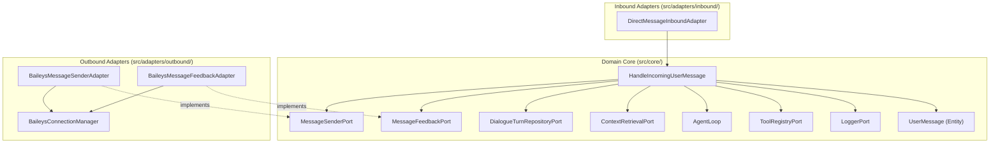

# WhatsApp Message Feedback Low-Level Design

**Spec Reference:** docs/specs/2026-11-08-whatsapp-message-feedback-spec.md  
**Date:** 2026-11-08  
**Status:** APPROVED

---

## 1. Module Map

| File Path                                                         | Zone             | Single Responsibility                                                                                                              | Does NOT Do                                                                                                    |
| :---------------------------------------------------------------- | :--------------- | :--------------------------------------------------------------------------------------------------------------------------------- | :------------------------------------------------------------------------------------------------------------- |
| `src/core/ports/MessageFeedbackPort.ts`                           | Core Port        | Declares abstract interface for sending read receipts, typing indicator presence, and message reactions.                           | Does NOT provide concrete runtime logic, import external libraries, or access sockets.                         |
| `src/adapters/outbound/whatsapp/BaileysMessageFeedbackAdapter.ts` | Outbound Adapter | Implements `MessageFeedbackPort` using the active Baileys WhatsApp socket connection.                                              | Does NOT contain business fallback rules, manage user dialogue state, or delay core execution.                 |
| `src/core/use-cases/HandleIncomingUserMessage.ts`                 | Core Use Case    | Coordinates conversational lifecycle: best-effort initial feedback, agent reasoning loop, response delivery, and feedback cleanup. | Does NOT import Baileys socket primitives, throw on auxiliary feedback errors, or manage database connections. |
| `src/index.ts`                                                    | Composition Root | Instantiates `BaileysMessageFeedbackAdapter` and injects it into `HandleIncomingUserMessage`.                                      | Does NOT execute message processing logic or manage Baileys event dispatching.                                 |

---

## 2. Inward Dependency Graph

### Directional Verification Checklist

- [x] No module inside `src/core/` imports any file from outside `src/core/`.
- [x] Inbound adapters import only use cases or ports, never outbound adapters.
- [x] Outbound adapters depend inward by implementing interfaces defined in `src/core/ports/`.
- [x] Zero horizontal imports exist between `src/adapters/inbound/` and `src/adapters/outbound/`.
- [x] Zero cyclic imports exist across the dependency graph.

---

## 3. Constitution Compliance Pre-Check

- [x] **Rule 1 (Port-First Contract):** `MessageFeedbackPort` declared explicitly in `src/core/ports/` with `implements` clause on `BaileysMessageFeedbackAdapter`.
- [x] **Rule 2 (Inward Boundary Isolation):** Inbound `DirectMessageInboundAdapter` calls only `HandleIncomingUserMessage`; zero imports of outbound adapters or raw socket infrastructure.
- [x] **Rule 3 (Tool Boundary Isolation):** Tools remain untouched; auxiliary feedback is orchestrated exclusively at the use case transport boundary.
- [x] **Rule 4 (150-Line Source File Limit):**
  - `src/core/ports/MessageFeedbackPort.ts`: Projected ~30 lines.
  - `src/adapters/outbound/whatsapp/BaileysMessageFeedbackAdapter.ts`: Projected ~55 lines.
  - `src/core/use-cases/HandleIncomingUserMessage.ts`: Currently 131 lines; compact helper extraction planned to ensure it remains <= 145 lines.
- [x] **Rule 5 (40-Line Function Limit):** All new methods (`sendReadReceipt`, `sendTypingIndicator`, `sendReaction`, `safeInitialFeedback`, `safeFinalFeedback`) are under 20 lines.
- [x] **Rule 6 (3-Level Nesting Limit):** Control flow nesting depth will not exceed 2 levels; try/catch blocks use early returns and flat structure.
- [x] **Rule 7 (No Test-Only Exports):** Only public port methods and public adapter classes are exported.
- [x] **Rule 8 (Single Responsibility & Cohesion):** `MessageFeedbackPort` focuses strictly on interactive user feedback (read receipt, presence, reactions); text delivery remains in `MessageSenderPort`.
- [x] **Rule 9 (Zero Speculative Boilerplate):** No uncalled factories, timer-based reaction schedulers, or speculative retry queues.
- [x] **Rule 10 (Strict Convention Conformance):** Extensionless TypeScript imports, strict constructor dependency injection without optional chaining (`?.`), and complete JSDoc without em dashes.

---

## 4. Canonical Codebase References

1. **`src/core/ports/MessageSenderPort.ts`**:
   - _Pattern Modeled:_ Pure, zero-dependency abstract port contract defining a clean, typed interface for WhatsApp user communication.
2. **`src/adapters/outbound/whatsapp/BaileysMessageSenderAdapter.ts`**:
   - _Pattern Modeled:_ Constructor dependency injection of `BaileysConnectionManager` and `LoggerPort`, socket connection guard check (`getSocket()`), and contextual structured error logging.

---

## 5. "Declined to Build" List

| Considered Abstraction          | Reason Declined (YAGNI / Anti-Slop Rationale)                                                                                                                                 |
| :------------------------------ | :---------------------------------------------------------------------------------------------------------------------------------------------------------------------------- |
| `MessageFeedbackOrchestrator`   | Redundant wrapper class; `HandleIncomingUserMessage` can invoke the two safe feedback helpers directly in fewer than 20 lines.                                                |
| `ReactionCyclingTimer`          | Spinning reaction timer cycling emojis (`👀` -> `💭` -> `⏳`); rejected to prevent WhatsApp bot detection flags and repetitive push vibration spam on user devices.           |
| `FeedbackRetryQueue`            | Background persistent retry queue for failed feedback stanzas; rejected because auxiliary feedback is strictly best-effort and retrying stale presence adds concurrency bugs. |
| `ConsolidatedMessageSenderPort` | Adding feedback methods into `MessageSenderPort`; rejected to respect Interface Segregation Principle (ISP) and avoid bloating test mocks.                                    |

---

## 6. Open Questions for Reviewer

1. **Concurrent vs Sequential Initial Feedback**:
   - Should initial feedback (`sendReadReceipt`, `sendTypingIndicator`, `sendReaction`) be dispatched concurrently via `Promise.allSettled` or sequentially?
   - _Design Recommendation:_ Concurrent dispatch (`Promise.allSettled`) to eliminate added latency before LLM reasoning starts.
2. **Symmetric Error Reaction Cleanup**:
   - When an unhandled error occurs and `safeSendFallback` sends a failure message, the design clears the `👀` reaction (`""`) and stops the typing indicator (`paused`).
   - _Design Recommendation:_ Confirmed as approved during brainstorming; no lingering `👀` left on user messages.
