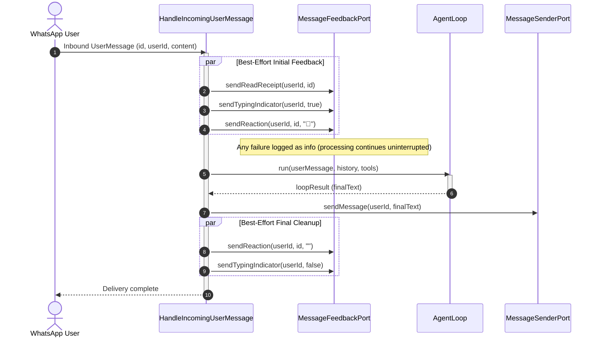

# Iny WhatsApp Message Feedback (Read Receipts, Typing Presence, Reactions) Specification

## 1. Overview & Business Objectives

Currently, when a user sends a direct message on WhatsApp, there is total silence during the 2-6 second processing window while Iny retrieves context, calls DeepSeek, and queries mess tools. The student has no visual cue indicating whether their message reached the server, whether it was read, or if Iny is actively formulating a response.

### Goals

1. **Immediate Acknowledgment**: Mark incoming direct messages as read (delivering double blue ticks to the user) as soon as authorization succeeds.
2. **Active Presence**: Display the native WhatsApp typing indicator (`composing`) in the chat header ("Iny is typing...") throughout the processing duration.
3. **Conversational Eye Reaction**: Add an initial `👀` reaction to the user's incoming message stanza upon arrival.
4. **Symmetric Cleanup**: Clear the reaction (send `""`) and stop typing presence (`paused`) as soon as the final response or error fallback is delivered.
5. **Zero-Block Degradation**: Ensure all auxiliary UX feedback operations are strictly best-effort. If WhatsApp network latency or socket hiccups cause a reaction, read receipt, or presence update to fail, the failure is logged at `info` level and never interrupts message reasoning or response delivery.

---

## 2. Invariants & Architectural Principles

1. **Zero-Block UX Degradation Invariant**: Auxiliary UX feedback actions (`sendReadReceipt`, `sendTypingIndicator`, `sendReaction`) are non-critical enhancements. Any transport exception thrown during their execution must be caught and logged at `info` level. They must NEVER throw out of `HandleIncomingUserMessage` or abort message processing.
2. **Interface Segregation Principle (ISP)**: Transport capabilities must remain decoupled. Delivering assistant text responses belongs to `MessageSenderPort`, while auxiliary message feedback (read receipts, typing presence, reactions) belongs to a dedicated `MessageFeedbackPort`.
3. **Single Stable Reaction Lifecycle**: To protect against WhatsApp account throttling and avoid buzzing recipient devices with repetitive reaction vibration notifications, Iny sets a single stable reaction (`👀`) on receipt and removes it (`""`) upon delivery. High-frequency reaction cycling is strictly prohibited.
4. **Symmetric Error Finalization**: When an unhandled error occurs during the reasoning loop, `safeSendFallback` delivers the user-friendly error notice and clears the `👀` reaction, ensuring no orphaned reaction is left behind.
5. **Constitution & Hexagonal Purity**: `MessageFeedbackPort` is defined in `src/core/ports/` with zero external runtime dependencies. Production files must adhere to the 150-line limit and 40-line function limit from `.agents/constitution.md`.

---

## 3. Port & Adapter Contracts

### 3.1 `MessageFeedbackPort`

Location: `src/core/ports/MessageFeedbackPort.ts`

```typescript
/**
 * Outbound port for auxiliary user interaction feedback (read receipts,
 * typing presence, message reactions) over the messaging transport.
 */
export interface MessageFeedbackPort {
	/**
	 * Transmits a read receipt acknowledgment for an inbound message.
	 *
	 * @param userId Canonical user identifier (e.g. phone number JID).
	 * @param messageId Unique stanza identifier of the incoming message.
	 */
	sendReadReceipt(userId: string, messageId: string): Promise<void>;

	/**
	 * Updates the assistant's presence status in the user's conversation.
	 *
	 * @param userId Canonical user identifier.
	 * @param active True to indicate active typing ('composing'); false to reset ('paused').
	 */
	sendTypingIndicator(userId: string, active: boolean): Promise<void>;

	/**
	 * Sets or clears an emoji reaction on a specific user message.
	 *
	 * @param userId Canonical user identifier.
	 * @param messageId Unique stanza identifier of the message to react to.
	 * @param emoji The emoji character to display, or an empty string ("") to clear.
	 */
	sendReaction(userId: string, messageId: string, emoji: string): Promise<void>;
}
```

### 3.2 `BaileysMessageFeedbackAdapter`

Location: `src/adapters/outbound/whatsapp/BaileysMessageFeedbackAdapter.ts`

- **Responsibilities**:
  - Implements `MessageFeedbackPort`.
  - Obtains the active socket from `BaileysConnectionManager`.
  - Invokes Baileys socket primitives:
    - `sendReadReceipt(userId, messageId)`: `socket.readMessages([{ remoteJid: userId, id: messageId }])`
    - `sendTypingIndicator(userId, active)`: `socket.sendPresenceUpdate(active ? "composing" : "paused", userId)`
    - `sendReaction(userId, messageId, emoji)`: `socket.sendMessage(userId, { react: { text: emoji, key: { remoteJid: userId, id: messageId } } })`
  - Throws if the socket is not connected or if Baileys rejects the stanza (which the use case catches and handles gracefully).

---

## 4. Use Case Orchestration (`HandleIncomingUserMessage`)

Location: `src/core/use-cases/HandleIncomingUserMessage.ts`

### 4.1 Dependency Injection

Add `private readonly feedback: MessageFeedbackPort` to constructor parameters.

### 4.2 Lifecycle Flow



### 4.3 Error Handling Flow

If reasoning or tool execution fails:

1. `handleReasoningError(error, log)` categorizes and logs the error.
2. In `safeSendFallback(userId, messageId, error, log)`:
   - Delivers the user-friendly fallback text via `this.sender.sendMessage(...)`.
   - Executes cleanup in a best-effort block:
     - `this.feedback.sendReaction(userId, messageId, "")`
     - `this.feedback.sendTypingIndicator(userId, false)`
   - Any transport error in cleanup is logged at `info` level.

---

## 5. Edge Cases & Resilience

| Scenario                         | Expected Behavior                                                                                                                          |
| :------------------------------- | :----------------------------------------------------------------------------------------------------------------------------------------- |
| **WhatsApp socket disconnected** | `BaileysMessageFeedbackAdapter` throws. `HandleIncomingUserMessage` catches error, logs at `info`, and proceeds to process the query.      |
| **Reaction fails to deliver**    | Logged as `info ("Failed to set message reaction", { userId, messageId, emoji })`. Text processing continues.                              |
| **Read receipt fails**           | Logged as `info ("Failed to send read receipt", { userId, messageId })`. Text processing continues.                                        |
| **Unauthenticated User**         | Blocked at `DirectMessageInboundAdapter`. No read receipt, presence, or reaction is transmitted.                                           |
| **Message Deduplication**        | Duplicate stanzas dropped at `WhatsAppMessageRouter` before reaching `HandleIncomingUserMessage`. No duplicate reactions or receipts sent. |
| **Empty Reaction (`""`)**        | Baileys interprets an empty string reaction as a retraction/deletion, cleanly removing the `👀` icon.                                      |

---

## 6. Constitution & Code Hygiene Compliance

1. **Line Limits**:
   - `src/core/ports/MessageFeedbackPort.ts`: ~30 lines (limit 150).
   - `src/adapters/outbound/whatsapp/BaileysMessageFeedbackAdapter.ts`: ~55 lines (limit 150).
   - `src/core/use-cases/HandleIncomingUserMessage.ts`: currently 131 lines. Helper methods for `safeSendInitialFeedback` and `safeSendFinalFeedback` will be extracted cleanly to keep the file strictly under 150 lines.
2. **Function Limits**: All new and modified methods remain under 30 lines (limit 40).
3. **Nesting Depth**: Guard clauses and flat Promise chains guarantee nesting depth <= 2 (limit 3).
4. **Purity**: Zero external dependencies in `src/core/`.
